# NexTrack --- Project Architecture & Engineering Specification

> **Purpose:** Build a portfolio-quality, Jira-inspired issue-tracking
> and project-management application that demonstrates strong Java
> full-stack engineering, thoughtful modular-monolith architecture,
> production-style edge-case handling, and measurable performance work.
>
> **Primary constraint:** Keep deployment simple. Build one Spring Boot
> backend application and one PostgreSQL database. Do not introduce
> microservices. Add infrastructure such as Redis or Kafka only in a
> later phase when there is a clear use case and the core product is
> stable.
>
> **Instructions for the coding agent:** Treat this document as the
> source of truth for planning and implementation. First inspect the
> repository and report what already exists. Then propose a phased
> implementation plan with milestones, dependencies, acceptance
> criteria, and test strategy. Do not attempt to implement every phase
> at once. Preserve a working application at each milestone, make
> reasonable choices within this specification, and document any
> deviations before implementing them.

------------------------------------------------------------------------

## 1. Product vision

**NexTrack** is a web-based project and issue-tracking application
inspired by Jira. It should support teams managing projects, issues,
workflows, comments, and activity while showcasing engineering beyond
basic CRUD.

### Product goals

-   Provide a polished, usable project-management experience.
-   Connect project-management issues with software engineering activity
    via a Jira-inspired **Development Module** (tracking connected Git
    repositories, branches, commits, pull requests, CI/CD builds, and
    deployments).
-   Demonstrate Java, Spring Boot, relational data modeling, REST API
    design, React/TypeScript, security, testing, and deployment.
-   Handle concurrency, retries, authorization boundaries, invalid
    input, and service failures deliberately.
-   Measure and explain database and API performance rather than making
    unsupported performance claims.
-   Keep the architecture understandable and easy to run locally or
    deploy as a single backend application.

### Non-goals for the first release

-   Microservices or Kubernetes.
-   A general-purpose workflow scripting engine or user-defined dynamic
    state machine editor (Release 1 enforces a standardized, robust finite
    state machine: `BACKLOG`, `TO_DO`, `IN_PROGRESS`, `IN_REVIEW`, `DONE`,
    `ARCHIVED`).
-   Real-time collaborative editing.
-   A full enterprise Jira feature set.
-   Mandatory Kafka or Redis.
-   A general-purpose CI/CD pipeline execution engine (NexTrack consumes
    and displays build data from external providers; it does not execute
    pipelines).
-   A source-code hosting platform or Git server (NexTrack integrates
    with external providers such as GitHub via APIs and webhooks; it
    does not host repositories).
-   Complex billing, organization plans, or arbitrary third-party
    integrations beyond initial Git providers.
-   Claiming production scale without reproducible benchmarks.

------------------------------------------------------------------------

## 2. Architecture decisions

### 2.1 Architecture style

Use a **modular monolith**:

-   One Spring Boot deployable application.
-   One primary PostgreSQL database.
-   One React single-page application.
-   Modules organized around business capabilities.
-   Clear module APIs and ownership; avoid arbitrary cross-module
    repository access.
-   Use ordinary in-process application/service calls between modules.
-   Use database transactions for operations that must be atomic.
-   Add optional background processing within the same application for
    the initial version.

A modular monolith is not a microservices system. Kafka, Redis, or
background jobs do not by themselves make it one.

### 2.2 Recommended stack

  -----------------------------------------------------------------------
  Area                    Technology              Notes
  ----------------------- ----------------------- -----------------------
  Language                Java 21 LTS or a newer  Pin the version in the
                          supported LTS if the    build and CI
                          environment is ready    

  Backend                 Spring Boot 3.x or a    Select a stable version
                          currently supported     at project start; avoid
                          compatible release      milestone releases

  Build                   Maven                   Maven Wrapper committed
                                                  to repository

  API                     Spring MVC REST + JSON  Version API under
                                                  `/api/v1`

  Validation              Jakarta Bean Validation Validate request DTOs
                                                  and domain rules

  Persistence             Spring Data JPA +       Avoid exposing entities
                          Hibernate               directly from
                                                  controllers

  Database                PostgreSQL              Primary and initially
                                                  sole database

  Schema migrations       Flyway                  Version every schema
                                                  change; avoid relying
                                                  on `ddl-auto=update`

  Security                Spring Security         Server-side
                                                  authorization; JWT or
                                                  secure session strategy
                                                  selected deliberately

  Frontend                React + TypeScript      Use a maintained
                                                  toolchain such as Vite

  Frontend routing        React Router            Protected routes are a
                                                  UX feature, not a
                                                  security boundary

  Server-state fetching   TanStack Query or a     Cache, invalidation,
                          similarly maintained    loading/error states
                          solution                

  Forms                   React Hook Form + Zod,  Client validation
                          or equivalent           improves UX; backend
                                                  validation remains
                                                  authoritative

  UI styling              Tailwind CSS or CSS     Choose one approach and
                          modules                 stay consistent

  Unit tests              JUnit 5, Mockito,       Test business behavior
                          AssertJ                 

  Integration tests       Spring Boot Test +      Use real PostgreSQL for
                          Testcontainers          DB-specific behavior

  Frontend tests          Vitest + React Testing  Component and
                          Library                 interaction tests

  Browser tests           Playwright              Add smoke and
                                                  critical-path E2E tests

  API documentation       springdoc-openapi /     Keep API contract
                          OpenAPI                 discoverable

  Observability           Spring Boot Actuator +  Structured logs and
                          Micrometer              useful health/metrics
                                                  endpoints

  Local environment       Docker Compose          App, database, and
                                                  optional supporting
                                                  services

  CI                      GitHub Actions          Build, test, and
                                                  optionally build
                                                  container image

  Deployment              One backend             Keep the deployment
                          container/JAR +         model simple
                          frontend static         
                          hosting/container +     
                          managed or              
                          containerized           
                          PostgreSQL              
  -----------------------------------------------------------------------

### 2.3 Optional technologies --- not required initially

-   **Redis:** Add only after identifying a measurable cache or
    rate-limiting need. Correctness must not depend on cache
    availability.
-   **Kafka/RabbitMQ:** Not required for v1. If asynchronous
    notification reliability becomes a learning goal, first consider a
    PostgreSQL-backed outbox and a background worker in the same
    application. Add a broker only if the benefit justifies the
    operational cost.
-   **Object storage:** For a deployed version, prefer S3-compatible
    storage for attachments. For local development, a local storage
    adapter may be used. Do not store large file bytes in ordinary issue
    rows.
-   **WebSockets/SSE:** Optional later enhancement for board updates;
    polling is acceptable for the first version.

### 2.4 Architectural rules

1.  Controllers handle HTTP concerns and delegate to application
    services.
2.  DTOs form the API boundary; do not serialize JPA entities directly.
3.  Business invariants belong in application/domain logic and database
    constraints where appropriate.
4.  Transactions should be short and have explicit boundaries.
5.  A module owns its tables and persistence logic even though all
    modules use one database.
6.  Other modules use a module's public application API/events rather
    than modifying its entities or repositories directly.
7.  Avoid circular module dependencies.
8.  Avoid generic abstractions until a real use case justifies them.
9.  Prefer explicit code over premature frameworks or elaborate design
    patterns.
10. Never commit credentials, JWT secrets, or production configuration.
11. All list endpoints must have bounded pagination.
12. Every write endpoint must define validation, authorization, and
    failure behavior.
13. External provider integrations (such as GitHub) isolate
    provider-specific API and webhook models within infrastructure
    adapters; the domain layer depends exclusively on provider-agnostic
    abstractions (`Repository`, `DevelopmentBranch`, `DevelopmentCommit`,
    `PullRequest`, `Build`, `Deployment`).
14. Issue workflow in Release 1 enforces a standardized, immutable
    finite state machine (`BACKLOG`, `TO_DO`, `IN_PROGRESS`, `IN_REVIEW`,
    `DONE`, `ARCHIVED`) with centralized transition validation in
    `IssueStatusTransitionRule`. User-configurable workflow schemes and
    dynamic status migrations are postponed to Phase 12+. External webhook
    events must never bypass domain validation or arbitrarily mutate issue
    status without traversing authorized workflow state transition rules.
15. Strict separation of Webhook Inbox and Transactional Outbox. Incoming
    external provider webhooks are ingested into `webhook_inbox_events`
    (Idempotent Receiver pattern) and processed asynchronously. Outgoing
    application events (e.g. notifications) are recorded in `outbox_events`
    within the initiating business transaction and published reliably.
16. Raw-byte cryptographic verification for webhooks before JSON parsing.
    Ingested webhook signatures (`X-Hub-Signature-256`) must be validated against
    the exact raw request bytes before any JSON parsing or business processing.
    Because Spring's `ContentCachingRequestWrapper` only caches bytes as they are
    read downstream and does not provide raw bytes upfront before reading,
    NexTrack utilizes a dedicated `WebhookSignatureFilter` that reads the raw
    request body once, verifies the HMAC-SHA256 signature against the raw bytes,
    and wraps the request in a replayable `CachedBodyHttpServletRequest` for
    downstream consumption. Re-serializing parsed JSON payloads for signature
    verification is strictly prohibited.

#### Modular Monolith Boundary & Communication Flow

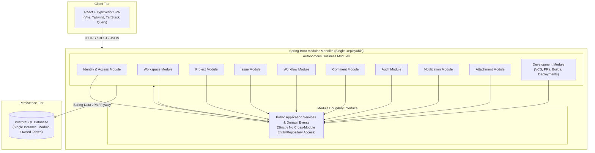

------------------------------------------------------------------------

## 3. High-level architecture

``` text
Browser
  |
  v
React + TypeScript SPA
  | HTTPS / JSON
  v
Spring Boot REST Application (single deployable)
  |
  +-- Identity & Access module
  +-- Workspace module
  +-- Project module
  +-- Issue module
  +-- Workflow module
  +-- Comment module
  +-- Audit module
  +-- Notification module
  +-- Attachment module
  +-- Development module (Repositories, branches, commits, PRs, builds, deployments)
  +-- Search/reporting capabilities
  |
  v
PostgreSQL (single database; module-owned tables)

Optional later:
- Object storage for attachment content
- Redis for a measured cache use case
- Background worker/outbox processing for reliable notifications
```

### High-Level System Architecture Diagram

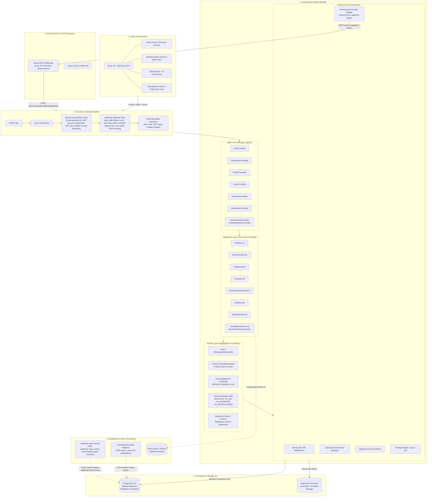

### 3.1 Development Provider Adapter Architecture

To prevent provider-specific models (such as GitHub App JSON payloads or API quirks) from polluting core domain entities, the Development Module enforces a strict **Provider Adapter Pattern**:

- **GitHub App as Primary Integration:** NexTrack integrates with GitHub
  primarily via a **GitHub App** rather than Personal Access Tokens (PATs).
  This provides granular repository permissions (contents, pull requests,
  checks, deployments), installation-based authentication, short-lived
  installation access tokens (1-hour TTL generated via RS256 JWTs),
  per-app webhook verification, and workspace-level repository selection.
- **Private Key Format Flexibility:** Supports RSA private keys in both
  **PKCS#8** (`BEGIN PRIVATE KEY`) and legacy **PKCS#1** (`BEGIN RSA PRIVATE KEY`)
  formats via BouncyCastle / Java KeyFactory, configurable via PEM string,
  Base64-encoded string, or local file path.
- **Standardized Token Caching:** Installation access tokens are cached
  in-memory with a standardized **50-minute TTL** and thread-safe proactive
  refresh to prevent mid-operation token expiration and eliminate redundant
  JWT negotiation overhead.
- **Provider-Independent Boundary:** The domain layer communicates
  exclusively with the `DevelopmentProvider` interface, allowing future
  adapters for **GitLab** (via Project Access Tokens or GitLab System Hooks)
  and **Bitbucket** (via Atlassian Connect or Workspace Access Tokens)
  without altering domain logic, persistence schemas, or UI contracts.

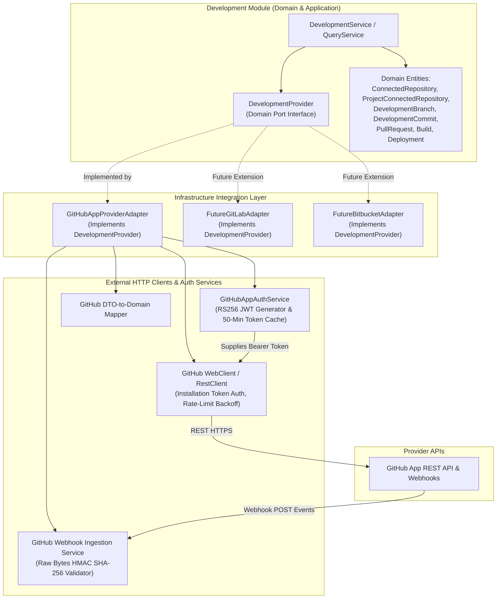

### 3.2 GitHub Webhook Ingestion & Webhook Inbox Lifecycle

Webhooks must never execute long-running tasks or direct database-heavy scans synchronously within the incoming HTTP thread. NexTrack utilizes an **Asynchronous Webhook Inbox Pattern** backed by PostgreSQL:

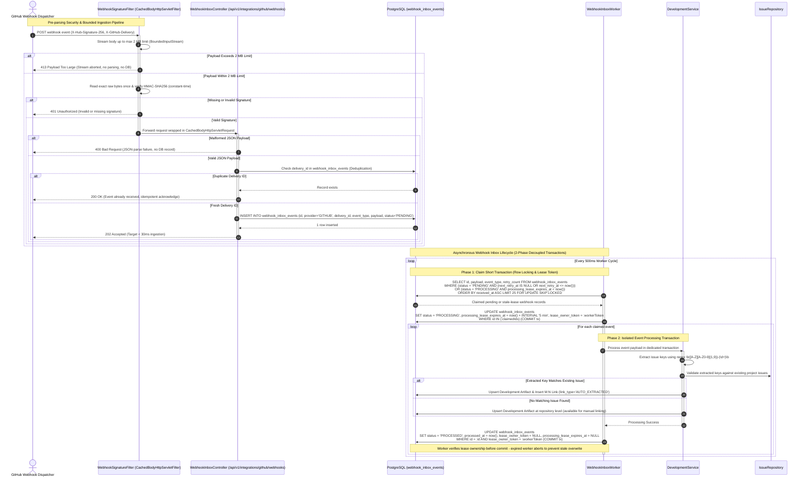

### 3.3 Issue-to-Development Activity Traceability Model

NexTrack links Jira-style issue tracking directly with code artifacts and deployment pipelines via explicit many-to-many associations, supporting multi-project repository sharing, automatic extraction, and manual linking fallback:

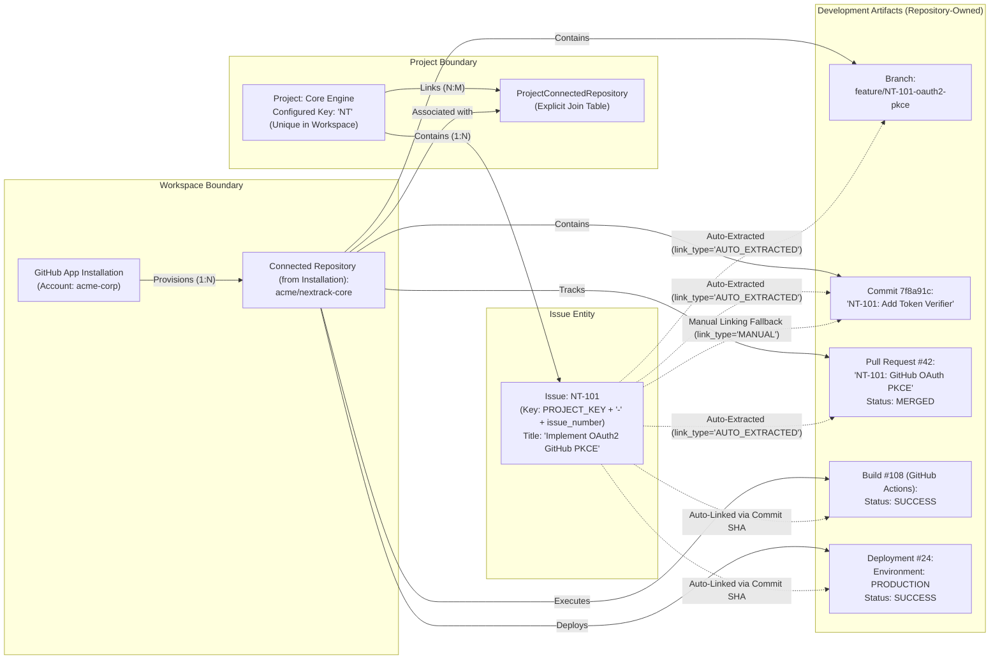

### Request flow

1.  Request enters Spring Security filters.
2.  Authentication is established.
3.  Request DTO is validated.
4.  Controller invokes an application service.
5.  Service checks workspace/project/resource permissions.
6.  Business rules are validated.
7.  A transaction writes state and associated audit/outbox records when
    needed.
8.  A DTO is returned with a consistent error or success response.
9.  Metrics/logs capture useful operational information without exposing
    secrets.

#### End-to-End Request Lifecycle Sequence

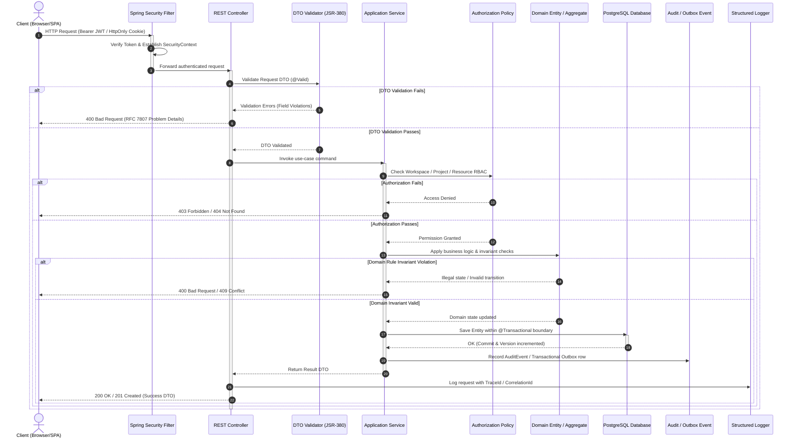

------------------------------------------------------------------------

## 4. Repository and folder structure

Use a single repository initially:

``` text
nextrack/
├── README.md
├── ARCHITECTURE.md
├── CONTRIBUTING.md
├── .gitignore
├── .editorconfig
├── .env.example
├── docker-compose.yml
├── Dockerfile
├── Makefile                         # Optional convenience commands
├── docs/
│   ├── architecture/
│   │   ├── decisions/               # Short ADRs for meaningful choices
│   │   ├── data-model.md
│   │   ├── security.md
│   │   ├── api-guidelines.md
│   │   └── performance-plan.md
│   ├── testing/
│   │   ├── test-matrix.md
│   │   └── load-test-results.md
│   └── screenshots/
├── backend/
│   ├── pom.xml
│   ├── mvnw
│   ├── mvnw.cmd
│   └── src/
│       ├── main/
│       │   ├── java/com/nextrack/
│       │   │   ├── NexTrackApplication.java
│       │   │   ├── config/
│       │   │   ├── shared/
│       │   │   │   ├── api/
│       │   │   │   ├── error/
│       │   │   │   ├── validation/
│       │   │   │   ├── time/
│       │   │   │   └── observability/
│       │   │   ├── identity/
│       │   │   │   ├── api/
│       │   │   │   ├── application/
│       │   │   │   ├── domain/
│       │   │   │   └── infrastructure/
│       │   │   ├── workspace/
│       │   │   ├── project/
│       │   │   ├── issue/
│       │   │   ├── workflow/
│       │   │   ├── comment/
│       │   │   ├── audit/
│       │   │   ├── notification/
│       │   │   ├── attachment/
│       │   │   ├── development/
│       │   │   │   ├── api/
│       │   │   │   │   ├── DevelopmentController.java
│       │   │   │   │   ├── WebhookController.java
│       │   │   │   │   ├── request/
│       │   │   │   │   └── response/
│       │   │   │   ├── application/
│       │   │   │   │   ├── DevelopmentService.java
│       │   │   │   │   ├── DevelopmentQueryService.java
│       │   │   │   │   └── DevelopmentAuthorization.java
│       │   │   │   ├── domain/
│       │   │   │   │   ├── Repository.java
│       │   │   │   │   ├── DevelopmentBranch.java
│       │   │   │   │   ├── DevelopmentCommit.java
│       │   │   │   │   ├── PullRequest.java
│       │   │   │   │   ├── Build.java
│       │   │   │   │   └── Deployment.java
│       │   │   │   └── infrastructure/
│       │   │   │       ├── persistence/
│       │   │   │       ├── integration/
│       │   │   │       │   └── github/
│       │   │   │       └── mapping/
│       │   │   └── reporting/
│       │   └── resources/
│       │       ├── application.yml
│       │       ├── application-local.yml
│       │       └── db/migration/
│       └── test/
│           ├── java/com/nextrack/
│           │   ├── unit/
│           │   ├── integration/
│           │   ├── architecture/
│           │   └── support/
│           └── resources/
├── frontend/
│   ├── package.json
│   ├── tsconfig.json
│   ├── vite.config.ts
│   ├── public/
│   └── src/
│       ├── app/
│       │   ├── router/
│       │   ├── providers/
│       │   └── query-client/
│       ├── components/
│       │   ├── ui/
│       │   └── layout/
│       ├── features/
│       │   ├── auth/
│       │   ├── workspaces/
│       │   ├── projects/
│       │   ├── issues/
│       │   ├── board/
│       │   ├── workflows/
│       │   ├── comments/
│       │   ├── notifications/
│       │   ├── development/
│       │   │   ├── api/
│       │   │   ├── components/
│       │   │   │   ├── ProjectDevelopmentView.tsx
│       │   │   │   ├── IssueDevelopmentPanel.tsx
│       │   │   │   ├── RepositoryConnectModal.tsx
│       │   │   │   ├── BranchList.tsx
│       │   │   │   ├── CommitList.tsx
│       │   │   │   ├── PullRequestList.tsx
│       │   │   │   ├── BuildBadge.tsx
│       │   │   │   └── DeploymentTimeline.tsx
│       │   │   └── hooks/
│       │   └── reports/
│       ├── hooks/
│       ├── lib/
│       │   ├── api-client.ts
│       │   ├── errors.ts
│       │   └── validation.ts
│       ├── types/
│       ├── styles/
│       └── test/
└── scripts/
    ├── seed-demo-data.*              # Use an appropriate script language
    └── load-tests/                   # k6 scripts or equivalent
```

### Backend module internals

For each substantial module, use a consistent pattern as needed:

``` text
issue/
├── api/
│   ├── IssueController.java
│   ├── request/
│   └── response/
├── application/
│   ├── IssueService.java
│   ├── IssueQueryService.java
│   └── IssueAuthorization.java
├── domain/
│   ├── Issue.java
│   ├── IssueStatus.java
│   ├── Priority.java
│   └── IssueRepository.java          # Port/interface if using this separation
└── infrastructure/
    ├── persistence/
    ├── JpaIssueRepository.java
    └── mapping/

development/
├── api/
│   ├── DevelopmentController.java
│   ├── WebhookInboxController.java
│   ├── WebhookSignatureFilter.java       # Raw-byte HMAC validator before JSON parsing
│   ├── CachedBodyHttpServletRequest.java # Replayable request wrapper preserving exact bytes
│   ├── request/
│   │   ├── ConnectRepositoryRequest.java
│   │   ├── LinkDevelopmentArtifactRequest.java
│   │   └── SyncRepositoryRequest.java
│   └── response/
│       ├── ConnectedRepositoryResponse.java
│       ├── IssueDevelopmentSummaryResponse.java
│       ├── BranchResponse.java
│       ├── CommitResponse.java
│       ├── PullRequestResponse.java
│       ├── BuildResponse.java
│       └── DeploymentResponse.java
├── application/
│   ├── DevelopmentService.java
│   ├── DevelopmentQueryService.java
│   └── DevelopmentAuthorization.java
├── domain/
│   ├── ConnectedRepository.java
│   ├── ProjectConnectedRepository.java # Explicit N:M join entity
│   ├── DevelopmentBranch.java
│   ├── DevelopmentCommit.java
│   ├── PullRequest.java
│   ├── PullRequestReview.java
│   ├── Build.java
│   ├── Deployment.java
│   ├── WebhookInboxEvent.java         # Inbox lifecycle (PENDING->PROCESSING->PROCESSED/FAILED)
│   ├── DevelopmentProvider.java       # Port interface for external Git/CI providers
│   └── RepositoryRepository.java      # Domain port
└── infrastructure/
    ├── persistence/
    │   ├── JpaConnectedRepositoryRepository.java
    │   ├── JpaProjectConnectedRepositoryRepository.java
    │   ├── JpaDevelopmentBranchRepository.java
    │   ├── JpaDevelopmentCommitRepository.java
    │   ├── JpaPullRequestRepository.java
    │   ├── JpaBuildRepository.java
    │   ├── JpaDeploymentRepository.java
    │   └── JpaWebhookInboxEventRepository.java
    ├── inbox/
    │   └── WebhookInboxWorker.java    # Lease-based worker & stuck-event supervisor
    ├── integration/
    │   └── github/
    │       ├── GitHubProviderAdapter.java # Implements DevelopmentProvider
    │       ├── GitHubAppAuthService.java  # RS256 JWT, PKCS#1/PKCS#8 parser, 50-min cache
    │       ├── GitHubClient.java
    │       ├── GitHubWebhookValidator.java
    │       └── dto/
    └── mapping/
        ├── DevelopmentDtoMapper.java
        └── GitHubPayloadMapper.java
```

Do not create empty packages/classes for every layer just to satisfy a
template. Keep small modules simple while maintaining the boundary.

#### Module Layering & Inward Dependency Flow

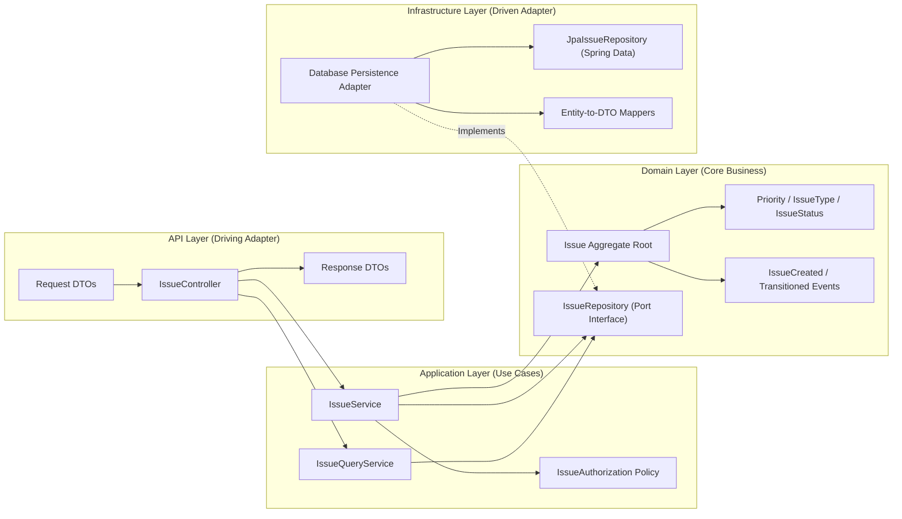

------------------------------------------------------------------------

## 5. Domain model and relationships

Start with the following conceptual entities. Refine fields and
normalization after inspecting requirements.

### Entity-Relationship Diagram (ERD)

```mermaid
erDiagram
    USER ||--o{ WORKSPACE_MEMBERSHIP : "holds"
    USER ||--o{ PROJECT_MEMBERSHIP : "holds"
    USER ||--o{ ISSUE : "reports"
    USER ||--o{ ISSUE : "assigned to"
    USER ||--o{ COMMENT : "authors"
    USER ||--o{ ATTACHMENT : "uploads"
    USER ||--o{ ISSUE_WATCHER : "watches"
    USER ||--o{ NOTIFICATION : "receives"
    USER ||--o{ AUDIT_EVENT : "triggers"

    WORKSPACE ||--|{ WORKSPACE_MEMBERSHIP : "contains"
    WORKSPACE ||--o{ PROJECT : "contains"
    WORKSPACE ||--o{ INTEGRATION_INSTALLATION : "installs"

    PROJECT ||--o{ PROJECT_MEMBERSHIP : "has"
    PROJECT ||--|| PROJECT_ISSUE_COUNTER : "tracks"
    PROJECT ||--o{ ISSUE : "contains"
    PROJECT ||--o{ ISSUE_LABEL : "defines"
    PROJECT ||--o{ PROJECT_CONNECTED_REPOSITORY : "links"

    INTEGRATION_INSTALLATION ||--o{ CONNECTED_REPOSITORY : "provisions"
    CONNECTED_REPOSITORY ||--o{ PROJECT_CONNECTED_REPOSITORY : "associated with"

    ISSUE ||--o{ COMMENT : "contains"
    ISSUE ||--o{ ATTACHMENT : "has"
    ISSUE ||--o{ ISSUE_LABEL_ASSIGNMENT : "tagged with"
    ISSUE_LABEL ||--o{ ISSUE_LABEL_ASSIGNMENT : "applies to"
    ISSUE ||--o{ ISSUE_WATCHER : "monitored by"
    ISSUE ||--o{ ISSUE_LINK : "source"
    ISSUE ||--o{ ISSUE_LINK : "target"

    CONNECTED_REPOSITORY ||--o{ DEVELOPMENT_BRANCH : "contains"
    CONNECTED_REPOSITORY ||--o{ DEVELOPMENT_COMMIT : "contains"
    CONNECTED_REPOSITORY ||--o{ PULL_REQUEST : "tracks"
    CONNECTED_REPOSITORY ||--o{ BUILD : "executes"
    CONNECTED_REPOSITORY ||--o{ DEPLOYMENT : "deploys"

    PULL_REQUEST ||--o{ PULL_REQUEST_REVIEW : "receives"

    ISSUE ||--o{ ISSUE_DEVELOPMENT_BRANCH : "linked to"
    DEVELOPMENT_BRANCH ||--o{ ISSUE_DEVELOPMENT_BRANCH : "links"

    ISSUE ||--o{ ISSUE_DEVELOPMENT_COMMIT : "linked to"
    DEVELOPMENT_COMMIT ||--o{ ISSUE_DEVELOPMENT_COMMIT : "links"

    ISSUE ||--o{ ISSUE_PULL_REQUEST : "linked to"
    PULL_REQUEST ||--o{ ISSUE_PULL_REQUEST : "links"

    ISSUE ||--o{ ISSUE_BUILD : "linked to"
    BUILD ||--o{ ISSUE_BUILD : "links"

    ISSUE ||--o{ ISSUE_DEPLOYMENT : "linked to"
    DEPLOYMENT ||--o{ ISSUE_DEPLOYMENT : "links"

    USER {
        uuid id PK
        string email UK
        string display_name
        string password_hash
        string status
        timestamptz created_at
        timestamptz updated_at
    }

    WORKSPACE {
        uuid id PK
        string name
        string slug UK
        uuid owner_user_id FK
        timestamptz created_at
        timestamptz archived_at
    }

    WORKSPACE_MEMBERSHIP {
        uuid workspace_id PK,FK
        uuid user_id PK,FK
        string role
        timestamptz joined_at
    }

    PROJECT {
        uuid id PK
        uuid workspace_id FK
        string name
        string project_key "UNIQUE(workspace_id, project_key)"
        string description
        uuid created_by FK
        timestamptz created_at
        timestamptz updated_at
        timestamptz archived_at
    }

    PROJECT_MEMBERSHIP {
        uuid project_id PK,FK
        uuid user_id PK,FK
        string role
        timestamptz joined_at
    }

    PROJECT_ISSUE_COUNTER {
        uuid project_id PK,FK
        bigint last_issue_number
    }

    ISSUE {
        uuid id PK
        uuid project_id FK
        bigint issue_number
        string title
        text description
        string issue_type
        string status
        string priority
        uuid reporter_id FK
        uuid assignee_id FK
        timestamptz due_date
        int story_points
        int version
        timestamptz created_at
        timestamptz updated_at
        timestamptz archived_at
    }

    COMMENT {
        uuid id PK
        uuid issue_id FK
        uuid author_id FK
        text body
        timestamptz created_at
        timestamptz updated_at
        timestamptz deleted_at
    }

    ATTACHMENT {
        uuid id PK
        uuid issue_id FK
        uuid uploader_id FK
        string original_filename
        string storage_key
        string content_type
        bigint size_bytes
        string checksum
        timestamptz created_at
        timestamptz deleted_at
    }

    AUDIT_EVENT {
        uuid id PK
        uuid actor_id FK
        string entity_type
        uuid entity_id
        string action
        jsonb before_payload
        jsonb after_payload
        string trace_id
        timestamptz created_at
    }

    NOTIFICATION {
        uuid id PK
        uuid recipient_id FK
        string event_type
        jsonb payload
        string dedup_key UK
        timestamptz created_at
        timestamptz read_at
    }

    OUTBOX_EVENT {
        uuid id PK
        string event_type
        jsonb payload
        string status
        int retry_count
        timestamptz next_retry_at
        timestamptz created_at
        timestamptz published_at
    }

    ISSUE_LABEL {
        uuid id PK
        uuid project_id FK
        string name
    }

    ISSUE_LABEL_ASSIGNMENT {
        uuid issue_id PK,FK
        uuid label_id PK,FK
    }

    ISSUE_LINK {
        uuid source_issue_id PK,FK
        uuid target_issue_id PK,FK
        string link_type
    }

    ISSUE_WATCHER {
        uuid issue_id PK,FK
        uuid user_id PK,FK
    }

    INTEGRATION_INSTALLATION {
        uuid id PK
        uuid workspace_id FK
        string provider
        bigint installation_id UK
        string account_name
        string account_type
        string account_avatar_url
        string repository_selection
        jsonb permissions
        timestamptz created_at
        timestamptz updated_at
    }

    CONNECTED_REPOSITORY {
        uuid id PK
        uuid installation_id FK
        string provider
        string external_repo_id
        string name
        string full_name
        string html_url
        string default_branch
        string webhook_id
        boolean is_active
        timestamptz last_synced_at
        timestamptz created_at
        timestamptz updated_at
    }

    PROJECT_CONNECTED_REPOSITORY {
        uuid project_id PK,FK
        uuid repository_id PK,FK
        uuid connected_by FK
        timestamptz connected_at
    }

    DEVELOPMENT_BRANCH {
        uuid id PK
        uuid repository_id FK
        string name
        string source_branch
        string last_commit_sha
        string created_by
        string url
        timestamptz created_at
        timestamptz updated_at
    }

    DEVELOPMENT_COMMIT {
        uuid id PK
        uuid repository_id FK
        string commit_sha
        text message
        string author_name
        string author_email
        string author_avatar_url
        string commit_url
        timestamptz committed_at
        timestamptz created_at
    }

    PULL_REQUEST {
        uuid id PK
        uuid repository_id FK
        bigint provider_pr_id
        int pr_number
        string title
        text description
        string source_branch
        string target_branch
        string pr_url
        string author_name
        string author_avatar_url
        string status
        string review_status
        boolean is_draft
        timestamptz pr_created_at
        timestamptz pr_updated_at
        timestamptz merged_at
        string merged_by
    }

    PULL_REQUEST_REVIEW {
        uuid id PK
        uuid pull_request_id FK
        string reviewer_name
        string state
        timestamptz submitted_at
    }

    BUILD {
        uuid id PK
        uuid repository_id FK
        string external_build_id
        string build_number
        string pipeline_name
        string commit_sha
        string branch_name
        string status
        string build_url
        timestamptz started_at
        timestamptz completed_at
        bigint duration_seconds
        timestamptz created_at
    }

    DEPLOYMENT {
        uuid id PK
        uuid repository_id FK
        string external_deployment_id
        string environment
        string commit_sha
        string status
        string deployment_url
        string deployed_by
        timestamptz started_at
        timestamptz completed_at
        timestamptz created_at
    }

    WEBHOOK_INBOX_EVENT {
        uuid id PK
        string provider
        string delivery_id
        string event_type
        jsonb payload
        string status
        uuid lease_owner_token
        timestamptz processing_lease_expires_at
        int retry_count
        timestamptz next_retry_at
        text error_message
        timestamptz received_at
        timestamptz processed_at
    }

    ISSUE_DEVELOPMENT_BRANCH {
        uuid issue_id PK,FK
        uuid branch_id PK,FK
        string link_type
        uuid linked_by FK
        timestamptz linked_at
    }

    ISSUE_DEVELOPMENT_COMMIT {
        uuid issue_id PK,FK
        uuid commit_id PK,FK
        string link_type
        uuid linked_by FK
        timestamptz linked_at
    }

    ISSUE_PULL_REQUEST {
        uuid issue_id PK,FK
        uuid pull_request_id PK,FK
        string link_type
        uuid linked_by FK
        timestamptz linked_at
    }

    ISSUE_BUILD {
        uuid issue_id PK,FK
        uuid build_id PK,FK
        string link_type
        uuid linked_by FK
        timestamptz linked_at
    }

    ISSUE_DEPLOYMENT {
        uuid issue_id PK,FK
        uuid deployment_id PK,FK
        string link_type
        uuid linked_by FK
        timestamptz linked_at
    }
```

### Identity and workspace

-   **User:** id, display name, email (unique, normalized), password
    hash or external identity reference, status, createdAt, updatedAt.
-   **Workspace:** id, name, slug (unique), ownerUserId, createdAt,
    archivedAt.
-   **WorkspaceMembership:** workspaceId, userId, role, joinedAt; unique
    constraint on `(workspace_id, user_id)`.

### Project

-   **Project:** id, workspaceId, name, projectKey (unique within workspace,
    enforcing uppercase alphanumeric format e.g. `^[A-Z][A-Z0-9]{1,9}$`),
    description, createdBy, createdAt, updatedAt, archivedAt.
    - *Constraints:* `CONSTRAINT uq_projects_workspace_project_key UNIQUE (workspace_id, project_key)`
      strictly enforces project-key uniqueness within the enclosing workspace.
      Project keys are NOT globally unique: distinct workspaces are permitted to define
      the same project key (e.g. `NT`, `CORE`, `APP`).
-   **ProjectIssueCounter:** projectId (PK, FK to Project),
    lastIssueNumber (bigint, default 0). Used to atomically allocate
    monotonically increasing sequential issue numbers (`1, 2, 3...`) per
    project under concurrent creation:
    `UPDATE project_issue_counters SET last_issue_number = last_issue_number + 1 WHERE project_id = :projectId RETURNING last_issue_number`.
    Initialized with `(project_id, 0)` atomically upon project creation.
    - *Transactional boundaries & rollback semantics:* Counter increment and
      issue insertion execute inside the same database transaction (`@Transactional`).
      Because both operations share the same transactional database connection,
      if the creation transaction rolls back (e.g. due to an unhandled exception
      or constraint violation), the counter increment rolls back along with the
      issue, restoring `last_issue_number` to its prior committed value. Thus,
      a transaction rollback does NOT create a numbering gap.
    - *Gaps from post-commit actions:* Deletion or archival occurring after a
      successful commit never causes previously allocated numbers to be reused,
      preserving auditability and historical commit/PR link integrity.
    - *Guarantees:* Guarantees unique, monotonically increasing issue numbers;
      gapless numbering is explicitly not promised.
-   **ProjectMembership:** projectId (FK), userId (FK), role, joinedAt;
    unique constraint on `(project_id, user_id)`. Explicitly inherits from
    workspace membership: a user must hold active `WorkspaceMembership`
    before being assigned `ProjectMembership`. Revoking workspace membership
    cascades to immediately revoke project access.

### Issue tracking

-   **Issue:** id, projectId, issueNumber (monotonically sequential per
    project), title, description, type, status (`IssueStatus` enum:
    `BACKLOG`, `TO_DO`, `IN_PROGRESS`, `IN_REVIEW`, `DONE`, `ARCHIVED`),
    priority, reporterId, assigneeId nullable, dueDate nullable,
    storyPoints nullable, version (JPA `@Version` optimistic lock),
    createdAt, updatedAt, archivedAt.
    - Public human-readable issue key follows the standard
      `<PROJECT_KEY>-<NUMBER>` format (e.g. `NT-101`, `CORE-42`), formed
      by combining the project's configured uppercase key with the
      sequential issue number.
    - *Constraints:* `UNIQUE (project_id, issue_number)` guarantees
      database-level uniqueness for public issue keys.
    - *Assignee eligibility:* Server-side validation strictly enforces that
      an issue's `assignee_id` must be an active member of `ProjectMembership`
      for the issue's `projectId`.
-   **IssueLabel:** id, projectId, name; define normalization/case
    behavior and uniqueness.
-   **IssueLabelAssignment:** issueId, labelId; unique pair.
-   **IssueLink:** sourceIssueId, targetIssueId, linkType; prevent
    invalid self-links and duplicate relationships as appropriate.
-   **IssueWatcher:** issueId, userId; unique pair.
-   **Comment:** id, issueId, authorId, body, createdAt, updatedAt,
    deletedAt nullable.
-   **Attachment metadata:** id, issueId, uploaderId, originalFilename,
    safeStorageKey, contentType, sizeBytes, checksum, createdAt,
    deletedAt nullable. File bytes live in storage, not in the metadata
    row.
-   **IssueHistory/AuditEvent:** actor, action, entity type/id, relevant
    before/after values or structured change payload, timestamp,
    correlation/request id where appropriate.
-   **Notification:** recipientId, event type, payload/reference,
    createdAt, readAt, deduplication key where appropriate.
-   **OutboxEvent:** id (UUID PK), eventType (string), payload (jsonb),
    status (string enum: `PENDING`, `PUBLISHED`, `FAILED`), retryCount (int),
    nextRetryAt (timestamptz, nullable), createdAt, publishedAt.
    Persisted atomically in the same database transaction as issue mutations
    to guarantee reliable delivery of notifications and downstream events.

### Workflow

-   In Release 1, NexTrack implements a standardized, immutable finite state
    machine defined by the `IssueStatus` enum:
    - `BACKLOG`: Backlog / unprioritized items.
    - `TO_DO`: Prioritized work ready for engineering.
    - `IN_PROGRESS`: Actively undergoing development.
    - `IN_REVIEW`: Code review or QA verification.
    - `DONE`: Completed and accepted.
    - `ARCHIVED`: Closed, canceled, or archived.
-   Centralized transition validation is enforced in code by
    `IssueStatusTransitionRule` and guarded by `WorkflowTransitionGuard`.
-   Every status transition is audited atomically in `audit_events`.
-   User-configurable dynamic workflow state machines, custom status schemas,
    and workflow migration wizards are postponed to Phase 12+ to eliminate
    schema overhead and prevent state corruption on active issues.

### Development tracking

-   **IntegrationInstallation:** id (UUID), workspaceId (FK to Workspace),
    provider (string enum: `GITHUB`, `GITLAB`, `BITBUCKET`),
    installationId (bigint, external GitHub App installation identifier),
    accountName (string, GitHub organization or username),
    accountType (string: `Organization` or `User`),
    accountAvatarUrl (string, nullable),
    repositorySelection (string: `ALL` or `SELECTED`),
    permissions (jsonb, granular permissions granted by installation),
    createdAt (timestamptz), updatedAt (timestamptz).
    - *Constraints:* `UNIQUE(provider, installation_id)`. Installed at
      the workspace tier, allowing projects to select authorized
      repositories.
-   **ConnectedRepository:** id (UUID),
    installationId (FK to IntegrationInstallation),
    provider (string enum: `GITHUB`, `GITLAB`, `BITBUCKET`),
    externalRepoId (string, e.g. GitHub numeric repository ID),
    name (string), fullName (string, e.g. `acme/nextrack-core`),
    htmlUrl (string), defaultBranch (string, e.g. `main`),
    webhookId (string, external webhook registration ID, nullable),
    isActive (boolean), lastSyncedAt (timestamptz, nullable),
    createdAt, updatedAt.
    - *Constraints:* `UNIQUE(installation_id, external_repo_id)`.
      Repositories are provisioned at the workspace installation level.
      Short-lived installation access tokens are generated on-demand and
      cached in-memory for 50 minutes, eliminating plaintext token persistence.
-   **ProjectConnectedRepository (Explicit Join Entity):**
    projectId (FK to Project), repositoryId (FK to ConnectedRepository),
    connectedBy (FK to User), connectedAt (timestamptz).
    - *Constraints:* Primary key on `(project_id, repository_id)`. Allows a
      single connected repository to be mapped to multiple NexTrack projects
      within the workspace, enabling multi-project repository sharing.
-   **DevelopmentBranch:** id (UUID), repositoryId (FK to
    ConnectedRepository), name (string, e.g. `feature/NT-101-auth`),
    sourceBranch (string, e.g. `main`, nullable), lastCommitSha
    (string, nullable), createdBy (string, nullable), url (string,
    nullable), createdAt, updatedAt.
    - *Constraints:* `UNIQUE(repository_id, name)`.
-   **DevelopmentCommit:** id (UUID), repositoryId (FK to
    ConnectedRepository), commitSha (string 40-char or 64-char git hash),
    message (text), authorName (string), authorEmail (string),
    authorAvatarUrl (string, nullable), commitUrl (string),
    committedAt (timestamptz), createdAt (timestamptz).
    - *Constraints:* `UNIQUE(repository_id, commit_sha)`. Prevents
      duplicate commit records across multiple sync operations or
      branches within the same repository.
-   **PullRequest:** id (UUID), repositoryId (FK to
    ConnectedRepository), providerPrId (bigint, provider's internal ID),
    prNumber (int, repository-scoped human PR number, e.g. `42`),
    title (string), description (text, nullable), sourceBranch
    (string), targetBranch (string), prUrl (string), authorName
    (string), authorAvatarUrl (string, nullable), status (string enum:
    `OPEN`, `MERGED`, `CLOSED`), reviewStatus (string enum: `PENDING`,
    `APPROVED`, `CHANGES_REQUESTED`, nullable), isDraft (boolean),
    prCreatedAt (timestamptz), prUpdatedAt (timestamptz), mergedAt
    (timestamptz, nullable), mergedBy (string, nullable).
    - *Constraints:* `UNIQUE(repository_id, provider_pr_id)` and
      `UNIQUE(repository_id, pr_number)`.
-   **PullRequestReview:** id (UUID), pullRequestId (FK to
    PullRequest), reviewerName (string), state (string enum:
    `APPROVED`, `CHANGES_REQUESTED`, `COMMENTED`, `DISMISSED`),
    submittedAt (timestamptz).
-   **Build:** id (UUID), repositoryId (FK to ConnectedRepository),
    externalBuildId (string, e.g. GitHub Actions workflow run ID),
    buildNumber (string), pipelineName (string, e.g. `CI / Build and Test`),
    commitSha (string), branchName (string, nullable), status (string
    enum: `QUEUED`, `IN_PROGRESS`, `SUCCESS`, `FAILED`, `CANCELLED`),
    buildUrl (string), startedAt (timestamptz, nullable),
    completedAt (timestamptz, nullable), durationSeconds (bigint,
    nullable), createdAt (timestamptz).
    - *Constraints:* `UNIQUE(repository_id, external_build_id)`.
    - *GitHub Status Mapping:* Ingested status is computed using both GitHub's
      `status` and `conclusion` fields:
      - `status == "queued"` → `QUEUED`
      - `status == "in_progress"` → `IN_PROGRESS`
      - `status == "completed"`:
        - `conclusion == "success"` → `SUCCESS`
        - `conclusion in ("failure", "timed_out")` → `FAILED`
        - `conclusion == "cancelled"` → `CANCELLED`
-   **Deployment:** id (UUID), repositoryId (FK to ConnectedRepository),
    externalDeploymentId (string, e.g. GitHub Deployment ID),
    environment (string enum: `DEVELOPMENT`, `STAGING`, `PRODUCTION`),
    commitSha (string), status (string enum: `QUEUED`, `IN_PROGRESS`,
    `SUCCESS`, `FAILED`, `CANCELLED`), deploymentUrl (string, nullable),
    deployedBy (string, nullable), startedAt (timestamptz, nullable),
    completedAt (timestamptz, nullable), createdAt (timestamptz).
    - *Constraints:* `UNIQUE(repository_id, external_deployment_id)`.
-   **WebhookInboxEvent (Webhook Inbox Pattern):** id (UUID), provider
    (string enum: `GITHUB`), deliveryId (string, provider delivery identifier
    e.g. `X-GitHub-Delivery`), eventType (string, e.g. `pull_request`,
    `push`, `workflow_run`), payload (jsonb, verified JSON payload), status
    (string enum: `PENDING`, `PROCESSING`, `PROCESSED`, `FAILED`),
    leaseOwnerToken (UUID, unique worker ownership token, nullable),
    processingLeaseExpiresAt (timestamptz, nullable), retryCount (int,
    default 0), nextRetryAt (timestamptz, nullable), errorMessage (text, nullable),
    receivedAt (timestamptz), processedAt (timestamptz, nullable).
    - *Constraints:*
      ```sql
      CONSTRAINT uq_webhook_provider_delivery
      UNIQUE (provider, delivery_id)
      ```
      guarantees idempotent delivery deduplication per provider. `delivery_id` is
      NOT globally unique on its own; distinct external providers (such as GitHub,
      GitLab, or Bitbucket) may generate colliding delivery UUIDs. Uniqueness is strictly
      enforced across the composite `(provider, delivery_id)` tuple.
    - *Payload Representation & Cryptographic Boundary:* HMAC-SHA256 signature
      verification is executed strictly against the exact raw HTTP request bytes
      in-memory before JSON parsing. Once cryptographically verified, the payload
      is parsed and stored as PostgreSQL `payload jsonb`. PostgreSQL `jsonb`
      decomposes and normalizes JSON structures (stripping insignificant whitespace,
      consolidating duplicate keys, and not preserving key order). This is intentional
      and optimal for NexTrack, enabling JSON path indexing and query execution without
      re-parsing raw bytes. Duplicate retention in a `bytea` column is omitted because
      cryptographic verification occurs synchronously at ingestion, making raw-byte
      storage redundant for v1.
    - *Decoupled 2-Phase Transaction Lifecycle:*
      1. Ingestion: `POST /api/v1/integrations/github/webhooks` is configured with
         `permitAll()` in Spring Security (no user JWT required) and excluded from CSRF
         protection (`csrf.ignoringRequestMatchers(...)`). `WebhookSignatureFilter` streams
         incoming request bytes up to a configurable maximum size (`nextrack.integrations.github.webhook.max-body-bytes`,
         default: 2 MB) using a bounded stream. Oversized payloads (> 2 MB) immediately abort stream
         reading and return `413 Payload Too Large` without parsing JSON or writing to the database.
         The filter computes HMAC-SHA256 using the configured secret and verifies against `X-Hub-Signature-256`
         using constant-time comparison (`MessageDigest.isEqual`). Missing or invalid signatures return
         `401 Unauthorized` immediately before JSON parsing. Valid requests are wrapped in
         `CachedBodyHttpServletRequest`. Downstream controller parses JSON (returning `400 Bad Request`
         if malformed JSON without writing to the inbox), checks delivery ID deduplication (returning `200 OK`
         if duplicate), inserts the fresh event with `status = 'PENDING'`, and returns `202 Accepted`
         (engineering target: < 30ms p95 ingestion latency under documented test workloads).
      2. Phase 1 — Lease Acquisition (Short Transaction): `WebhookInboxWorker` polls candidate events:
         `SELECT id, payload, event_type, retry_count FROM webhook_inbox_events WHERE (status = 'PENDING' AND (next_retry_at IS NULL OR next_retry_at <= now())) OR (status = 'PROCESSING' AND processing_lease_expires_at < now()) ORDER BY received_at ASC LIMIT 25 FOR UPDATE SKIP LOCKED`.
         Generates a unique `lease_owner_token = UUID.randomUUID()`, updates claimed rows in the same short transaction:
         `UPDATE webhook_inbox_events SET status = 'PROCESSING', processing_lease_expires_at = now() + INTERVAL '5 min', lease_owner_token = :workerToken WHERE id IN (:claimedIds)`,
         and COMMITS the claim transaction before processing event payloads.
      3. Phase 2 — Isolated Event Processing (Dedicated Transaction per Event): Runs in its own
         `@Transactional` boundary per event. Deserializes the JSON payload, extracts issue keys, validates
         existing project issues, upserts development artifacts (`development_branches`, `development_commits`,
         `pull_requests`, `builds`, `deployments`), and inserts association rows (`link_type = 'AUTO_EXTRACTED'`).
         If long-running, the worker safely renews the lease via `UPDATE webhook_inbox_events SET processing_lease_expires_at = now() + INTERVAL '5 min' WHERE id = :id AND lease_owner_token = :workerToken`.
         Before committing domain writes, the worker verifies lease ownership and updates status atomically:
         `UPDATE webhook_inbox_events SET status = 'PROCESSED', processed_at = now(), lease_owner_token = NULL, processing_lease_expires_at = NULL WHERE id = :id AND lease_owner_token = :workerToken`.
         If 0 rows are updated (the worker's lease expired and another worker claimed the record), the worker
         aborts and rolls back its domain transaction, preventing stale workers from overwriting newer worker results.
         If 1 row is updated, the domain writes and status update commit atomically.
      4. Phase 3 — Failure Recovery (Independent Short Transaction): If domain processing throws an exception,
         domain writes roll back. In a separate short transaction, the worker increments `retry_count`.
         If `retry_count < 5`, it computes exponential backoff with jitter (`min(3600, 2^retry_count * 10) + jitter`),
         sets `status = 'PENDING'`, `next_retry_at = now() + backoff_jitter`, `lease_owner_token = NULL`, `processing_lease_expires_at = NULL`.
         If `retry_count >= 5` (Poison pill defense), it sets `status = 'FAILED'`, stores diagnostic `error_message`,
         clears lease fields, and alerts for operator review or manual replay (`POST .../inbox/{eventId}/retry`).
      8. Stuck-Event Recovery: A scheduled supervisor job resets events
         stuck in `PROCESSING` past their lease back to `PENDING`.
-   **Explicit Many-to-Many Issue Association Tables (with Manual Linking Fallback):**
    - `issue_development_branches`: `issue_id` (FK to Issue),
      `branch_id` (FK to DevelopmentBranch), `link_type` (string enum:
      `AUTO_EXTRACTED`, `MANUAL`), `linked_by` (UUID FK to User, nullable),
      `linked_at` (timestamptz); PK on `(issue_id, branch_id)`.
    - `issue_development_commits`: `issue_id` (FK to Issue),
      `commit_id` (FK to DevelopmentCommit), `link_type` (string enum:
      `AUTO_EXTRACTED`, `MANUAL`), `linked_by` (UUID FK to User, nullable),
      `linked_at` (timestamptz); PK on `(issue_id, commit_id)`.
    - `issue_pull_requests`: `issue_id` (FK to Issue), `pull_request_id`
      (FK to PullRequest), `link_type` (string enum:
      `AUTO_EXTRACTED`, `MANUAL`), `linked_by` (UUID FK to User, nullable),
      `linked_at` (timestamptz); PK on `(issue_id, pull_request_id)`.
    - `issue_builds`: `issue_id` (FK to Issue), `build_id` (FK to
      Build), `link_type` (string enum: `AUTO_EXTRACTED`, `MANUAL`),
      `linked_by` (UUID FK to User, nullable), `linked_at` (timestamptz);
      PK on `(issue_id, build_id)`.
    - `issue_deployments`: `issue_id` (FK to Issue), `deployment_id`
      (FK to Deployment), `link_type` (string enum: `AUTO_EXTRACTED`,
      `MANUAL`), `linked_by` (UUID FK to User, nullable), `linked_at`
      (timestamptz); PK on `(issue_id, deployment_id)`.
    - *Automated extraction vs manual fallback rules:*
      1. When webhooks arrive, NexTrack executes regex extraction
         `\b([A-Z][A-Z0-9]{1,9})-(\d+)\b` on branch names, commit
         messages, and PR titles/descriptions.
      2. Extracted keys are verified against active project issues. If
         matched, an association row is inserted with
         `link_type = 'AUTO_EXTRACTED'`.
      3. If a commit or branch did not follow naming conventions, users
         can manually link it from the UI via search or URL, creating
         an association row with `link_type = 'MANUAL'` and recording
         `linked_by` for auditability.
      4. A single development artifact can link to multiple issues if
         multiple issue keys appear in the message (e.g. `NT-101, NT-102`).

### Data rules

-   Use UUIDs or identity-generated numeric IDs consistently; choose one
    and document the choice. Public issue keys can be human-readable,
    such as `APP-123`.
-   Store timestamps as timezone-aware instants (for PostgreSQL,
    `timestamptz` is appropriate); display them in the user's configured
    timezone.
-   Store enums with stable string representations rather than ordinal
    values.
-   Use database foreign keys, unique constraints, check constraints,
    and non-null constraints where appropriate.
-   Prefer archive/soft-delete for projects and issues when history
    retention matters; explicitly define what is restorable and who may
    restore it.
-   Do not use soft deletion as a substitute for authorization.
-   Index based on actual query patterns and verify with query plans.

------------------------------------------------------------------------

## 6. Main product modules and acceptance criteria

### 6.1 Identity and access

Capabilities: - Registration or a safe seeded demo account. -
Login/logout and session/token lifecycle. - Password hashing using
Spring Security's supported password encoder. - Email normalization and
unique account enforcement. - Profile and account status. - Workspace
membership and roles.

Acceptance: - Invalid credentials return a generic authentication error
that does not disclose whether an email exists. - Disabled accounts
cannot authenticate. - Passwords are never stored or logged in
plaintext. - Authenticated users cannot access data merely by guessing
an ID. - Token/session expiration and revocation behavior is
documented. - If JWT is used, signing keys come from
environment/secrets, never source control. Prefer secure, HttpOnly
cookies or carefully document token storage and CSRF/XSS trade-offs; do
not casually store long-lived access tokens in localStorage.

### 6.2 Workspace and project management

Capabilities: - Create, list, update, archive, and restore
workspaces/projects as authorized. - Manage members and roles. - Project
key generation and uniqueness. - Project overview and activity summary.

Acceptance: - Duplicate project keys within the same workspace are
rejected safely. - Membership changes are authorized and audited. -
Archived projects are read-only except for permitted restore/admin
operations. - Project deletion/archive behavior is explicit and does not
orphan issues.

### 6.3 Issues and board

Capabilities:
- Create/edit issues, assign users, change priority/type/status, set due
  date, labels, and story points.
- Search/filter/sort and paginate using bounded queries.
- Kanban columns bound to the fixed `IssueStatus` enum values.
- Issue detail page, watchers, comments, and audit history.
- Bulk actions with bounded batch sizes (max 50) and atomic per-batch or
  documented per-item semantics.

Acceptance:
- **Assignee eligibility:** Assignee must be an active member of the issue's
  project, established either through explicit assignment in `project_members`
  or inherited via workspace-level administrative roles (`WORKSPACE_OWNER`,
  `WORKSPACE_ADMIN`). Attempting to assign an unverified user or a user
  lacking project membership returns `400 Bad Request` (`ASSIGNEE_NOT_IN_PROJECT`).
- **Server-managed invariants:** Client cannot set server-managed fields such as
  `id`, `issueNumber`, `createdAt`, `updatedAt`, `version`, or audit actor.
- **Concurrent issue number generation:** Issue numbers are generated strictly
  sequentially and monotonically per project using the atomic database counter
  in `project_issue_counters` (`UPDATE ... RETURNING`). Counter allocation and
  issue insertion execute within the same database transaction. A transaction
  rollback undoes both the issue insert and the counter increment, restoring
  `last_issue_number` so no gap is introduced by the rollback itself. Committed
  issues that are subsequently deleted or archived never release their numbers
  for reuse. Database unique constraints enforce `UNIQUE(project_id, issue_number)`,
  preventing duplicate issue numbers under concurrent requests. The system
  guarantees unique, monotonically increasing issue numbers; gapless numbering
  is explicitly not guaranteed.
- **Data protection:** API responses never expose password hashes, internal secrets,
  or unauthorized project data.
- **Resource bounding:** Empty and very large result sets are handled with bounded
  resource use (default page size 25, maximum page size 100).

### 6.4 Workflow

Capabilities:
- Standardized, immutable finite state machine for v1 (`BACKLOG`, `TO_DO`,
  `IN_PROGRESS`, `IN_REVIEW`, `DONE`, `ARCHIVED`).
- Centralized server-side transition validation enforced via `IssueStatusTransitionRule`.
- Atomic recording of successful transitions in `issue_history`.
- Dynamic user-configurable workflow schemes, custom statuses, and workflow
  migration engines are explicitly postponed to Phase 12+ to maintain
  high implementation quality and delivery velocity.

Acceptance:
- **Transition validation:** A status cannot be changed to an invalid or unauthorized
  state through any API call or external webhook. Only explicitly permitted transitions
  succeed; all other transitions return `400 Bad Request` (`WORKFLOW_TRANSITION_DENIED`).
- **Permitted v1 transitions:**
  - `BACKLOG` <-> `TO_DO` (Backlog grooming / sprint planning)
  - `TO_DO` <-> `IN_PROGRESS` (Development started / paused)
  - `IN_PROGRESS` <-> `IN_REVIEW` (PR submitted / changes requested)
  - `IN_REVIEW` <-> `DONE` (PR merged & QA approved)
  - `DONE` -> `IN_PROGRESS` (Issue reopened after defect discovered)
  - `BACKLOG` -> `ARCHIVED` (Issue canceled or abandoned)
  - `DONE` -> `ARCHIVED` (Completed milestone or archived release)
- **Concurrency defense:** Concurrent status changes cannot silently overwrite each
  other. All status updates require the current entity `version` and enforce JPA
  `@Version` optimistic locking, mapping conflicts to `409 Conflict`.
- **Atomic audit trail:** Status transition audit records (`issue_history`) capturing
  `from_status`, `to_status`, `transitioned_by`, and timestamp are committed
  in the same database transaction as the issue status mutation.
- **External webhook safety:** External Git webhooks (e.g. PR merge) must invoke
  the standard application service transition pathway; webhooks cannot bypass transition
  rules or force arbitrary status mutations.

#### Issue Workflow State Machine

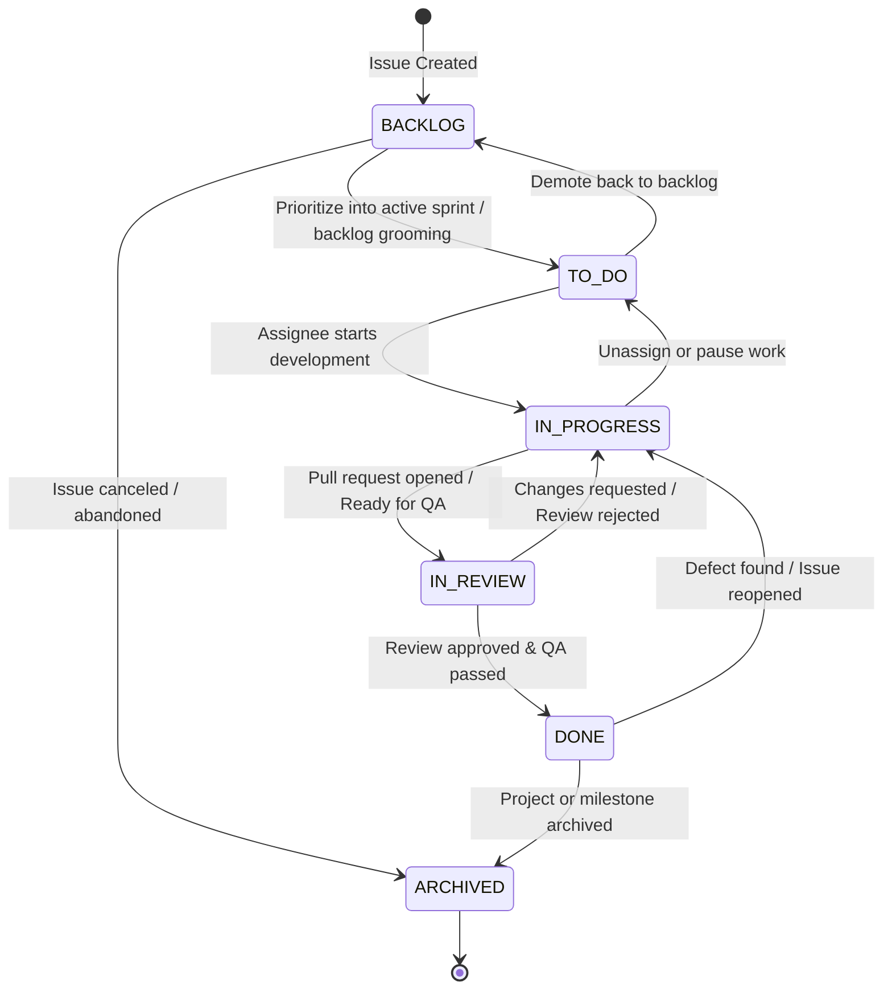

### 6.5 Comments and audit

Capabilities: - Add/edit/delete comments according to permissions. -
Display issue activity/history. - Record key changes such as assignment,
status, priority, due date, and membership changes.

Acceptance: - Comment edits and deletes follow a defined policy. - Audit
actor is derived from authenticated server context, not accepted from
the request body. - Audit records for a successful state change are
committed atomically with that change where required. - Audit history is
access-controlled and does not expose sensitive data.

### 6.6 Notifications

Initial version: - In-app notifications. - Assignment and mention
notifications where supported. - Mark read/unread. - Optional scheduled
deadline reminders after core features are stable.

Later reliability enhancement: - Persist an outbox event in the same
transaction as the domain update. - Background worker processes pending
events. - Retry transient failures with bounded exponential backoff and
jitter. - Track attempts and terminal failures. - Make handlers
idempotent and deduplicate delivery. - Keep delivery state observable.

Do not require Kafka for the initial implementation. A database-backed
outbox/worker can demonstrate the pattern without requiring another
service to deploy.

### 6.7 Attachments

Capabilities: - Upload/download files linked to an issue. - Enforce size
and allowed content type/extension policies. - Authorization on both
upload and download. - Store metadata in PostgreSQL and content in
local/object storage.

Acceptance: - Reject oversized uploads before fully buffering them in
memory. - Normalize/sanitize filenames; never use user-provided paths as
storage paths. - Generate opaque storage keys. - Validate content type
and, where feasible, inspect file signatures. - Prevent path traversal
and unauthorized downloads. - Handle a failed storage write without
leaving misleading metadata; handle failed metadata persistence without
orphaning files through compensation/cleanup. - Document local storage
limitations for multi-instance deployments.

#### Secure Attachment Processing Pipeline

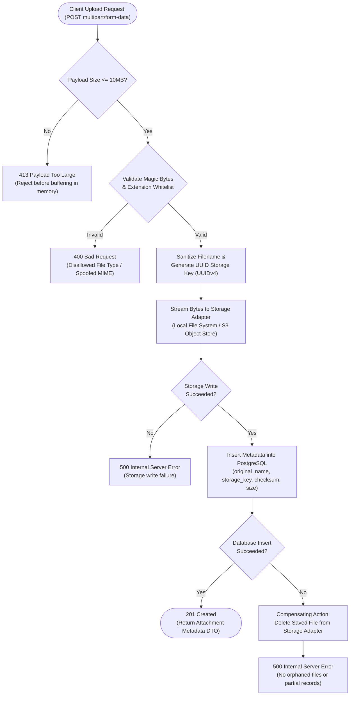

### 6.8 Development module (VCS & CI/CD Integration)

Inspired by Jira's Development section, the **Development Module**
connects project-management activities with software engineering work.
It tracks branches, commits, pull requests, builds, and deployments
associated with NexTrack issues without turning NexTrack into a source-code
host or a CI/CD pipeline execution engine.

#### 6.8.1 Repository integration

-   **Primary integration method (GitHub App):**
    -   Initial integration uses **GitHub Apps** as the primary integration
        method. Personal Access Tokens (PATs) are explicitly disallowed as
        the primary integration method due to lack of granular scope, absence
        of installation boundaries, and credential rotation liabilities.
    -   **Installation-based authentication:**
        -   Authentication is scoped to GitHub App installations on GitHub
            organizations or user accounts, mapped to NexTrack workspaces.
        -   NexTrack signs ephemeral RS256 JSON Web Tokens (JWT) using the
            GitHub App's private key (supporting both PKCS#1 and PKCS#8 formats,
            loaded from `NEXTRACK_INTEGRATIONS_GITHUB_APP_PRIVATE_KEY_BASE64`,
            `NEXTRACK_INTEGRATIONS_GITHUB_APP_PRIVATE_KEY_PATH`, or
            `NEXTRACK_INTEGRATIONS_GITHUB_APP_PRIVATE_KEY_PEM`) with a 10-minute maximum validity.
        -   The JWT is exchanged via GitHub API
            (`POST /app/installations/{installation_id}/access_tokens`) for
            short-lived installation access tokens (1-hour TTL).
        -   Installation access tokens are cached in-memory with proactive
            background refresh at 50 minutes (10 minutes before expiration),
            eliminating token generation latency, safely handling concurrent refreshes,
            and preventing plaintext token persistence in the database.
    -   **Granular repository permissions:**
        -   The GitHub App requests strictly minimal read-only permissions:
            `contents: read` (branches and commits), `pull_requests: read`
            (PR metadata and reviews), `statuses: read` & `checks: read`
            (CI/CD workflow runs), `deployments: read` (environments), and
            `metadata: read` (repository identity).
    -   **Repository cardinality & explicit project join entity:**
        -   When installing the GitHub App, organization owners grant repository
            access ("All repositories" or "Only select repositories").
        -   An installation owns discovered `ConnectedRepository` records with
            `UNIQUE(installation_id, external_repo_id)`. The `connected_repositories`
            table does NOT contain a `project_id` column.
        -   Projects associate with repositories via an explicit join entity and table:
            `project_connected_repositories` (`project_id`, `repository_id`,
            `connected_at`, `connected_by`).
        -   Within NexTrack, Workspace and Project Admins use a repository picker
            to associate granted repositories to specific NexTrack projects.
        -   This clean normalization allows a single external repository to be
            safely associated with multiple projects across a workspace without
            data duplication or orphaned links.
    -   **Spring Security & Webhook Filter Pipeline Configuration:**
        -   *Endpoint Security & Filter Ordering:* The ingestion endpoint `POST /api/v1/integrations/github/webhooks`
            is configured with `.permitAll()` in the Spring Security filter chain; it does not require
            or evaluate user JWT authentication. It is explicitly excluded from CSRF protection
            (`.csrf(csrf -> csrf.ignoringRequestMatchers("/api/v1/integrations/github/webhooks"))`) because
            external GitHub webhook dispatches cannot supply application CSRF tokens. Public accessibility
            does NOT mean unauthenticated webhook acceptance: strict machine-to-machine authentication is
            enforced via mandatory pre-parsing HMAC-SHA256 signature verification. Ordinary application
            endpoints (`/api/v1/projects/**`, `/api/v1/issues/**`, etc.) remain strictly guarded by JWT
            authentication and workspace/project RBAC.
        -   *Streaming Payload Size Limit (DoS Defense):* To prevent unbounded memory consumption from large
            or chunked HTTP streams, `WebhookSignatureFilter` enforces a configurable maximum request body size
            (`nextrack.integrations.github.webhook.max-body-bytes`, default: `2 MB` = `2,097,152 bytes`).
            Rather than relying solely on the client-supplied `Content-Length` header (which can be omitted or
            spoofed in HTTP/1.1 chunked transfer encoding), the filter streams incoming bytes through a bounded
            counting reader. If the payload exceeds 2 MB before EOF, reading terminates immediately and the filter
            returns `413 Payload Too Large` without writing to disk, allocating excess memory, parsing JSON, or
            creating inbox records.
        -   *Pre-Parsing Cryptographic Verification Sequence:* Standard Spring `ContentCachingRequestWrapper`
            only caches bytes *as they are read* downstream and does NOT provide raw bytes upfront before reading.
            Therefore, NexTrack implements a dedicated `WebhookSignatureFilter` that guarantees raw-byte
            availability before JSON parsing using this exact sequence:
            1. Intercept the incoming HTTP POST request at `/api/v1/integrations/github/webhooks`.
            2. Stream and preserve raw request bytes into memory up to the 2 MB limit; abort with `413 Payload Too Large` if exceeded.
            3. Retrieve the `X-Hub-Signature-256` header. If missing or malformed, immediately return `401 Unauthorized`.
            4. Calculate HMAC-SHA256 using the configured GitHub App webhook secret and the exact raw request bytes (`Mac.getInstance("HmacSHA256")`).
            5. Compare the calculated signature with the header using constant-time comparison (`MessageDigest.isEqual`).
            6. If invalid, immediately abort with `401 Unauthorized` before any JSON parsing or business processing.
            7. Only after successful cryptographic verification, wrap the request in a `CachedBodyHttpServletRequest` (an `HttpServletRequestWrapper` providing a replayable `ByteArrayInputStream(rawBytes)`) and forward to the controller.
            8. Downstream `WebhookInboxController` parses the verified JSON payload. If the JSON is malformed, return `400 Bad Request` (Problem Details) without creating an inbox record.
            9. Check delivery ID (`X-GitHub-Delivery`) deduplication against `webhook_inbox_events`. If duplicate, return `200 OK`. If fresh, persist the event with `status = 'PENDING'`.
            10. Return `202 Accepted` (engineering target: < 30ms p95 ingestion latency under documented test workloads) after durable persistence.
        -   *Strict prohibition:* The signature verifier must NEVER verify a
            re-serialized JSON object or reconstructed payload. Whitespace or key
            ordering variations in JSON would invalidate cryptographic signatures.
        -   Constant-time comparison (`MessageDigest.isEqual`) prevents timing attacks.
-   **Provider-independent SPI boundary:**
    -   All provider interactions are isolated behind the `DevelopmentProvider`
        SPI interface (in `domain/port/`).
    -   Enables adding future providers (**GitLab** via Group Webhooks &
        Project Access Tokens, **Bitbucket** via Atlassian Connect & App
        Passwords) without altering core domain entities, application
        services, or database schemas.
-   **Repository management capabilities:**
    -   Connect and disconnect external Git repositories to NexTrack projects.
    -   A project can connect multiple repositories; a repository can associate
        with multiple projects in the workspace via `project_connected_repositories`.
    -   Store repository metadata: provider, external repository ID, full name
        (`owner/repo`), HTML URL, default branch (`main`/`master`), and active status.
    -   Support manual incremental synchronization as well as real-time
        webhook-driven synchronization.
    -   Disconnecting a repository from a project removes the join record
        without deleting historical development artifacts or issue links.
    -   Uninstalling the GitHub App marks the installation and its repositories
        inactive (`is_active = false`), stops synchronization, and preserves
        historical records for audit and traceability integrity.

#### 6.8.2 Branch tracking

-   **Capabilities:**
    -   Track branch name, repository reference, source branch (where
        available from webhook or API), last commit SHA, creator, and web
        URL.
    -   **Automatic issue-key extraction:**
        -   Scans branch names using standard regex:
            `\b([A-Z][A-Z0-9]{1,9})-(\d+)\b`.
        -   Examples: `feature/NT-101-login-validation`, `bugfix/PROJ-42-fix-lock`.
    -   **Validation against existing issues:**
        -   Extracted issue keys are validated against existing issues within
            the connected repository's project.
        -   If matching issues exist: Creates association in
            `issue_development_branches` with `link_type = 'AUTO_EXTRACTED'`.
        -   If multiple valid keys are detected (e.g. `feature/NT-101-NT-102`),
            associates with all matched issues.
        -   If an extracted key does not exist or belongs to an unrelated
            project: The branch is persisted at the repository level without
            error; no invalid issue associations are forged.
    -   **Manual linking fallback:**
        -   Branches that do not follow naming conventions can be manually
            linked to issues by authorized users with `link_type = 'MANUAL'`.

#### 6.8.3 Commit tracking

-   **Capabilities:**
    -   Store commit SHA (full 40-char or 64-char hash), commit message,
        author name, author email, author avatar URL, web URL, and commit
        timestamp.
    -   **Automatic issue-key extraction:**
        -   Extracts issue keys from commit messages:
            - Example: `NT-101: Fix login validation`
            - Example: `Resolve NT-42 and NT-43: Add optimistic lock retry`
        -   Scans commit message text using regex `\b([A-Z][A-Z0-9]{1,9})-(\d+)\b`.
    -   **Validation against existing issues:**
        -   Matches extracted keys against issues in the connected project.
        -   Valid matches create records in `issue_development_commits` with
            `link_type = 'AUTO_EXTRACTED'`.
    -   **Commit deduplication:**
        -   Enforces a unique database constraint on `(repository_id, commit_sha)`
            to ensure idempotent upserts across multiple branch pushes or
            incremental syncs.
    -   **Repository-level storage:**
        -   Commits referencing no issue keys are stored at the repository level
            for commit history and audit visibility without raising errors.
    -   **Manual linking fallback:**
        -   Users can manually link repository commits to issues with
            `link_type = 'MANUAL'`.

#### 6.8.4 Pull request tracking

-   **Capabilities:**
    -   Associate pull requests with NexTrack issues.
    -   **Automatic issue-key extraction:**
        -   Scans PR titles, source branch names, and PR body descriptions for
            issue keys matching `\b([A-Z][A-Z0-9]{1,9})-(\d+)\b`.
    -   **Validation against existing issues:**
        -   Matches extracted keys against issues in the project. Valid
            matches link via `issue_pull_requests` with `link_type = 'AUTO_EXTRACTED'`.
    -   Store provider PR ID, PR number (e.g. `#42`), title, description,
        PR web URL, source branch, target branch, author name, author
        avatar URL, creation timestamp, update timestamp, and draft status.
    -   Track PR lifecycle status: `OPEN`, `MERGED`, `CLOSED`.
    -   Track review status: `PENDING`, `APPROVED`, `CHANGES_REQUESTED`.
    -   Track merge details: `merged_at` timestamp and `merged_by` user.
    -   Display linked commits belonging to the PR.
    -   Synchronize pull request lifecycle transitions in real-time via
        GitHub `pull_request` and `pull_request_review` webhooks.
    -   **Manual linking fallback:**
        -   Authorized users can manually link PRs to issues with
            `link_type = 'MANUAL'` if keys were omitted from title and body.

#### 6.8.5 Build tracking (CI/CD)

-   **Capabilities:**
    - Track continuous integration builds associated with repositories,
      commits, branches, and issues.
    - Store external build ID, build number, pipeline/workflow name
      (e.g. `CI / Build & Test`), commit SHA, branch name, started and
      completed timestamps, duration in seconds, and direct build URL.
    - Initial integration ingests GitHub Actions `workflow_run` and
      `check_run` webhook events.
    - Associated issues are linked via `issue_builds` through the commit
      SHA or branch name.
-   **Dual-field status mapping (GitHub Actions status + conclusion):**
    GitHub Actions reports execution status in two separate fields: `status`
    (the operational phase) and `conclusion` (the final verdict). NexTrack
    evaluates both fields to accurately derive `BuildStatus`:

    | GitHub `status` | GitHub `conclusion` | NexTrack `BuildStatus` | Operational Semantics |
    |---|---|---|---|
    | `queued` | *null / ignored* | `QUEUED` | Workflow run queued in GitHub Actions runner pool |
    | `in_progress` | *null / ignored* | `IN_PROGRESS` | Runner active, tests or build steps currently executing |
    | `completed` | `success` | `SUCCESS` | Pipeline finished with zero failed steps |
    | `completed` | `failure` | `FAILED` | One or more non-optional pipeline steps failed |
    | `completed` | `timed_out` | `FAILED` | Job exceeded timeout threshold |
    | `completed` | `cancelled` | `CANCELLED` | Manually aborted by team member or superseded by newer commit |
    | `completed` | `neutral` | `CANCELLED` | GitHub Actions neutral condition met (no action taken) |
    | `completed` | `skipped` | `CANCELLED` | Pipeline execution skipped by branch/path filters |
    | `completed` | `action_required` | `FAILED` | Blocked on required manual approval or billing failure |
    | `completed` | `stale` | `FAILED` | Workflow run abandoned or marked stale by provider |

-   **Architectural constraint:** NexTrack is an observer and consumer
    of build telemetry; it does not implement a pipeline runner or
    execution engine.

#### 6.8.6 Deployment tracking

-   **Capabilities:**
    - Track environment deployments associated with repositories,
      commits, and issues.
    - Store external deployment ID, environment (`DEVELOPMENT`,
      `STAGING`, `PRODUCTION`), commit SHA, deployment status (`QUEUED`,
      `IN_PROGRESS`, `SUCCESS`, `FAILED`, `CANCELLED`), deployment web
      URL, deployer identity, and started/completed timestamps.
    - Initial integration ingests GitHub `deployment_status` webhook
      events.
    - Associated issues are linked via `issue_deployments`.
-   **Architectural constraint:** NexTrack displays deployment visibility
    and release status; it does not orchestrate or trigger infrastructure
    deployments.

#### 6.8.7 Manual linking fallback

-   **Capabilities:**
    -   Provide explicit fallback capabilities when external development
        activities omit issue keys or use non-standard branch naming.
    -   Authorized project members can manually associate or disassociate
        branches, commits, pull requests, builds, or deployments with any
        issue in the project.
    -   Manual links are stored in the respective association tables with:
        - `link_type = 'MANUAL'`
        - `linked_by = <user_id>` (audit FK to users table)
        - `created_at = <timestamp>`
    -   Database unique constraints (e.g. `UNIQUE(issue_id, commit_id)`)
        prevent duplicate links regardless of whether created automatically
        or manually.
    -   Disassociating a link removes the relationship from the issue panel
        without altering or deleting the underlying repository record.
    -   Manual link actions are audited in `issue_history` for compliance.

#### 6.8.8 Webhook Inbox processing lifecycle & reliability

To guarantee reliable, fault-tolerant webhook processing under high volume,
network failures, and server restarts, the Development module implements the
**Webhook Inbox Pattern** backed by `webhook_inbox_events`:

1.  **Ingestion, Security & Verification:**
    - **Spring Security Configuration:** `POST /api/v1/integrations/github/webhooks` is explicitly configured as
      `permitAll()` (no user JWT required) and excluded from CSRF protection (`csrf.ignoringRequestMatchers(...)`).
      Pre-parsing HMAC-SHA256 signature verification provides strict machine-to-machine authentication.
    - **Streaming Body Size Limit (2 MB):** `WebhookSignatureFilter` streams incoming bytes through a bounded counting
      stream up to `nextrack.integrations.github.webhook.max-body-bytes` (default: 2 MB). If a request exceeds 2 MB
      (including chunked requests lacking `Content-Length`), stream reading aborts immediately and returns `413 Payload Too Large`.
      No excess memory is allocated, no JSON is parsed, and no inbox rows are created.
    - **Raw-Byte HMAC Verification:** The filter retrieves `X-Hub-Signature-256`. Missing or invalid signatures abort
      immediately with `401 Unauthorized` before JSON parsing. HMAC-SHA256 is computed directly over the exact raw byte stream
      using the configured secret and verified with `MessageDigest.isEqual`. Re-serializing parsed JSON is strictly forbidden.
    - **Replayable Request Wrapping:** Upon successful HMAC verification, the filter wraps the request in
      `CachedBodyHttpServletRequest`, providing a replayable `ByteArrayInputStream` for downstream Spring message converters.
    - **JSON Parsing & Ingestion Outcome Matrix:** The downstream `WebhookInboxController` parses the verified payload:

      | Situation | HTTP Status | Response Payload | Inbox Action |
      |---|---|---|---|
      | Missing HMAC Signature Header | `401 Unauthorized` | RFC 9457 Problem Details | Aborted immediately; no inbox row created |
      | Invalid HMAC Signature | `401 Unauthorized` | RFC 9457 Problem Details | Aborted immediately; no inbox row created |
      | Oversized Payload (> 2 MB) | `413 Payload Too Large` | RFC 9457 Problem Details | Stream aborted; no JSON parsed; no inbox row |
      | Valid Signature, Malformed JSON | `400 Bad Request` | RFC 9457 Problem Details | Deserialization error; no inbox row created |
      | Valid Signature, Duplicate Delivery ID | `200 OK` | `{"status": "DUPLICATE", "deliveryId": "..."}` | Deduplicated via `CONSTRAINT uq_webhook_provider_delivery UNIQUE (provider, delivery_id)`; no new row |
      | Valid Signature, Fresh Event | `202 Accepted` | `{"status": "QUEUED", "deliveryId": "..."}` | Atomic insert into `webhook_inbox_events` with `status = 'PENDING'` |

    - **Raw vs. JSONB Storage Boundary:** The verified JSON payload is stored in PostgreSQL as `payload jsonb`. PostgreSQL `jsonb`
      normalizes JSON (stripping insignificant whitespace, consolidating duplicate keys, and not preserving key order). This is
      optimal for NexTrack, enabling JSON path indexing and query execution without re-parsing raw bytes. Raw request bytes are not
      retained in a duplicate `bytea` column because signature verification is already completed synchronously at ingestion.
    - **Ingestion Latency Target:** Fresh events return `202 Accepted` (engineering target: < 30ms p95 ingestion latency under documented test workloads).

2.  **Worker Claiming & Leasing (Phase 1 — Short Claim Transaction):**
    - A dedicated background worker (`WebhookInboxWorker`) polls for claimable events every 500ms using row-level locking:
      ```sql
      SELECT id, payload, event_type, retry_count
      FROM webhook_inbox_events
      WHERE (status = 'PENDING' AND (next_retry_at IS NULL OR next_retry_at <= now()))
         OR (status = 'PROCESSING' AND processing_lease_expires_at < now())
      ORDER BY received_at ASC
      LIMIT 25
      FOR UPDATE SKIP LOCKED;
      ```
    - Claimed rows are immediately updated within the same short transaction:
      ```sql
      UPDATE webhook_inbox_events
      SET status = 'PROCESSING',
          processing_lease_expires_at = now() + INTERVAL '5 min',
          lease_owner_token = :workerToken
      WHERE id IN (:claimedIds);
      ```
    - The claim transaction is COMMITTED immediately before processing event payloads, releasing database locks on unaffected rows.

3.  **Execution & Idempotent Upsert (Phase 2 — Isolated Event Processing Transaction):**
    - Each claimed event executes in its own dedicated database transaction (`@Transactional`):
      - Deserializes the JSON payload from `payload jsonb`.
      - Scans for issue keys (`\b([A-Z][A-Z0-9]{1,9})-(\d+)\b`).
      - Resolves matching issues within projects connected to the repository via `project_connected_repositories`.
      - Performs idempotent upserts into development artifact tables (`development_branches`, `development_commits`, `pull_requests`, `builds`, `deployments`).
      - Inserts M:N association rows with `link_type = 'AUTO_EXTRACTED'` using `ON CONFLICT DO NOTHING`.
    - **Safe Lease Renewal:** If processing is expected to exceed the 5-minute lease (e.g. processing large commit batches), the worker safely renews its lease:
      ```sql
      UPDATE webhook_inbox_events
      SET processing_lease_expires_at = now() + INTERVAL '5 min'
      WHERE id = :id AND lease_owner_token = :workerToken;
      ```
    - **Lease Verification Before Commit:** Before committing domain writes, the worker verifies it still owns the lease and updates status atomically:
      ```sql
      UPDATE webhook_inbox_events
      SET status = 'PROCESSED',
          processed_at = now(),
          lease_owner_token = NULL,
          processing_lease_expires_at = NULL
      WHERE id = :id AND lease_owner_token = :workerToken;
      ```
      - If 0 rows are updated, the worker's lease expired and another worker acquired the event. The worker MUST abort and roll back its domain transaction, preventing stale workers from overwriting newer worker results or corrupting state.
      - If 1 row is updated, the domain writes and status update commit atomically.

4.  **Error Recovery & Dead-Letter Handling (Phase 3 — Failure Recovery Transaction):**
    - **Transient Failure:** If domain processing throws an exception, domain writes roll back. In a separate short transaction, the worker increments `retry_count`. If `retry_count < 5`, it computes exponential backoff with jitter (`min(3600, 2^retry_count * 10) + jitter`), sets `status = 'PENDING'`, `next_retry_at = now() + backoff_jitter`, and clears lease fields.
    - **Terminal Failure (Poison Pill Defense):** After 5 failed attempts, the worker marks `status = 'FAILED'`, writes diagnostic exception details to `error_message`, clears lease fields, and does not reschedule the event, preventing poison pills from blocking subsequent events.
    - **Stuck-Event Supervisor:** A scheduled supervisor job scans for events stuck in `PROCESSING` past their lease expiration and resets them to `PENDING` if their worker crashed.
    - **Operator Inspection & Replay:** Operators can inspect failed events and trigger re-processing via `POST /api/v1/integrations/github/webhooks/inbox/{eventId}/retry`.

#### 6.8.9 Acceptance criteria for Development module

1.  **GitHub App primary integration:** Integration uses GitHub App
    installation-based authentication. Ephemeral RS256 JWTs generate
    short-lived (1-hour) installation access tokens cached in-memory with
    proactive refresh at 50 minutes. Supports PKCS#1 and PKCS#8 private keys.
    Personal Access Tokens (PATs) are rejected as primary integration.
2.  **Repository-to-project normalization:** Connected repositories belong to
    an installation (`connected_repositories.installation_id`). Projects associate
    with repositories via the explicit join entity `project_connected_repositories`
    (`project_id`, `repository_id`). A single external repository can connect to
    multiple projects in the workspace.
3.  **Configurable project key & monotonic issue numbering:** Each project configures
    a unique uppercase project key matching `^[A-Z][A-Z0-9]{1,9}$` (unique per
    workspace). Issue numbers are generated monotonically per project using an
    atomic counter (`project_issue_counters`). Counter allocation and issue creation
    execute in the same database transaction; an abort rolls back both the issue and
    the counter increment, while post-commit deletion or archival never releases
    previously allocated numbers. `UNIQUE(project_id, issue_number)` guarantees
    zero duplicate issue numbers.
4.  **Automatic issue-key extraction & validation:** Automatically parse
    branch names, commit messages, and PR titles/bodies for keys matching
    `\b([A-Z][A-Z0-9]{1,9})-(\d+)\b`. Extracted keys must be validated
    against existing issues in the project. Valid matches create
    `AUTO_EXTRACTED` links; unlinked records are stored at repository level.
5.  **Manual linking fallback:** Users can manually link and unlink any
    repository branch, commit, PR, build, or deployment to any issue in the
    project with `link_type = 'MANUAL'`.
6.  **Secret protection:** Provider private keys and webhook secrets are
    encrypted at rest with AES-256-GCM. Unencrypted secrets are never
    returned in API responses or written to logs. Short-lived access tokens
    are cached in-memory and never persisted.
7.  **Webhook raw-byte authentication before JSON parsing:** Every incoming webhook
    must validate its HMAC-SHA256 signature (`X-Hub-Signature-256`) directly against
    the exact raw request bytes before JSON parsing using constant-time comparison.
    Because Spring's `ContentCachingRequestWrapper` does not cache bytes before they are read,
    NexTrack utilizes `WebhookSignatureFilter` to read raw bytes, verify HMAC, and wrap the
    request in `CachedBodyHttpServletRequest`. Re-serialized JSON verification is strictly
    prohibited. Missing or invalid signatures return `401 Unauthorized`.
8.  **Webhook Inbox reliability lifecycle:** Incoming webhooks are ingested
    into `webhook_inbox_events` with `status = 'PENDING'` (engineering target: < 30ms p95 ingestion latency).
    A background worker claims events using `SKIP LOCKED` and a 5-minute lease.
    Transient errors retry up to 5 times with exponential backoff and jitter.
    Terminal errors mark the event `FAILED` with diagnostic errors without
    halting worker throughput.
9.  **Repository selection:** Project admins can explicitly select which
    repositories granted to the GitHub App installation connect to the
    NexTrack project.
10. **Dual-field CI/CD status mapping:** Build status evaluates both GitHub
    Actions `status` and `conclusion` fields accurately.
11. **Workflow isolation:** External provider events must never bypass
    workflow transition rules. For example, a PR merge cannot force an
    issue from `TO_DO` to `DONE` unless a valid workflow transition rule
    explicitly permits that path and is executed through domain logic.
12. **Project authorization & tenant isolation:** All development
    endpoints verify that the requesting user has valid project and
    workspace membership. Users cannot inspect development records across
    unauthorized projects or workspaces.

------------------------------------------------------------------------

## 7. API conventions

Use `/api/v1` and consistent JSON request/response DTOs.

Example endpoints (the final plan may refine naming, but keep it
consistent):

``` text
POST   /api/v1/auth/register
POST   /api/v1/auth/login
POST   /api/v1/auth/logout
GET    /api/v1/me

GET    /api/v1/workspaces
POST   /api/v1/workspaces
GET    /api/v1/workspaces/{workspaceId}
GET    /api/v1/workspaces/{workspaceId}/members
POST   /api/v1/workspaces/{workspaceId}/members
DELETE /api/v1/workspaces/{workspaceId}/members/{userId}

GET    /api/v1/workspaces/{workspaceId}/integrations/github/app/install-url
POST   /api/v1/workspaces/{workspaceId}/integrations/github/app/installations
GET    /api/v1/workspaces/{workspaceId}/integrations/github/installations
GET    /api/v1/workspaces/{workspaceId}/integrations/github/installations/{installationId}/repositories
DELETE /api/v1/workspaces/{workspaceId}/integrations/github/installations/{installationId}

GET    /api/v1/workspaces/{workspaceId}/projects
POST   /api/v1/workspaces/{workspaceId}/projects
GET    /api/v1/projects/{projectId}
PATCH  /api/v1/projects/{projectId}
POST   /api/v1/projects/{projectId}/archive
GET    /api/v1/projects/{projectId}/members
POST   /api/v1/projects/{projectId}/members
DELETE /api/v1/projects/{projectId}/members/{userId}
GET    /api/v1/projects/{projectId}/workflow

GET    /api/v1/projects/{projectId}/issues
POST   /api/v1/projects/{projectId}/issues
GET    /api/v1/issues/{issueId}
PATCH  /api/v1/issues/{issueId}
POST   /api/v1/issues/{issueId}/transitions
GET    /api/v1/issues/{issueId}/history
GET    /api/v1/issues/{issueId}/comments
POST   /api/v1/issues/{issueId}/comments
PATCH  /api/v1/issues/{issueId}/comments/{commentId}
DELETE /api/v1/issues/{issueId}/comments/{commentId}
POST   /api/v1/issues/{issueId}/attachments
GET    /api/v1/attachments/{attachmentId}
DELETE /api/v1/attachments/{attachmentId}

GET    /api/v1/notifications
POST   /api/v1/notifications/{notificationId}/read

POST   /api/v1/projects/{projectId}/development/repositories
GET    /api/v1/projects/{projectId}/development/repositories
DELETE /api/v1/projects/{projectId}/development/repositories/{repositoryId}
POST   /api/v1/projects/{projectId}/development/repositories/{repositoryId}/sync

GET    /api/v1/projects/{projectId}/development/branches
GET    /api/v1/projects/{projectId}/development/commits
GET    /api/v1/projects/{projectId}/development/pull-requests
GET    /api/v1/projects/{projectId}/development/builds
GET    /api/v1/projects/{projectId}/development/deployments

GET    /api/v1/issues/{issueId}/development
POST   /api/v1/issues/{issueId}/development/links
DELETE /api/v1/issues/{issueId}/development/links/{linkType}/{targetId}

POST   /api/v1/integrations/github/webhooks
POST   /api/v1/integrations/github/webhooks/inbox/{eventId}/retry
```

### API behavior

-   **Workspace-scoped project listing:** `GET /api/v1/workspaces/{workspaceId}/projects`
    returns only projects within the specified workspace that the authenticated user is
    authorized to access. There is no global un-scoped project listing endpoint.
-   **Membership inheritance and validation:** `POST /api/v1/projects/{projectId}/issues`
    validates that the assigned user (`assigneeId`) possesses active membership in the
    project (either explicitly in `project_members` or via workspace role inheritance).
    Assigning users outside the project returns `400 Bad Request`.
-   **Workflow status retrieval:** `GET /api/v1/projects/{projectId}/workflow` returns
    the active statuses (`BACKLOG`, `TO_DO`, `IN_PROGRESS`, `IN_REVIEW`, `DONE`, `ARCHIVED`)
    and the permitted transition graph for UI rendering.
-   **Secure attachment download:** `GET /api/v1/attachments/{attachmentId}` verifies
    that the requesting user has read access to the parent project before streaming the
    file bytes from the storage adapter. Files are returned with appropriate `Content-Disposition`,
    `Content-Type`, and cache control headers. `DELETE /api/v1/attachments/{attachmentId}`
    removes the file from storage and its database record atomically.
-   **Project key validation:** `POST /api/v1/workspaces/{workspaceId}/projects`
    accepts a user-configurable uppercase `key` (matching `^[A-Z][A-Z0-9]{1,9}$`).
    The key is validated for uniqueness within the workspace; duplicate keys within
    the same workspace return `409 Conflict` via `CONSTRAINT uq_projects_workspace_project_key UNIQUE (workspace_id, project_key)`.
-   **Monotonically increasing issue numbers:** `POST /api/v1/projects/{projectId}/issues`
    atomically increments and retrieves the project's next sequential integer
    via `project_issue_counters` (`UPDATE ... RETURNING`). The returned payload includes
    the human-readable issue key (e.g. `NT-101`), `issueNumber` (e.g. `101`), and `projectKey` (e.g. `NT`).
    Counter allocation and issue creation occur within the same database transaction;
    a transaction rollback rolls back both operations, restoring the counter so no gap
    is created by the rollback. Committed issues that are subsequently deleted or archived
    never release their numbers for reuse. Database constraints enforce `UNIQUE(project_id, issue_number)`.
    The system guarantees unique, monotonically increasing issue numbers; gapless numbering is not promised.
-   **Repository connection to project:** `POST /api/v1/projects/{projectId}/development/repositories`
    associates a repository owned by the workspace's GitHub App installation with the project
    by inserting a row into `project_connected_repositories`. `DELETE .../{repositoryId}`
    removes the association without deleting historical development records.
-   **Manual development linking:** `POST /api/v1/issues/{issueId}/development/links`
    accepts `{ "targetType": "BRANCH"|"COMMIT"|"PULL_REQUEST"|"BUILD"|"DEPLOYMENT", "targetId": "<UUID>" }`.
    The endpoint validates that both the issue and target entity exist within the
    project scope. Links created manually store `link_type = 'MANUAL'` and the
    authenticated user's ID as `linked_by`. Existing links return `409 Conflict`.
-   **Manual link removal:** `DELETE /api/v1/issues/{issueId}/development/links/{linkType}/{targetId}`
    removes the association row without deleting the underlying external record.
-   **Webhook raw-byte ingestion before JSON parsing:** `POST /api/v1/integrations/github/webhooks`
    is permitted in Spring Security (`permitAll()`, no JWT required) and excluded from CSRF protection.
    `WebhookSignatureFilter` streams incoming request bytes up to a configurable maximum size (default: 2 MB),
    rejecting oversized payloads with `413 Payload Too Large`. It verifies the `X-Hub-Signature-256` HMAC-SHA256
    signature using constant-time comparison before any JSON parsing, rejecting missing or invalid signatures
    with `401 Unauthorized`. If valid, it wraps the request in `CachedBodyHttpServletRequest`. Downstream controller
    parses JSON (returning `400 Bad Request` if malformed JSON without writing to the inbox), checks provider delivery ID
    (`X-GitHub-Delivery`) deduplication against `webhook_inbox_events` (returning `200 OK` if duplicate),
    persists fresh events with `status = 'PENDING'`, and returns `202 Accepted` (engineering target: < 30ms p95 ingestion latency under documented test workloads).
-   **Dead-letter inbox event replay:** `POST /api/v1/integrations/github/webhooks/inbox/{eventId}/retry`
    allows authorized administrators to reset a `FAILED` webhook inbox event back to `PENDING`
    for immediate re-evaluation.
-   Use `201 Created` for successful resource creation, including a
    `Location` header where useful.
-   Use `200 OK` for successful reads/updates returning content and
    `204 No Content` for successful operations with no response body
    where appropriate.
-   Use `400 Bad Request` for malformed requests or validation failures.
-   Use `401 Unauthorized` for unauthenticated requests or invalid webhook HMAC signatures.
-   Use `403 Forbidden` for authenticated users lacking permission; use
    `404 Not Found` instead where hiding resource existence is part of
    the security policy.
-   Use `404 Not Found` for missing resources.
-   Use `409 Conflict` for optimistic-lock conflicts, duplicate business
    keys, duplicate project keys, and idempotency-key payload conflicts.
-   Use `413 Payload Too Large` for oversized uploads.
-   Use `429 Too Many Requests` when rate limiting is configured.
-   Use `500` only for unexpected server errors, without leaking stack
    traces.

Return a consistent Problem Details-style error body, for example:

``` json
{
  "type": "about:blank",
  "title": "Conflict",
  "status": 409,
  "detail": "This issue was updated by another user. Reload it and retry.",
  "instance": "/api/v1/issues/123",
  "code": "ISSUE_VERSION_CONFLICT",
  "traceId": "correlation-id"
}
```

Do not expose SQL, stack traces, secrets, or sensitive entity details in
errors.

For list endpoints: - Support bounded `page` and `size` or a documented
cursor model. - Set a reasonable maximum page size, such as 100. -
Validate sort fields against an allowlist; never concatenate arbitrary
client sort input into SQL. - Document filter semantics and stable
sorting. - Return pagination metadata without expensive unbounded count
queries where possible.

------------------------------------------------------------------------

## 8. Security requirements

Security is a core project feature, not a polish item.

-   Enforce authorization in the backend for every protected resource
    and operation.
-   Validate the user's workspace/project membership for nested
    resources.
-   Prevent IDOR/BOLA (insecure direct object reference / broken
    object-level authorization).
-   Apply least-privilege roles.
-   Validate all input on the server.
-   Use secure password hashing.
-   Configure CORS narrowly for the actual frontend origin.
-   If cookies are used for authentication, apply Secure, HttpOnly,
    appropriate SameSite settings, and CSRF protection as required.
-   If bearer tokens are used, define expiration, refresh,
    logout/revocation, and storage strategy.
-   Rate-limit sensitive operations such as login and registration if
    practical.
-   Do not log passwords, authorization headers, access tokens, reset
    tokens, or full sensitive payloads.
-   Protect file upload and download routes.
-   Use environment variables/secrets for credentials.
-   Use safe defaults for production configuration and disable debug
    stack traces.
-   Add security tests for cross-workspace and cross-project access.
-   **GitHub App private key protection:** The GitHub App RSA private key
    (supporting both PKCS#1 and PKCS#8 formats) is never stored in the database
    or committed to source control. It is parsed using BouncyCastle / Java Security
    `KeyFactory` and loaded securely from runtime configuration:
    `NEXTRACK_INTEGRATIONS_GITHUB_APP_PRIVATE_KEY_BASE64`,
    `NEXTRACK_INTEGRATIONS_GITHUB_APP_PRIVATE_KEY_PATH`, or
    `NEXTRACK_INTEGRATIONS_GITHUB_APP_PRIVATE_KEY_PEM`. Ephemeral RS256
    JWTs generated for installation authentication have a maximum 10-minute validity.
-   **Short-lived installation tokens:** Installation access tokens expire in
    1 hour, are cached strictly in memory with proactive eviction and refresh at
    50 minutes (safeguarded against concurrent refresh stampedes via internal locking),
    and are never persisted to database tables, disk, or logs. Personal Access
    Tokens (PATs) are explicitly disallowed as primary integration credentials.
-   **Encrypted webhook secrets:** All webhook secrets are encrypted at rest
    using AES-256-GCM before persistence in `integration_installations`.
    The master encryption key is supplied via `ENCRYPTION_MASTER_KEY` and never hardcoded.
-   **Spring Security & Webhook Filter Pipeline Configuration:** The webhook ingestion endpoint
    `POST /api/v1/integrations/github/webhooks` is explicitly configured with `permitAll()` in the Spring
    Security filter chain (no user JWT authentication required or evaluated) and excluded from CSRF protection
    (`.csrf(csrf -> csrf.ignoringRequestMatchers("/api/v1/integrations/github/webhooks"))`) because external GitHub
    webhook dispatches cannot supply application CSRF tokens. Public accessibility does NOT mean unauthenticated:
    mandatory machine-to-machine authentication is enforced via HMAC-SHA256 signature verification prior to JSON
    deserialization or controller execution. Ordinary application endpoints remain strictly guarded by JWT authentication
    and workspace/project RBAC.
-   **Webhook request body size limit & streaming DoS defense:** To prevent unbounded memory consumption,
    `WebhookSignatureFilter` streams incoming bytes through a bounded counting reader up to `nextrack.integrations.github.webhook.max-body-bytes`
    (default: `2 MB` = `2,097,152 bytes`). Bounded stream enforcement applies to standard as well as HTTP/1.1 chunked
    requests lacking `Content-Length`. Oversized requests (> 2 MB) immediately abort reading and return `413 Payload Too Large`
    without allocating excess memory, parsing JSON, or creating database records.
-   **Raw-byte webhook signature verification before JSON parsing:** GitHub webhook requests
    must be cryptographically verified using `X-Hub-Signature-256` HMAC-SHA256 over the
    exact raw request payload bytes before any JSON parsing occurs. Because Spring's
    `ContentCachingRequestWrapper` only caches bytes as they are read downstream and does
    not provide raw bytes upfront before reading, `WebhookSignatureFilter` reads the body
    via a bounded stream up to 2 MB once into memory, performs the HMAC calculation, compares using
    constant-time equality (`MessageDigest.isEqual`), rejects invalid or missing signatures
    immediately with `401 Unauthorized`, and wraps the request in `CachedBodyHttpServletRequest`
    for downstream processing. Re-serializing JSON for signature verification is strictly
    forbidden to prevent discrepancies from whitespace, formatting, or key reordering.
-   **Webhook replay protection:** Record provider delivery identifiers
    (`X-GitHub-Delivery`) in `webhook_inbox_events` with composite unique
    constraints (`CONSTRAINT uq_webhook_provider_delivery UNIQUE (provider, delivery_id)`)
    to prevent replay attacks and duplicate processing. `delivery_id` is not globally unique;
    uniqueness is strictly scoped to the combination of provider and delivery ID.
-   **Assignee project membership enforcement:** Assigning an issue verifies that
    the assignee is an active member of the issue's project, established either via
    `project_members` or inherited from workspace-level administrative roles
    (`WORKSPACE_OWNER`, `WORKSPACE_ADMIN`). Cross-tenant or unauthorized assignment
    is rejected with `400 Bad Request`.
-   **Attachment download authorization & path traversal defense:** Downloading an
    attachment verifies the user's project read permissions before streaming bytes.
    Storage keys are strictly opaque UUIDv4 identifiers generated server-side;
    user-supplied filenames are sanitized and stored solely as metadata.
-   **Project key validation & workspace isolation:** Project keys must conform
    to `^[A-Z][A-Z0-9]{1,9}$` and are enforced unique per workspace via
    `CONSTRAINT uq_projects_workspace_project_key UNIQUE (workspace_id, project_key)`. Project keys
    are strictly scoped to the workspace and are not globally unique. Issue-key parsing and manual
    linking strictly scope queries within the project and workspace boundary.
-   **Development RBAC boundaries:** Connecting, disconnecting, or
    initiating synchronization on a repository requires Project Admin
    privileges. Viewing development records requires verified project
    membership.
-   **Secret redaction:** Mask all external provider access tokens,
    OAuth client secrets, private keys, and webhook secrets in application logs,
    error responses, and OpenAPI schemas.
-   **Workflow transition defense:** External webhooks cannot
    arbitrarily mutate issue status. Any automated transition (such as
    auto-resolving an issue upon PR merge) must be explicitly configured
    and validated against domain transition rules (`IssueStatusTransitionRule`).

------------------------------------------------------------------------

## 9. Edge cases and failure handling

Implement these as explicit tests, not just documentation.

  ---------------------------------------------------------------------------
  Area                    Scenario                 Expected behavior
  ----------------------- ------------------------ --------------------------
  Authentication          Invalid password or      Generic failure; no
                          unknown account          account enumeration

  Authentication          Disabled user or expired Reject access
                          session/token            

  Authorization           User changes an ID in    Deny access or return
                          the URL                  policy-appropriate 404

  Authorization           User loses project       Subsequent protected
                          membership               operations are denied

  Authorization           User assigns issue to a  Reject with
                          member outside the       validation/permission
                          project                  error

  Input                   Missing title, malformed Clear 400 response
                          ID, invalid enum         

  Input                   Excessively long         Reject before persistence
                          title/comment or invalid 
                          story points             

  Project                 Duplicate project key    Database uniqueness constraint
                          under concurrent         `UNIQUE(workspace_id, project_key)`
                          requests                 guarantees one winner within workspace (409)

  Issue creation          Two requests generate    Atomic row counter increment
                          same issue number        (`project_issue_counters` `UPDATE ... RETURNING`);
                                                   `UNIQUE(project_id, issue_number)`
                                                   prevents duplicates

  Issue creation          Transaction rollback     Counter allocation and issue insert share
                          after counter allocate   the same transaction; rollback restores
                                                   last_issue_number; no gap created

  Issue creation          Issue deleted after      Allocated number remains consumed;
                          successful commit        number is never reused; gap persists
                                                   in active issue sequence by design

  Concurrency             Two users update same    Optimistic lock detects
                          issue version            stale update; return 409

  Concurrency             Status update races with Enforce a consistent state
                          archive                  transition and reject
                                                   stale operation

  Workflow                Illegal transition       Reject; no state or audit
                          attempted directly       partial write; fixed v1 FSM
                          through API              enforces valid paths only

  Transactions            Exception after updating Roll back both if they
                          issue but before audit   must be atomic
                          write                    

  Idempotency             Client retries after     Return the prior result or
                          timeout                  a documented safe
                                                   response; no duplicate
                                                   logical creation

  Idempotency             Same key with a          Reject with conflict
                          different payload        

  Idempotency             Same key requests arrive Unique
                          concurrently             constraint/transactional
                                                   coordination prevents
                                                   duplicate execution

  Database                Unique or foreign-key    Map to safe domain/API
                          constraint violation     error, not raw SQL error

  Database                Deadlock/serialization   Bounded retry only when
                          failure                  safe; otherwise return
                                                   retriable error

  Database                Connection pool          Timeouts, observable
                          exhausted                error, graceful failure;
                                                   do not hang indefinitely

  Querying                Page size is zero,       Validate and enforce
                          negative, or enormous    maximum size

  Querying                User sorts by an         Reject or use documented
                          unsupported field        safe default

  Querying                Project has tens of      Bounded query and
                          thousands of issues      response; no full-table
                                                   serialization

  ORM                     Board causes N+1 selects Query-count/integration
                                                   checks and DTO
                                                   projection/fetch plan

  Cache (if added)        Redis unavailable or     Correctness preserved;
                          stale                    fallback or explicit
                                                   degraded behavior

  Notifications           Provider/worker          Persist pending work,
                          unavailable              retry safely, expose
                                                   failures

  Notifications           Same event delivered     Idempotent
                          twice                    handler/deduplication
                                                   prevents duplicate
                                                   user-visible effect

  Jobs                    Scheduler runs on two    Coordination or
                          instances                idempotency prevents
                                                   harmful duplicate work

  Jobs                    Job crashes halfway      Resume/retry safely;
                          through batch            completed work is not
                                                   corrupted

  Dates                   Deadline viewed across   Store instants
                          time zones               consistently; render in
                                                   user's timezone

  Attachments             File is too large or     Reject with a clear error;
                          type is disallowed       do not leave partial
                                                   metadata

  Attachments             Filename contains `../`  Safe generated storage
                          or unusual characters    key; no path traversal

  Attachments             Storage succeeds but DB  Compensation/cleanup and
                          write fails (or vice     observable failure
                          versa)                   

  Bulk action             Some IDs are invalid or  Explicit all-or-nothing or
                          unauthorized             per-item semantics; never
                                                   silently modify
                                                   unauthorized records

  Archive                 Project contains issues  Apply documented
                          and comments             archive/retention policy
                                                   without orphaning records

  Development             GitHub App uninstalled   Mark integration as SUSPENDED;
                          or revoked on GitHub     disable repository sync; surface
                                                   clear alert in settings; preserve
                                                   historical development records

  Development             Installation token       Token cache proactively refreshes
                          expired or expiring      at 50 min; if 401 received, evicts
                                                   cached token and re-authenticates

  Development             Duplicate repository     UNIQUE(project_id, repository_id)
                          connection to project    in project_connected_repositories
                                                   prevents duplicate join; returns 409

  Development             Duplicate commit SHA     UNIQUE(repository_id, sha)
                          received across branches ensures idempotent upsert;
                                                   no duplicate records

  Development             Webhook payload exceeds  Reject with 413 Payload Too Large;
                          body limit (> 2 MB)      streaming reader terminates immediately;
                                                   no JSON parsed, no DB record created

  Development             Webhook signature        Reject with 401 Unauthorized;
                          HMAC verification fails  verified against raw request bytes
                          or header is missing     before JSON parsing; payload is
                                                   never deserialized by Jackson

  Development             Valid webhook signature  Reject with 400 Bad Request;
                          but malformed JSON       RFC 9457 Problem Details returned;
                                                   no inbox record created

  Development             Duplicate webhook        CONSTRAINT uq_webhook_provider_delivery
                          delivery from GitHub     UNIQUE (provider, delivery_id) in
                                                   webhook_inbox_events detects duplicate;
                                                   return 200 immediately

  Development             Webhook worker crash     Lease (5 min) expires; supervisor
                          during processing        or subsequent poll with SKIP LOCKED
                                                   reclaims event safely

  Development             Webhook worker lease     Worker verifies lease_owner_token before
                          expires during work      committing domain tx; detect 0 rows updated,
                                                   rolls back domain writes to prevent stale overwrite

  Development             Poison pill webhook      After 5 retries, worker marks status
                          payload throws exception FAILED, stores diagnostic error, and
                                                   continues unblocked; admin replays via API

  Development             Stuck webhook event past Supervisor scheduled task detects
                          lease expiration         processing_lease_expires_at < now(),
                                                   resets to PENDING for retry

  Development             Out-of-order webhook     Compare provider updated_at
                          events (e.g. PR merged   timestamps; do not overwrite
                          before PR opened)        newer state with older payload

  Development             GitHub API rate limit    Read X-RateLimit-Reset; apply
                          (403/429) encountered    exponential backoff + jitter;
                                                   surface rate-limit UI notice

  Development             External Git provider    Bounded retry with jitter;
                          downtime or timeout      serve persisted DB records;
                                                   gracefully degrade

  Development             Extracted issue key not  Persist record at repo level;
                          found in project         skip missing issue link without
                          failing transaction; manual link fallback

  Development             Extracted key matches    Create M:N associations for
                          multiple issue keys      every valid matching issue
                          (e.g. NT-101 and NT-102) within the project boundary

  Development             Manual link duplicate    UNIQUE(issue_id, target_id)
                          attempt                  detects duplicate; return 409
                                                   Conflict ('Already linked')

  Development             Manual link target does  Validate existence in connected
                          not exist or is outside  repositories; return 404 Not Found
                          project scope            with clear error message

  Development             Repository disconnected  Set is_active=false; stop
                          or deleted on provider   webhooks; preserve historical
                          issue links and audit data

  Observability           Unexpected exception     Correlation ID and safe
                                                   structured log; no secret
                                                   leakage

  Frontend                Network timeout during   Preserve user input; show
                          save                     retryable error and avoid
                                                   blind duplicate writes

  Frontend                Two requests complete    Avoid stale response
                          out of order             overwriting newer UI state

  Frontend                Empty/loading/error      Provide useful UI
                          states                   feedback, not a blank
                                                   screen

  Deployment              App starts before DB is  Health/readiness checks
                          ready                    and retry/compose
                                                   dependency strategy

  Deployment              Migration fails          Fail startup/deployment
                                                   clearly; don't run with an
                                                   unknown schema

  Deployment              Missing required         Fail fast with a safe
                          secret/config            diagnostic
  ---------------------------------------------------------------------------

### Idempotency design notes

Do not implement idempotency using an in-memory map. For selected
endpoints: - Accept an `Idempotency-Key`. - Scope the key to the
authenticated actor and operation. - Store key, request fingerprint,
status, and response/result reference in PostgreSQL. - Add a unique
constraint for the chosen scope. - Define behavior for in-progress
requests, payload mismatch, retries, and expiration. - Keep the
operation and idempotency record consistent transactionally where
possible. - Do not apply this mechanism to every endpoint without
reason.

#### Idempotent Request Execution Pipeline

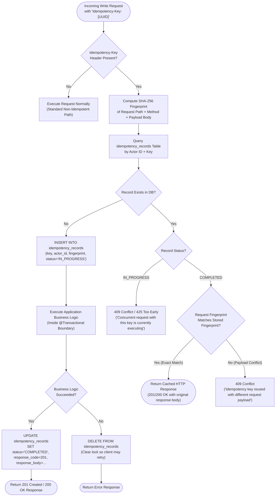

### Optimistic locking notes

Use a JPA `@Version` column on mutable entities where concurrent edits
are plausible. Make sure the API and frontend expose and submit the
version or otherwise enforce the concurrency policy. Catch optimistic
locking failures and map them to `409 Conflict`. Test with concurrent
transactions against PostgreSQL; sequential unit tests are insufficient.

#### Optimistic Locking & Version Conflict Sequence

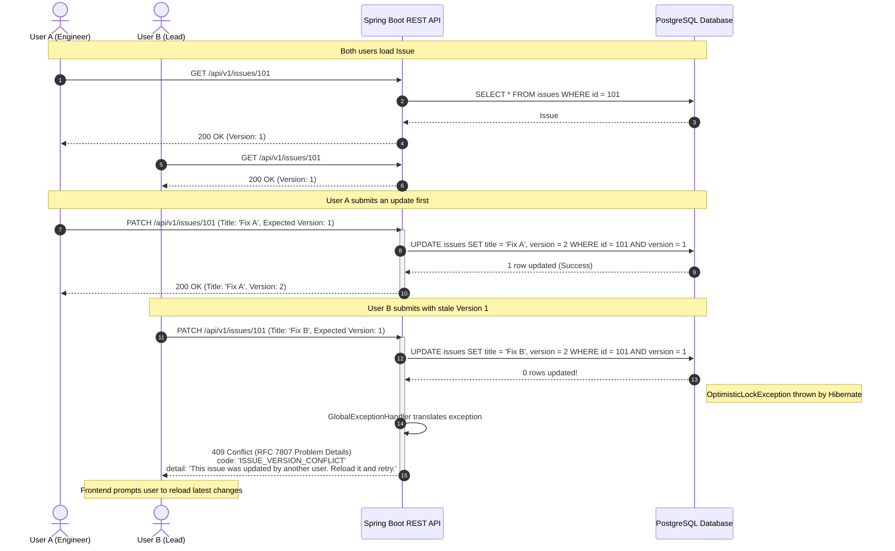

------------------------------------------------------------------------

## 10. Performance bottlenecks and planned mitigations

### 10.1 Kanban board / issue listing

Potential bottlenecks: - Loading every issue in a project. - Returning
large descriptions/comments/attachments in board cards. - N+1 ORM
queries. - Expensive total-count queries. - Sorting/filtering on
unindexed fields. - Repeated client requests and stale UI state.

Mitigations: - Use board-specific DTO projections with only card
fields. - Keep comments and attachment lists out of board-card
responses. - Add bounded pagination or status-based board queries. - Use
deterministic sorting and indexes aligned with real filters. - Debounce
text search. - Cache only where measured and safe. - Avoid fetching full
entity graphs for list views.

### 10.2 Database and ORM

Potential bottlenecks: - Missing or redundant indexes. - N+1 selects. -
Long transactions. - Oversized connection pool. - Large offset
pagination at deep pages. - Unbounded bulk operations. - Lock contention
on issue-number allocation.

Mitigations: - Inspect slow queries and use PostgreSQL
`EXPLAIN (ANALYZE, BUFFERS)` in a safe test environment. - Measure query
count and latency. - Add indexes based on workload, not guesswork. - Use
DTO projections and carefully chosen fetch strategies. - Keep
transactions short and avoid network calls inside DB transactions. -
Configure connection pool sizes and timeouts deliberately. - Consider
cursor/keyset pagination if deep-page performance becomes a demonstrated
problem. - Choose a concurrency-safe issue-number allocation strategy
and benchmark it if needed.

Candidate indexes to validate against the final schema and query plan:

``` sql
CREATE INDEX idx_issue_project_status_updated
    ON issues (project_id, status, updated_at DESC);

CREATE INDEX idx_issue_project_assignee
    ON issues (project_id, assignee_id);

CREATE INDEX idx_issue_project_due_date
    ON issues (project_id, due_date)
    WHERE due_date IS NOT NULL;

CREATE INDEX idx_comment_issue_created
    ON comments (issue_id, created_at DESC);

CREATE INDEX idx_dev_commit_repo_sha
    ON development_commits (repository_id, commit_sha);

CREATE INDEX idx_dev_commit_repo_committed
    ON development_commits (repository_id, committed_at DESC);

CREATE INDEX idx_dev_branch_repo_name
    ON development_branches (repository_id, name);

CREATE INDEX idx_dev_pr_repo_number
    ON pull_requests (repository_id, pr_number);

CREATE INDEX idx_dev_pr_repo_status
    ON pull_requests (repository_id, status);

CREATE INDEX idx_dev_build_repo_status
    ON builds (repository_id, status);

CREATE INDEX idx_dev_deploy_repo_env
    ON deployments (repository_id, environment);

CREATE INDEX idx_issue_commits_lookup
    ON issue_development_commits (issue_id, commit_id);

CREATE INDEX idx_issue_prs_lookup
    ON issue_pull_requests (issue_id, pull_request_id);

CREATE INDEX idx_project_connected_repo_repo
    ON project_connected_repositories (repository_id);

CREATE INDEX idx_webhook_inbox_pending
    ON webhook_inbox_events (status, received_at)
    WHERE status = 'PENDING';

CREATE INDEX idx_webhook_inbox_lease
    ON webhook_inbox_events (status, processing_lease_expires_at)
    WHERE status = 'PROCESSING';

CREATE INDEX idx_outbox_events_pending
    ON outbox_events (status, next_retry_at)
    WHERE status = 'PENDING';
```

These are examples, not a command to create every index blindly. Confirm
table/column names, workload, selectivity, and query plans first.
Indexes consume storage and add write overhead.

### 10.3 Frontend performance

Potential bottlenecks: - Re-rendering every board card after one issue
changes. - Fetching on every keystroke. - Huge DOM trees. - Repeated
requests for the same data. - Unhandled race conditions between
requests.

Mitigations: - Use query caching/invalidation. - Debounce search. - Keep
board DTOs small. - Use stable component props and memoization only
where profiling warrants it. - Consider virtualization if issue counts
make DOM size a measured problem. - Cancel or ignore stale requests and
handle out-of-order responses. - Provide optimistic UI only when
rollback and conflict handling are implemented.

### 10.4 Background processing

Potential bottlenecks: - Sending emails synchronously inside a user
request. - Retrying forever. - Two app instances running the same
scheduled job. - A single poison event blocking a queue.

Mitigations: - Move slow side effects to background processing. -
Persist pending events when reliable delivery is required. - Use bounded
exponential backoff with jitter. - Record attempts and terminal
failures. - Make jobs restartable and idempotent. - Keep batch sizes
bounded. - Add a dead-letter/failed-work review mechanism if complexity
warrants it.

### 10.5 How to demonstrate performance credibly

Seed realistic test data, including a project with at least tens of
thousands of issues. Use k6 or another repeatable load tool. Record: -
Dataset size and environment. - Request rate and concurrency. - p50,
p95, p99 latency. - Throughput and error rate. - Query count and
slow-query plans. - CPU/memory when available. - Before/after changes
and test conditions.

Do not hardcode performance claims in documentation until tests have
been run. Results are environment-specific and must be reproducible.

All numerical latency figures specified in this architecture document (e.g.
webhook ingestion under 30ms, atomic counter increment under 1ms, issue-to-code
traceability queries under 50ms) are **engineering targets**, not guaranteed
PostgreSQL or hardware performance characteristics. They must be empirically
measured and documented using repeatable load-testing tools (such as k6) under
specified hardware configurations, PostgreSQL connection pools, dataset sizes,
concurrency levels, and percentiles (p50, p95, p99). No numerical target may be
presented as an achieved result prior to benchmarking.

### 10.6 Development activity and webhook synchronization

Potential bottlenecks:
- High-volume Git commit histories: Full repository synchronization
  clogging database connections and memory buffers.
- Synchronous webhook blocking: Long-running webhook requests hitting
  provider HTTP timeouts (e.g. GitHub 10-second timeout) and exhausting
  backend thread pools.
- Issue-to-development N+1 lookups: Fetching branches, commits, PRs,
  builds, and deployments in separate sequential queries when loading the
  issue detail view.
- Rapid bursts of webhook events: Pushes containing hundreds of commits
  saturating write locks.

Mitigations:
- **Incremental synchronization:** Never perform an unbounded commit
  walk or clone a repository to disk. Use GitHub REST API queries with
  the `since` timestamp parameter and bounded pagination (`per_page=100`,
  capped at 5 pages per sync run).
- **Asynchronous ingestion queue:** Incoming webhooks perform bounded streaming size
  checks (max 2 MB), raw-byte HMAC verification, and persist the verified event payload into
  `webhook_inbox_events` with an engineering target of < 30ms p95 ingestion latency under
  documented test workloads. All parsing, issue-key resolution, and relational linking occur
  asynchronously in the background worker.
- **Consolidated DTO projections:** The issue development panel is
  backed by a single consolidated query or parallel projections returning
  `IssueDevelopmentSummaryDto` (counts + top 5 recent items per category)
  rather than loading unindexed entity graphs.
- **Installation token in-memory caching:** Generating RS256 JWTs and
  exchanging them with GitHub for installation tokens on every API call
  introduces ~200-400ms network round-trip overhead. Caching installation
  access tokens in-memory with a 50-minute TTL (tokens expire in 60 minutes)
  eliminates token negotiation latency for almost all webhook processing
  and manual sync calls.
- **Atomic issue counter concurrency:** Sequential issue numbering uses
  `UPDATE project_issue_counters SET last_issue_number = last_issue_number + 1 WHERE project_id = ? RETURNING last_issue_number`.
  This atomic row-level increment targets < 1ms p95 latency on PostgreSQL under documented
  concurrent workloads, avoiding table locks or sequence contention across different projects,
  subject to empirical verification.
- **Partial index on pending webhooks:**
  `CREATE INDEX idx_webhook_inbox_pending ON webhook_inbox_events (status, received_at) WHERE status = 'PENDING';`
  ensures the background polling query avoids full-table scans.

------------------------------------------------------------------------

## 11. Transactional consistency and event handling

NexTrack strictly separates incoming external telemetry from outgoing
system events using two complementary patterns:
1. **Webhook Inbox Pattern** (`webhook_inbox_events`): Ingests untrusted,
   high-volume external Git provider webhooks asynchronously with lease-based
   locking, deduplication, retry backoff, and poison pill isolation.
2. **Transactional Outbox Pattern** (`outbox_events`): Guarantees at-least-once
   delivery of NexTrack-generated domain events (such as issue assignments, mentions,
   and status changes) to asynchronous consumers (in-app notifications, audit logs)
   without dual-write vulnerability.

### 11.1 Webhook Inbox Pattern (Incoming Provider Events)

-   **Zero network calls within DB transactions:** When communicating
    with external Git provider APIs (e.g. GitHub REST queries or webhook
    registration), network calls must be executed strictly outside any
    Spring `@Transactional` boundary. This prevents external latency or
    network timeouts from exhausting the PostgreSQL connection pool.
-   **Bounded webhook ingestion:** `WebhookSignatureFilter` streams incoming request bytes
    up to a configurable maximum size (default: 2 MB), aborting oversized payloads with `413 Payload Too Large`.
    It reads raw request bytes into memory once, verifies the `X-Hub-Signature-256` HMAC signature using
    constant-time equality before any JSON parsing, and rejects invalid requests with 401. Valid requests
    are wrapped in `CachedBodyHttpServletRequest` for downstream parsing. Downstream controller parses JSON
    (rejecting malformed JSON with 400 Bad Request), verifies delivery ID (`X-GitHub-Delivery`) deduplication
    (returning 200 OK for duplicates), executes a short atomic insert into `webhook_inbox_events` (`status = 'PENDING'`),
    and immediately returns `202 Accepted` to GitHub (engineering target: < 30ms p95 ingestion latency under documented test workloads).
-   **Worker Claiming & Leasing (Phase 1 — Short Claim Transaction):** The background worker claims
    pending or expired-lease events using row-level locking:
    ```sql
    SELECT id, payload, event_type, retry_count
    FROM webhook_inbox_events
    WHERE (status = 'PENDING' AND (next_retry_at IS NULL OR next_retry_at <= now()))
       OR (status = 'PROCESSING' AND processing_lease_expires_at < now())
    ORDER BY received_at ASC
    LIMIT 25
    FOR UPDATE SKIP LOCKED;
    ```
    Claimed events are updated in the same short transaction with a unique lease token:
    ```sql
    UPDATE webhook_inbox_events
    SET status = 'PROCESSING',
        processing_lease_expires_at = now() + INTERVAL '5 min',
        lease_owner_token = :workerToken
    WHERE id IN (:claimedIds);
    ```
    The claim transaction is COMMITTED immediately before processing event payloads.
-   **Idempotent Worker Processing (Phase 2 — Isolated Event Processing Transaction):** For each claimed event,
    an isolated `@Transactional` boundary executes:
    1.  Deserializes payload from `payload jsonb` and extracts issue keys via compiled regex.
    2.  Resolves existing project issues across repositories connected via `project_connected_repositories`.
    3.  Performs idempotent upserts into `development_commits`, `development_branches`, `pull_requests`, `builds`, or `deployments`.
    4.  Inserts association rows into `issue_development_*` (using `ON CONFLICT DO NOTHING`).
    5.  **Lease Verification Before Commit:** Updates the event record atomically:
        ```sql
        UPDATE webhook_inbox_events
        SET status = 'PROCESSED',
            processed_at = now(),
            lease_owner_token = NULL,
            processing_lease_expires_at = NULL
        WHERE id = :id AND lease_owner_token = :workerToken;
        ```
        If 0 rows are updated, the worker's lease expired and was claimed by another worker. The current worker
        rolls back its domain transaction and aborts, preventing stale workers from overwriting newer worker results.
        If 1 row is updated, domain writes and status update commit atomically.
-   **Transient Failure & Exponential Backoff (Phase 3 — Failure Recovery Transaction):** If domain processing throws
    an exception, domain writes roll back. In an independent short transaction, the worker increments `retry_count`.
    If `retry_count < 5`, it computes an exponential backoff delay with jitter (`min(3600, 2^retry_count * 10) + jitter`),
    sets `status = 'PENDING'`, `next_retry_at = now() + backoff_jitter`, and clears lease fields.
-   **Poison Pill Isolation:** If an event encounters an unrecoverable payload error or exceeds 5 retries, the worker
    marks `status = 'FAILED'`, writes diagnostic stack traces to `error_message`, clears lease fields, and does not
    reschedule the event, preventing poison pills from blocking subsequent events.
-   **Stuck-event supervisor:** A periodic supervisor task scans for events stuck
    in `PROCESSING` past lease expiration and resets them to `PENDING`.
-   **Operator replay:** Failed inbox events can be inspected and manually replayed
    via `POST /api/v1/integrations/github/webhooks/inbox/{eventId}/retry`.

### 11.2 Transactional Outbox Pattern (Outgoing Domain Events)

For ordinary issue updates, keep the issue update and its audit record
in one database transaction when the audit event is required for
correctness.

If a notification must eventually be delivered reliably:
1. Update the issue and insert an outbox record into `outbox_events` in the
   same PostgreSQL transaction.
2. A background worker claims pending records via `FOR UPDATE SKIP LOCKED`.
3. It performs delivery/publication outside the original transaction.
4. It marks success (`status = 'PROCESSED'`) or records a retryable/terminal failure.
5. Consumers/delivery handlers use stable event IDs to deduplicate.

Be explicit about the delivery guarantee: retries imply **at-least-once delivery**,
so handlers must be idempotent. Universal exactly-once delivery is impossible.

#### Transactional Outbox Pattern Sequence

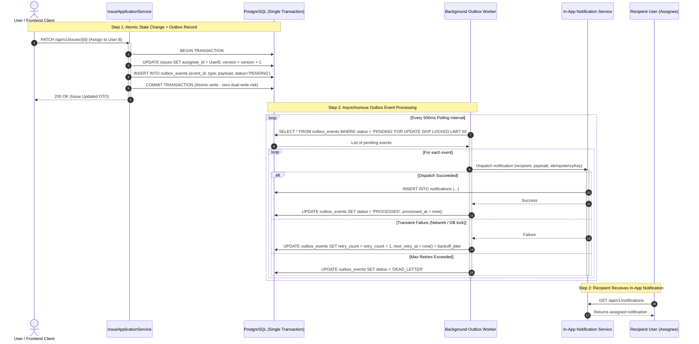

### 11.3 Concurrency-safe atomic sequential issue numbering pattern

-   **Problem:** In Jira-like systems, issues are numbered sequentially per
    project (e.g. `NT-1`, `NT-2`, `NT-3`). Generating sequential numbers using
    PostgreSQL `SERIAL` or global sequences creates gaps, lacks project
    partitioning, and leaks cross-project volume. Selecting `MAX(issue_number) + 1`
    creates race conditions and duplicate key exceptions under concurrent issue
    creation.
-   **Transactional solution:** A dedicated `project_issue_counters` table
    maintains `(project_id, last_issue_number)`. Each project has its own isolated
    counter initialized to `(project_id, 0)` upon project creation.
-   **Atomic allocation query:** When an issue is created inside `@Transactional`:
    ```sql
    UPDATE project_issue_counters
    SET last_issue_number = last_issue_number + 1
    WHERE project_id = :projectId
    RETURNING last_issue_number;
    ```
-   **Concurrency control:** PostgreSQL acquires an exclusive row-level `FOR UPDATE`
    write lock on that project's single counter row only for the microseconds required
    to increment and return the integer. Concurrent transactions for the same project
    serialize briefly and receive monotonically increasing numbers without race conditions.
    Issue creations for different projects run completely concurrently without lock contention.
-   **Transactional boundaries & rollback semantics:**
    Counter allocation and issue insertion execute inside the same database transaction
    (`@Transactional`). Because both operations share the same database connection and
    transaction context:
    - *Transaction rollback:* If the issue creation transaction aborts or encounters an
      unhandled exception before committing, PostgreSQL rolls back the entire transaction.
      The counter increment is rolled back along with the uncommitted issue insert,
      restoring `last_issue_number` to its pre-transaction value. Thus, an ordinary
      transaction rollback does NOT introduce a numbering gap.
    - *Post-commit deletions and archival:* Once an issue creation transaction successfully
      commits, the allocated issue number is permanently consumed. If that issue is
      subsequently deleted or archived, its number is never recycled or reallocated. This
      guarantees immutable audit history and prevents historical Git commit messages,
      branch names, and pull request references from associating with unrelated future issues.
    - *Uniqueness guarantee:* The database enforces `UNIQUE(project_id, issue_number)`,
      guaranteeing zero duplicate issue numbers under any concurrency level.
    - *Monotonic vs. gapless distinction:* NexTrack guarantees unique, monotonically
      increasing issue numbers. Gapless numbering is explicitly not promised, as gaps
      occur whenever committed issues are deleted, archived, or skipped during data migration.

------------------------------------------------------------------------

## 12. Testing strategy

### Test Architecture & Reliability Pyramid

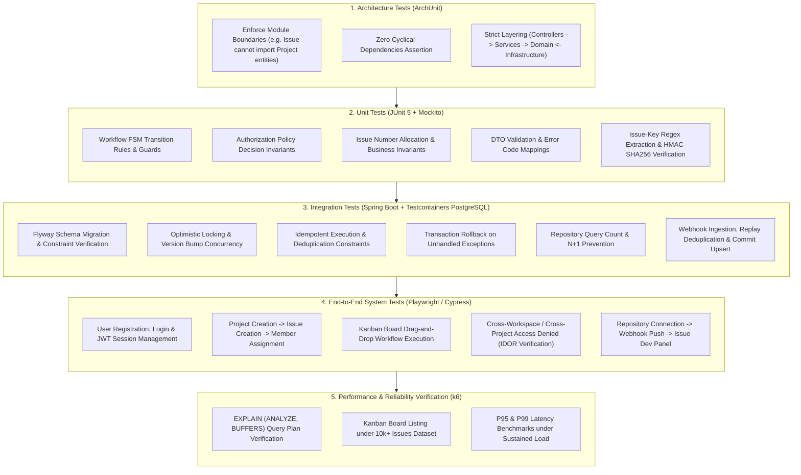

### Unit tests

Test domain rules and application services:
- Workflow transition validity against fixed FSM (`IssueStatusTransitionRule`).
- Assignment eligibility (active project membership check, workspace role inheritance).
- Permission policy decisions across workspace and project roles.
- Validation and issue state rules.
- Idempotency behavior where it can be isolated.
- **GitHub App authentication:** Assert RS256 JWT generation with valid
  claims (issuer, expiration <= 10 min) and PKCS#1 and PKCS#8 private key signing.
- **Raw-byte webhook HMAC verification (Filter & Validator unit tests):**
  1. *Valid signature:* Asserts valid HMAC-SHA256 signature against exact raw bytes passes verification.
  2. *Invalid signature:* Asserts mismatched signature header returns `401 Unauthorized`.
  3. *Missing signature header:* Asserts request lacking `X-Hub-Signature-256` is rejected immediately with `401 Unauthorized`.
  4. *Modified payload bytes:* Asserts modifying even a single byte in the request payload invalidates signature and returns `401 Unauthorized`.
  5. *JSON formatting/whitespace sensitivity:* Demonstrates why raw-byte verification is essential: pretty-printed vs. compact JSON payloads with identical semantic content fail if signature is evaluated against re-serialized JSON, but succeed when validated against the exact raw request bytes.
  6. *Empty or malformed payload:* Asserts empty or malformed byte arrays are handled safely without unhandled exceptions and rejected with 401.
  7. *Pre-parsing verification guard:* Asserts signature verification occurs strictly before Jackson JSON parsing; unauthenticated requests with malformed JSON return `401 Unauthorized` without throwing deserialization exceptions.
  8. *Raw-byte preservation for downstream consumers:* Asserts `CachedBodyHttpServletRequest` wraps the verified raw bytes, allowing Jackson message converters and controllers downstream to replay and parse the exact same byte stream.
- **Issue-key regex extraction:** Assert that `\b([A-Z][A-Z0-9]{1,9})-(\d+)\b`
  correctly matches patterns across commit messages (`NT-101: fix bug`,
  `fixes PROJ-42, ENG-99`), branch names (`feature/NT-101-auth`), and PR
  titles/descriptions, while ignoring false positives (e.g. lowercase,
  excessively long keys).
- **Dual-field build status mapping:** Assert correct `BuildStatus` mapping for
  all combinations of GitHub Actions `status` and `conclusion`.
- **Project key validator:** Assert `^[A-Z][A-Z0-9]{1,9}$` rejects lowercase
  letters, special characters, and keys longer than 10 characters.

Use mocks sparingly and focus on observable behavior.

### Integration tests

Use Spring Boot Test and Testcontainers with real PostgreSQL for:
- JPA mappings and constraints.
- Flyway migrations.
- Transaction rollback.
- Optimistic locking (`@Version`).
- **Issue numbering transaction & rollback semantics (Testcontainers PostgreSQL):**
  1. *Concurrent creation within same project:* 50 concurrent worker threads creating issues in the same project; asserts serialized atomic row increments on `project_issue_counters`, creating strictly monotonic, unique issue numbers (`1` through `50`) with zero duplicate key exceptions.
  2. *Concurrent creation across different projects:* Concurrent threads creating issues in Project A and Project B execute in parallel without lock contention or cross-project counter interference.
  3. *Transaction rollback after counter allocation:* Simulates an unhandled exception thrown after counter increment (`UPDATE ... RETURNING`) but before transaction commit; asserts database transaction rolls back, `last_issue_number` is restored to its pre-transaction value, and the subsequent issue creation receives the restored number (verifying no numbering gap is created by an aborted transaction).
  4. *Successful atomic commit:* Asserts counter increment and issue row insertion commit atomically in the same transaction.
  5. *Post-commit deletion gap persistence:* Creates and commits an issue (e.g. `NT-5`), then deletes or archives it; asserts subsequent issue creation receives `NT-6` (verifying deleted issue numbers are never reused and gaps in active sequences persist by design).
  6. *Unique constraint enforcement:* Directly verifies `UNIQUE(project_id, issue_number)` rejects duplicate insertions, preventing data corruption under any concurrency race.
- **Repository connection and project join:** Assert that GitHub App installations
  correctly expose accessible repositories and persist explicit project associations
  via `project_connected_repositories`. Verify multi-project repository sharing.
- **Webhook Inbox claiming & leasing:** Verify worker claims events using
  `SKIP LOCKED`, enforces 5-minute lease, and supervisor resets expired leases.
- **Webhook poison pill retry threshold:** Inject failing webhook event; assert
  retries up to 5 times with backoff, transitions to `FAILED`, and allows manual replay.
- **Webhook raw-byte HMAC verification & deduplication:** Verify that requests with
  valid `X-Hub-Signature-256` are accepted, invalid signatures return 401,
  and repeated deliveries of identical `X-GitHub-Delivery` return 200 without
  duplicate DB inserts.
- **Issue linking lifecycle:** Push commits and PRs containing `NT-101`;
  verify association rows are persisted with `link_type = 'AUTO_EXTRACTED'`.
- **Manual linking API:** Call manual link endpoints; verify associations are
  persisted with `link_type = 'MANUAL'` and subsequent duplicate link attempts
  return `409 Conflict`.
- **Attachment streaming & authorization:** Verify authorized users can download
  attachment binary streams; assert unauthenticated/cross-project requests return 403/404.
- **Assignee validation:** Verify assigning an issue to an ineligible user fails
  with `400 Bad Request`.
- Repository queries and pagination.
- Authorization at the HTTP/service boundary.

Do not rely on H2 to validate PostgreSQL-specific behavior.

### Frontend tests

Test: - Loading, empty, success, and error states. - Form validation. -
Protected routes as UX behavior. - API error handling. - Board drag/drop
transitions and conflict response. - Preserving unsaved edits after
network errors.

### End-to-end tests

At minimum: 1. Register/login or use a safe demo account. 2. Create
workspace and project. 3. Create issue and assign a project member. 4.
Move issue through a valid workflow. 5. Attempt an invalid transition.
6. Verify a user outside the project cannot read/update the issue. 7.
Add comment and verify history. 8. Archive project and verify defined
behavior.

### Architecture tests

Use ArchUnit or Spring Modulith where useful to assert: - Module
dependency direction. - No cycles between business modules. - Modules do
not reach into another module's persistence internals. - Shared code
does not become a dumping ground for business logic.

### Reliability test matrix

  -----------------------------------------------------------------------
  Test                                Expected result
  ----------------------------------- -----------------------------------
  Two concurrent edits with same      One succeeds; stale edit gets
  version                             conflict

  Duplicate POST with same            One logical resource/result
  idempotency key                     

  Same key with different request     Conflict
  payload                             

  Force failure between domain update Transaction rolls back
  and audit insert                    

  Cross-project access attempt        Denied

  Database unavailable                Readiness unhealthy; request fails
                                      safely

  Notification delivery fails         Retry without duplicate effect
  temporarily                         

  Large issue dataset                 Bounded response and measured
                                      latency

  Webhook delivered twice with same   First processes; duplicate returns 200
  delivery ID                         without duplicate database records

  Forged, invalid, or missing webhook Rejected with 401 Unauthorized;
  signature against raw bytes         zero state changes; rejected before JSON parsing

  JSON payload formatted with extra   Signature verified against raw bytes
  whitespace or line breaks           succeeds; re-serialization avoided

  Webhook worker crash during lease   Lease expires after 5 min; supervisor
                                      or next poll reclaims via SKIP LOCKED

  Poison pill webhook payload         Retries 5 times with backoff, marked
                                      FAILED; does not block subsequent events

  Out-of-order webhook events (PR     Merged state persists based on
  closed before PR opened)            event timestamps; no regression

  GitHub API returns 429 rate limit   Backoff with jitter and retry;
                                      graceful degradation in UI

  Commit references multiple project  Associates all valid issues; ignores
  issue keys (NT-101 and NT-102)      invalid keys safely

  Concurrent issue creation under     Monotonically increasing issue numbers
  50 parallel threads                 allocated atomically without duplicates

  Transaction rollback after issue    Counter increment rolls back with issue;
  counter increment                   last_issue_number restored; zero gap

  Committed issue deleted or          Allocated issue number remains consumed;
  archived                            never reused; gap persists in sequence

  Assign issue to ineligible user     Rejected with 400 Bad Request;
  outside project boundary            zero assignment state changes

  Manual link to already linked       Rejected with 409 Conflict;
  development artifact                zero duplicate association rows

  GitHub App installation access      Proactively refreshed at 50 min via
  token expires during long sync      RS256 JWT without worker interruption

  Cross-project repository access     Denied with 403 Forbidden

  Invalid migration/schema            Deployment fails visibly and safely
  -----------------------------------------------------------------------

------------------------------------------------------------------------

## 13. UI/UX scope

Build a professional, consistent interface, not just a set of forms.

### Required screens

-   Login/register.
-   Workspace selector and workspace overview.
-   Workspace members and role management (`/workspaces/:id/members`).
-   Project list and project settings.
-   Project members and assignment modal (`/projects/:id/settings/members`).
-   Project board (Kanban) with columns bound to fixed `IssueStatus` enum.
-   Issue detail view or drawer (with attachment download/delete actions).
-   Create/edit issue form (with validated assignee selection).
-   Search/filter view.
-   Notifications center.
-   Basic activity/history view.
-   Project-level Development view (`/projects/:id/development`).
-   Issue detail Development panel / tab.
-   Repository connection & settings modal.

### Development UI/UX

#### Project Creation & Settings
-   **Configurable Project Key:** The Project creation dialog provides an
    uppercase `Key` field (e.g. `NT`, `PROJ`, `CORE`). Enforces regex
    `^[A-Z][A-Z0-9]{1,9}$`, displays a live preview badge (e.g. `NT-1`,
    `NT-2`), and performs asynchronous uniqueness validation against the
    active workspace.

#### Project-level Development view (`/projects/:id/development`)
-   **Connected Repositories overview:** Displays all repositories
    linked to the project via `project_connected_repositories` with sync status
    indicators (`CONNECTED`, `SYNCING`, `AUTH_ERROR`, `DISCONNECTED`).
-   **Connect Repository modal:** Guides authorized Project Admins
    through GitHub App installation authorization. Displays a repository
    picker showing repositories granted to the installation for granular
    selection and connection to the project.
-   **Cross-repository activity tabs:** Filterable tabs for
    **Branches**, **Commits**, **Pull Requests**, **Builds**, and
    **Deployments**, with pagination and issue-key search.

#### Issue-level Development panel
-   **Sidebar / Tab integration:** Embedded directly within the Issue
    Detail view or drawer, providing engineers and managers instant
    code context.
-   **Traceability tags (`Auto` vs `Manual`):** Each branch, commit, PR,
    build, and deployment renders a subtle badge indicating its link origin:
    - `Auto`: Extracted automatically from commit message, branch name, or PR body.
    - `Manual`: Linked manually by a team member (hover tooltip shows
      `Linked by @alice on Oct 24`).
-   **Manual Linking Modal / Action:** A "+ Link" action button opens a
    modal allowing users to search and link repository commits (by SHA or
    message), pull requests (by number or title), or branches. Allows
    unlinking with confirmation.
-   **Branches subsection:** Lists active branches with branch name,
    source branch, last commit SHA, and a one-click copy command
    (`git checkout -b feature/NT-101-...`).
-   **Commits subsection:** Shows related commits, author avatars,
    short SHAs linking to GitHub, and commit timestamps.
-   **Pull Requests subsection:** Displays PR number, title, source and
    target branches, author, review status (`APPROVED`,
    `CHANGES_REQUESTED`), and prominent status pills:
    - `OPEN` (Linear purple / blue)
    - `MERGED` (Emerald green)
    - `CLOSED` (Slate gray / red)
-   **Builds subsection:** Shows CI/CD status (GitHub Actions workflow
    runs) with pass/fail iconography and execution duration.
-   **Deployments subsection:** Displays deployment environment chips
    (`DEVELOPMENT`, `STAGING`, `PRODUCTION`), deployment status, and
    timestamp.

#### UI state specifications
-   **Empty state (Connected repo, zero matches):** Display helpful
    developer onboarding: *"No branches or commits linked to this issue
    yet. Include the issue key `NT-101` in your branch name or commit
    message, or click '+ Link' to link existing activity manually."*
-   **Disconnected state (No repos connected to project):** Display a
    clear call to action: *"No Git repositories connected. Connect a
    repository to track branches, commits, PRs, and builds."* (With a
    *Connect Repository* button for admins).
-   **Loading state:** Fluid shimmer skeleton cards matching the Linear
    dual-theme layout.
-   **Error state:** User-friendly alert banner with a *Retry* button;
    development panel failures must not break or block rendering of the
    parent issue.
-   **Zero hardcoded mock data:** Production views must strictly consume
    TanStack Query hooks backed by `/api/v1/issues/{issueId}/development`.

### Board behavior

-   Columns are bound to the standardized `IssueStatus` enum (`BACKLOG`,
    `TO_DO`, `IN_PROGRESS`, `IN_REVIEW`, `DONE`, `ARCHIVED`). Dynamic workflow
    customization schemes are postponed to Phase 12+.
-   Drag/drop requests a server-side transition (`POST /api/v1/issues/{id}/transitions`);
    the client optimistically moves the card but must reconcile with server response.
-   If a transition fails (invalid FSM transition or `@Version` conflict), revert
    the card back to its previous column and display a helpful toast notification.
-   Display useful loading, empty, and error states.
-   Avoid loading comments/attachments for every card (use lightweight board DTO).
-   Keyboard-accessible actions and clear focus behavior are expected.

#### Board Drag-and-Drop & Optimistic UI Reversion Sequence

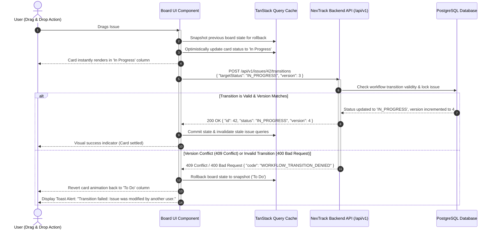

### UX quality requirements

-   Responsive enough for desktop and tablet.
-   Consistent spacing, typography, buttons, dialogs, and error states.
-   Confirmation for destructive/archive actions.
-   Unsaved-change protection where appropriate.
-   Form validation messages associated with fields.
-   No dead buttons or fake functionality presented as complete.

------------------------------------------------------------------------

## 14. Deployment and operations

### Local development

Use Docker Compose for PostgreSQL and optionally the backend. Frontend
can run with the development server. Document one-command startup where
practical.

Expected local flow: 1. Copy `.env.example` to `.env`. 2. Set
development-only secrets. 3. Start PostgreSQL with Docker Compose. 4.
Start backend; Flyway applies migrations. 5. Start frontend. 6. Load
seed data using a development-only command.

Never commit `.env` or production secrets. Seed accounts and passwords
must be development-only and clearly documented.

### Container/deployment requirements

-   Multi-stage Docker build where appropriate.
-   Run the container as a non-root user.
-   Keep images reasonably small.
-   Expose health/readiness endpoints safely.
-   Configure database connection/timeouts and graceful shutdown.
-   Use separate local/test/production profiles without committing
    secrets.
-   Run migrations as a controlled startup/deployment step and fail
    clearly if migration fails.
-   Provide a health check that does not leak internal details.
-   Keep frontend and backend origins/CORS configuration explicit.
-   Configure logs to stdout/stderr for container platforms.
-   Document persistent storage requirements for local attachments.
-   **Integration configuration & secrets (GitHub App):**
    - `NEXTRACK_INTEGRATIONS_GITHUB_APP_ID`: GitHub App ID (numeric integer).
    - `NEXTRACK_INTEGRATIONS_GITHUB_APP_PRIVATE_KEY_BASE64` or
      `NEXTRACK_INTEGRATIONS_GITHUB_APP_PRIVATE_KEY_PATH` or
      `NEXTRACK_INTEGRATIONS_GITHUB_APP_PRIVATE_KEY_PEM`: GitHub App RSA
      private key (supporting both PKCS#1 and PKCS#8 formats) used exclusively
      by the backend to sign ephemeral RS256 JWT tokens for installation token exchange.
    - `NEXTRACK_INTEGRATIONS_GITHUB_APP_CLIENT_ID` / `CLIENT_SECRET`: GitHub
      App client credentials used for user authorization and installation redirect.
    - `NEXTRACK_INTEGRATIONS_GITHUB_WEBHOOK_SECRET`: Webhook secret configured
      on the GitHub App for validating incoming `X-Hub-Signature-256` HMAC signatures
      directly against raw bytes.
    - `NEXTRACK_SECURITY_ENCRYPTION_MASTER_KEY`: 256-bit AES master key
      (Base64-encoded) used for envelope encryption of stored webhook secrets and
      sensitive integration records in PostgreSQL.
    - *Note:* Personal Access Tokens are not required or used for primary integration.
    - For local development with webhooks, use a tunnel adapter
      (e.g. ngrok or Cloudflare Tunnel) forwarding to
      `http://localhost:8080/api/v1/integrations/github/webhooks`.
    - Operations & Replay: Dead-letter webhook inbox events can be inspected via
      database queries on `webhook_inbox_events` and retried via
      `POST /api/v1/integrations/github/webhooks/inbox/{eventId}/retry`.
-   Backups and restore instructions for PostgreSQL should be documented
    for a real deployment.

### CI pipeline

1.  Checkout.
2.  Set up pinned Java and Node versions.
3.  Run backend formatting/static checks if configured.
4.  Run backend unit and integration tests.
5.  Run frontend lint/typecheck/tests.
6.  Build backend and frontend.
7.  Optionally build the Docker image.
8.  Publish/deploy only from intended branches/environments.

#### Continuous Integration & Quality Gate Pipeline

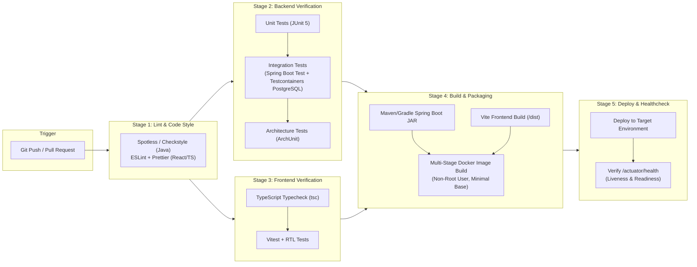

------------------------------------------------------------------------

## 15. Phased implementation plan

Do not implement all features in one giant change. Keep the application
runnable after every phase.

### Phased Implementation Roadmap

```mermaid
flowchart TD
    P0["<b>Phase 0: Repository Inspection & Architectural Design</b><br/>• Inspect repo & confirm modular layout<br/>• Document Architecture Decision Records (ADRs)<br/>• Define first vertical slice"]

    P1["<b>Phase 1: Skeleton & Developer Experience</b><br/>• Spring Boot 3 + React/TS/Vite bootstrap<br/>• Docker Compose for PostgreSQL<br/>• Flyway migration setup & RFC 7807 error format<br/>• CI build pipeline"]

    P2["<b>Phase 2: Identity, Workspace & Project Management</b><br/>• Authentication, password hashing & JWT/Cookie session<br/>• Workspace multi-tenancy & membership RBAC<br/>• Project CRUD, project keys & authorization guards"]

    P3["<b>Phase 3: Core Issue Workflow & Kanban Board</b><br/>• Issue CRUD, monotonic numbering & project-scoped IDs<br/>• Fixed Workflow FSM & transition rules<br/>• React Kanban board with drag-and-drop<br/>• Comments, watchers & audit log atomicity"]

    P4["<b>Phase 4: Quality, Concurrency & Hardening</b><br/>• Optimistic locking (@Version) & 409 Conflict handling<br/>• Idempotent writes with Idempotency-Key support<br/>• Testcontainers integration suite & reliability matrix<br/>• Attachment upload, MIME validation & storage adapter"]

    P5["<b>Phase 5: Performance & Observability</b><br/>• Board-specific DTO projections (eliminate N+1 queries)<br/>• Composite indexing & EXPLAIN ANALYZE verification<br/>• k6 load testing on 10,000+ issues dataset<br/>• Structured logging with traceId/correlationId"]

    P6["<b>Phase 6: Notifications & Transactional Outbox</b><br/>• In-app notifications & unread badge<br/>• Transactional Outbox pattern with background worker<br/>• Exponential backoff, jitter & dead-letter tracking"]

    P7["<b>Phase 7: Production Readiness & Release</b><br/>• Multi-stage Docker image & non-root user execution<br/>• End-to-end user journey tests<br/>• Seed demo data script & interactive walkthrough<br/>• Final architectural documentation & resume evidence"]

    P8["<b>Phase 8: Development Module & GitHub App Integration</b><br/>• IntegrationInstallation, ConnectedRepository & ProjectConnectedRepository<br/>• GitHub App PKCS#1/PKCS#8 keys & 50-min cached tokens<br/>• Repository selection picker & raw-byte HMAC filter<br/>• Webhook Inbox queue with 5-min lease & recovery"]

    P9["<b>Phase 9: Branch, Commit, PR Tracking & Manual Linking</b><br/>• Regex key extraction (NT-101) & validation<br/>• Monotonic issue numbering & project key uniqueness<br/>• Manual linking fallback modal with link_type<br/>• Issue Detail Development panel & Project Development view"]

    P10["<b>Phase 10: CI/CD Build & Deployment Tracking</b><br/>• GitHub Actions workflow runs & build status ingest<br/>• Environment deployments (DEV / STAGING / PRODUCTION)<br/>• Build & deployment status badges on issue panel<br/>• Deployment release timeline"]

    P11["<b>Phase 11: Development Analytics & Insights</b><br/>• Development cycle time & PR review turnaround metrics<br/>• Cross-project repository sharing audit<br/>• High-volume commit indexing & benchmark evidence"]

    P0 --> P1 --> P2 --> P3 --> P4 --> P5 --> P6 --> P7 --> P8 --> P9 --> P10 --> P11
```

### Phase 0 --- Repository inspection and design

-   Inspect existing files and report current state.
-   Confirm versions and folder layout.
-   Produce a concise implementation plan and identify risks.
-   Record key decisions in ADRs.
-   Define the first vertical slice and acceptance criteria.

**Exit criteria:** Plan approved, no premature infrastructure
dependencies, local startup approach defined.

### Phase 1 --- Skeleton and developer experience

-   Create backend and frontend applications.
-   Add PostgreSQL Docker Compose setup.
-   Configure Flyway and health endpoint.
-   Add global API error format and configuration profiles.
-   Add CI for basic build/test.
-   Write README startup instructions.

**Exit criteria:** Clean checkout can build and start locally using
documented steps.

### Phase 2 --- Identity, workspace, and project

-   Implement authentication and security.
-   Implement workspace/project/membership model.
-   Add server-side resource authorization.
-   Add migrations and integration tests.

**Exit criteria:** Users can securely create projects and manage
permitted membership.

### Phase 3 --- Core issue workflow

-   Implement issue model, monotonic sequential numbering (`project_issue_counters`),
    CRUD, filtering, and bounded pagination.
-   Ensure counter allocation and issue creation occur within the same database transaction;
    verify transaction rollback restores the counter and committed deletions/archival do not reuse numbers.
-   Enforce assignee project membership validation (direct `project_members`
    or workspace role inheritance).
-   Implement fixed workflow FSM (`BACKLOG`, `TO_DO`, `IN_PROGRESS`, `IN_REVIEW`,
    `DONE`, `ARCHIVED`) and centralized `IssueStatusTransitionRule`.
-   Dynamic user-configurable workflow schemes and migrations are postponed to Phase 12+.
-   Add optimistic locking (`@Version`).
-   Add audit history and comments committed atomically with status transitions.
-   Build core board (columns bound to fixed `IssueStatus`) and issue details UI.

**Exit criteria:** Main project workflow works end-to-end; invalid transitions
are rejected with 400; key authorization and concurrency tests pass.

### Phase 4 --- Quality and hardening

-   Add idempotency for selected write operations.
-   Add bulk action semantics and limits.
-   Add attachment upload, MIME validation, storage adapter, streaming download,
    and deletion endpoints with project-scoped authorization.
-   Expand security, integration, and E2E tests.
-   Add architecture boundary tests.

**Exit criteria:** Edge-case matrix is covered for all implemented
features.

### Phase 5 --- Performance and observability

-   Seed large datasets.
-   Inspect query plans and query counts.
-   Fix N+1 queries and add justified indexes.
-   Add metrics and structured logs.
-   Run repeatable load tests and document baseline.

**Exit criteria:** Measured bottlenecks are documented and at least one
real bottleneck is improved with before/after evidence.

### Phase 6 --- Notifications and background work

-   Add in-app notifications.
-   Add deadline reminders only after time-zone semantics are defined.
-   Add Transactional Outbox pattern (`outbox_events`), background publisher,
    retry backoff with jitter, and deduplication for reliable in-app notifications.
-   Test provider/worker failure scenarios.

**Exit criteria:** Notification work survives expected transient
failures without duplicate user-visible effects.

### Phase 7 --- Release readiness

-   Finish UI polish and accessibility basics.
-   Add deployment configuration and CI checks.
-   Document architecture, API, data model, trade-offs, and test
    commands.
-   Provide demo data/screenshots.
-   Publish benchmark results and limitations honestly.

**Exit criteria:** A reviewer can run, understand, test, and demonstrate
the project without needing undocumented setup.

### Phase 8 --- Development module & GitHub App integration

-   Create the `development` backend module, `IntegrationInstallation`,
    `ConnectedRepository`, `ProjectConnectedRepository`, and `WebhookInboxEvent`
    entities with Flyway migrations.
-   Implement GitHub App authentication: RSA private key loader (supporting
    both PKCS#1 and PKCS#8 formats via Base64, path, or PEM string), ephemeral
    RS256 JWT generation, and short-lived (1-hour) installation access
    tokens cached in-memory with proactive refresh at 50 minutes.
-   Personal Access Tokens (PATs) are explicitly disallowed as primary integration.
-   Implement repository selection workflow allowing Project Admins to
    select from repositories granted to the GitHub App installation and associate
    them via `project_connected_repositories`.
-   Implement the `DevelopmentProvider` SPI port and `GitHubProviderAdapter`.
-   Implement repository connection, disconnection, and manual
    incremental sync endpoints under `/api/v1`.
-   Implement `WebhookSignatureFilter` reading raw payload bytes, verifying
    HMAC-SHA256 (`X-Hub-Signature-256`) before JSON parsing, and wrapping requests in
    `CachedBodyHttpServletRequest` for downstream replayable parsing.
-   Implement deduplication of delivery IDs via composite unique constraint
    `CONSTRAINT uq_webhook_provider_delivery UNIQUE (provider, delivery_id)`
    (`X-GitHub-Delivery`) and sub-second queuing (engineering target: < 30ms p95)
    into `webhook_inbox_events`.
-   Implement `WebhookInboxWorker` with `SKIP LOCKED`, 5-minute lease, exponential
    backoff with jitter, 5-retry limit with `FAILED` dead-letter status,
    supervisor lease expiration recovery, and manual replay endpoint.

**Exit criteria:** Authorized Project Admins can install the GitHub App,
connect accessible repositories to projects via the explicit join table; webhooks
are verified against raw bytes and ingested asynchronously into the inbox queue;
worker claims and processes events with lease locking and retry safety; invalid
signatures return 401.

### Phase 9 --- Branch, commit, and pull request tracking & manual linking

-   Implement `DevelopmentBranch`, `DevelopmentCommit`, `PullRequest`,
    and `PullRequestReview` entities with Flyway migrations.
-   Implement monotonic sequential issue number allocation using
    `project_issue_counters` (`<PROJECT_KEY>-<NUMBER>`) protected by
    `UNIQUE(project_id, issue_number)`.
-   Implement automatic regex issue-key parser (`\b([A-Z][A-Z0-9]{1,9})-(\d+)\b`)
    for branch names, commit messages, and PR titles/descriptions.
-   Validate extracted keys against existing project issues before creating
    associations (`link_type = 'AUTO_EXTRACTED'`).
-   Implement explicit M:N association tables
    (`issue_development_branches`, `issue_development_commits`,
    `issue_pull_requests`) with `link_type` and `linked_by` audit fields.
-   Implement manual linking and unlinking REST endpoints
    (`POST /api/v1/issues/{id}/development/links`) and frontend modal
    (`link_type = 'MANUAL'`).
-   Implement PR lifecycle webhook handling (`opened`, `closed`,
    `reopened`, `review_submitted`).
-   Build frontend `ProjectDevelopmentView` (listing connected
    repositories via join table, recent commits, and PRs).
-   Build frontend `IssueDevelopmentPanel` on Issue Detail view (displaying
    linked branches, commits with author avatars, PR status pills, and
    `Auto` / `Manual` link badges).
-   Provide empty, disconnected, loading, and error states.

**Exit criteria:** Pushing commits or opening PRs with issue keys (e.g.
`NT-101`) automatically displays linked artifacts on the issue panel with
`Auto` badges; manual linking fallback allows linking any unassociated
commit or PR; PR merge status updates in real-time via webhooks.

### Phase 10 --- Build and deployment tracking

-   Implement `Build` and `Deployment` domain entities with Flyway
    migrations.
-   Implement ingestion for GitHub Actions `workflow_run` / `check_run`
    webhooks using dual-field mapping (`status` and `conclusion` mapped to
    `QUEUED`, `IN_PROGRESS`, `SUCCESS`, `FAILED`, `CANCELLED`).
-   Implement ingestion for GitHub `deployment_status` webhooks
    (environments: `DEVELOPMENT`, `STAGING`, `PRODUCTION`).
-   Link builds and deployments to issues via commit SHA and branch
    associations.
-   Add CI build status icons and deployment environment badges to the
    frontend `IssueDevelopmentPanel` and `ProjectDevelopmentView`.

**Exit criteria:** Successful and failed CI/CD workflow runs and deployment
milestones display accurately on associated issues with execution
timings and direct provider links.

### Phase 11 --- Development analytics and insights

-   Compute development velocity and cycle time metrics (time from first
    commit to PR merge, lead time to production deployment).
-   Add cross-project repository sharing audit logs.
-   Seed 100,000+ commit records to benchmark development query
    projections with execution plans (`EXPLAIN (ANALYZE, BUFFERS)`).
-   Document limitations, rate-limit policies, and multi-provider
    architecture notes.

**Exit criteria:** Issue-to-code traceability benchmarks validate engineering target of sub-50ms p95
read latency on large repositories; cycle time analytics render
accurately.

------------------------------------------------------------------------

## 16. Definition of done

A feature is not done merely because the happy path works. It is done
when:

-   API contract and authorization are defined.
-   Request validation and domain invariants are implemented.
-   Error responses are consistent and safe.
-   Database constraints and migrations are included.
-   Unit/integration tests cover meaningful edge cases.
-   Frontend loading, empty, success, and failure states exist where
    applicable.
-   Logs/metrics are useful without leaking secrets.
-   Integration credentials are encrypted at rest using AES-256-GCM, and
    external webhook signatures are verified cryptographically directly against
    exact raw request bytes before JSON parsing using a pre-reading filter
    and replayable request wrapper (`CachedBodyHttpServletRequest`).
-   Incoming external webhooks are ingested into `webhook_inbox_events` within
    engineering target < 30ms and processed asynchronously via lease-based claiming with supervisor
    recovery and 5-retry poison pill defense.
-   Outgoing domain events are dispatched reliably via the Transactional Outbox
    pattern (`outbox_events`).
-   Issue numbers are monotonically increasing per project and protected by
    `UNIQUE(project_id, issue_number)` database constraints. Counter increment
    and issue insertion share the same transaction boundary; rollback restores
    the counter, and post-commit deletions do not reuse numbers.
-   Repository connections use normalized `project_connected_repositories` join
    tables allowing safe multi-project sharing within a workspace.
-   Assignees must be validated project members.
-   Documentation and setup steps are current.
-   No fake buttons or unimplemented behavior are presented as finished.
-   The full test suite passes.
-   Any known limitation is recorded.

------------------------------------------------------------------------

## 17. Resume evidence and demo checklist

Build evidence rather than inventing metrics: - Short demo video or
screenshots. - Architecture diagram and ADRs. - OpenAPI documentation. -
Test report and coverage summary (coverage is a signal, not the sole
quality metric). - Concurrency test proving stale update rejection. -
Authorization test proving cross-project access is denied. - Database
query plan and before/after latency comparison. - Load-test report with
environment and dataset size. - CI status and repeatable deployment
instructions.

Possible resume bullets, to be edited only after implementation and
measurement: - Built a full-stack issue-tracking platform using Java,
Spring Boot, React, TypeScript, and PostgreSQL, with project-scoped
authorization and a validated issue workflow state machine with controlled status
transitions and audit history. - Designed a Jira-inspired asynchronous development
integration module using the Provider Adapter Pattern, ingesting GitHub webhooks
with HMAC-SHA256 signature verification and webhook inbox event deduplication
to link branches, commits, PRs, and deployments to project issues. - Implemented optimistic
locking and idempotent writes to handle concurrent edits and client
retries safely. - Diagnosed and optimized issue-list queries using
execution plans, targeted indexes, and DTO projections, improving p95
latency by **\[measured result\]** under **\[documented workload\]**. -
Added integration and end-to-end tests for transaction rollback,
authorization boundaries, workflow invariants, and failure recovery.

Never claim an unimplemented feature, a benchmark that was not run, or a
scale level not demonstrated.

------------------------------------------------------------------------

## 18. Instructions to Antigravity / coding agent

Use this specification as the product and architecture baseline.

1.  **Inspect first:** list existing files, identify what already works,
    and avoid overwriting user work.
2.  **Plan before coding:** propose milestones, exact files/modules per
    phase, acceptance criteria, and test commands.
3.  **Keep the modular monolith:** do not create microservices or
    multiple independently deployed backends.
4.  **Minimize infrastructure:** start with PostgreSQL; don't add
    Redis/Kafka unless a later phase explicitly justifies it.
5.  **Implement vertical slices:** deliver working end-to-end
    functionality incrementally.
6.  **Test edge cases:** prioritize authorization, transaction
    boundaries, concurrency, idempotency, pagination, and error mapping.
7.  **Use migrations:** all schema changes must be versioned with
    Flyway.
8.  **Use real PostgreSQL integration tests** for locking, constraints,
    and transaction behavior.
9.  **Measure before optimizing:** identify bottlenecks with query
    plans, query counts, and repeatable load tests.
10. **No unsupported claims:** record real results only.
11. **Keep documentation current:** update README, API docs, and
    architecture decisions as behavior changes.
12. **Report each milestone:** files changed, behavior implemented,
    tests run and results, known limitations, and the next milestone.
13. **Do not stop at a plan indefinitely:** after producing the plan,
    proceed phase by phase, asking for clarification only when a genuine
    product/security decision cannot reasonably be inferred.
14. **Maintain a runnable main branch:** do not leave the project in a
    broken or half-migrated state at the end of a milestone.

### First response expected from the agent

Before editing code, return: - Repository assessment. - Proposed final
stack/version choices. - Architecture and module dependency summary. -
Initial data model and key constraints. - Phased task list with
acceptance criteria. - Highest-risk edge cases. - Exact local run/test
commands. - Any assumptions or conflicts with the existing repository.

Then begin Phase 1 once the plan is coherent.

------------------------------------------------------------------------

## 19. Initial priorities if time is limited

Build these well before adding optional infrastructure:

1.  Secure project-scoped authorization.
2.  Issue CRUD, board, filters, and pagination.
3.  Workflow transitions and audit history.
4.  Optimistic locking and concurrency tests.
5.  PostgreSQL schema constraints and Flyway migrations.
6.  React loading/error/conflict states.
7.  Testcontainers integration tests.
8.  Query profiling and documented performance improvement.
9.  Docker-based setup and CI.
10. Notifications/outbox only after the core product is stable.
11. Development module (repositories, branches, commits, PRs, builds,
    and deployments) after core issue tracking, authorization, and
    workflow engines are verified and release-ready.

**Guiding principle:** a complete, secure, measured, well-documented
modular monolith is more valuable than an unfinished feature list with
unnecessary infrastructure.
