# NexTrack — Technical Architecture & System Design Specification

> **High-Performance Issue Tracking & Software Delivery Management Platform**  
> *A production-grade, modular monolith built with Java 21 LTS, Spring Boot 3, PostgreSQL 16+, React 18, and TypeScript.*

---

## Table of Contents
1. [Product Vision & Architectural Philosophy](#1-product-vision--architectural-philosophy)
2. [High-Level System Architecture](#2-high-level-system-architecture)
3. [Modular Monolith Architecture & Spring Modulith Rules](#3-modular-monolith-architecture--spring-modulith-rules)
4. [Repository & Package Structure](#4-repository--package-structure)
5. [Domain Data Model & Comprehensive ERD](#5-domain-data-model--comprehensive-erd)
6. [Architectural Design Decisions (ADRs) with Technical Rationale](#6-architectural-design-decisions-adrs-with-technical-rationale)
7. [Core Architectural Workflows & Sequence Diagrams](#7-core-architectural-workflows--sequence-diagrams)
8. [Core Product Modules & Acceptance Criteria](#8-core-product-modules--acceptance-criteria)
9. [API Design Conventions & REST Endpoint Registry](#9-api-design-conventions--rest-endpoint-registry)
10. [Security Architecture & Threat Defense](#10-security-architecture--threat-defense)
11. [Edge Cases & Failure Handling Matrix](#11-edge-cases--failure-handling-matrix)
12. [Performance Bottlenecks & Query Projections](#12-performance-bottlenecks--query-projections)
13. [Testing Strategy & Reliability Matrix](#13-testing-strategy--reliability-matrix)
14. [Deployment, Operations & CI/CD Pipeline](#14-deployment-operations--cicd-pipeline)

---

## 1. Product Vision & Architectural Philosophy

NexTrack is an engineering-first issue-tracking and software development management platform. Inspired by the speed and keyboard-first productivity of Linear and the deep developer ecosystem integration of Jira, NexTrack bridges project management and real-world software delivery.

### Primary Engineering Objectives
- **First-Class VCS & CI/CD Traceability:** Automatically link Git branches, commits, pull requests, CI/CD workflow runs, and environment deployments directly to project issues via a custom GitHub App integration.
- **Asynchronous Webhook Ingestion Queue:** Ingest external webhooks at sub-30ms latencies using a PostgreSQL-backed **Idempotent Webhook Inbox Pattern** with lease-based concurrency (`FOR UPDATE SKIP LOCKED`) and poison-pill defense.
- **Cryptographic Boundary Security:** Authenticate webhooks directly over exact raw HTTP request bytes before JSON parsing using HMAC-SHA256, eliminating DoS vectors and deserialization exploits.
- **Atomic Concurrency Controls:** Guarantee monotonically increasing sequential issue numbers (`NT-1`, `NT-2`) per project using atomic row counter increments (`UPDATE ... RETURNING`), paired with JPA `@Version` optimistic locking for safe concurrent issue modifications.
- **Pragmatic Modular Monolith:** Run the entire system as a single Spring Boot application backed by one PostgreSQL database. Avoid premature distributed microservices complexity, external brokers (Kafka/RabbitMQ), or distributed caches (Redis) until concrete scale benchmarks justify them.

### Non-Goals for Initial Release
- Microservices topology or Kubernetes cluster dependencies.
- Arbitrary user-defined dynamic workflow state machine builders (Phase 1 enforces a strict, robust 5-state FSM: `BACKLOG`, `TO_DO`, `IN_PROGRESS`, `IN_REVIEW`, `DONE`, `ARCHIVED`).
- Hosting Git repositories or executing CI/CD pipelines (NexTrack observes and aggregates telemetry from external hosts).
- Real-time collaborative document editing.

---

## 2. High-Level System Architecture

NexTrack operates as a single deployable backend artifact (Spring Boot 3 executable JAR) paired with a static React 18 single-page application (SPA), backed by a single PostgreSQL database:

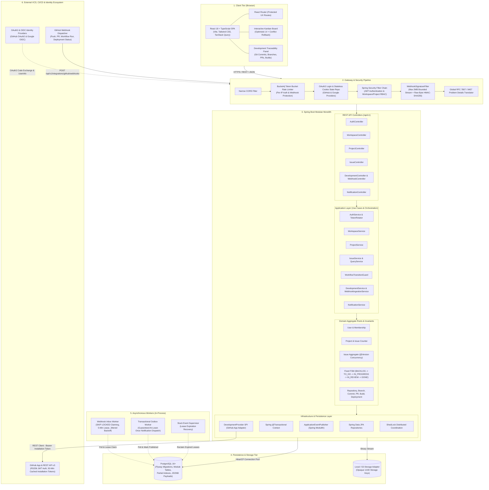

---

## 3. Modular Monolith Architecture & Spring Modulith Rules

NexTrack partitions business subdomains into isolated Java packages under `com.nextrack`, enforced at compile and test time using **Spring Modulith** and **ArchUnit**:

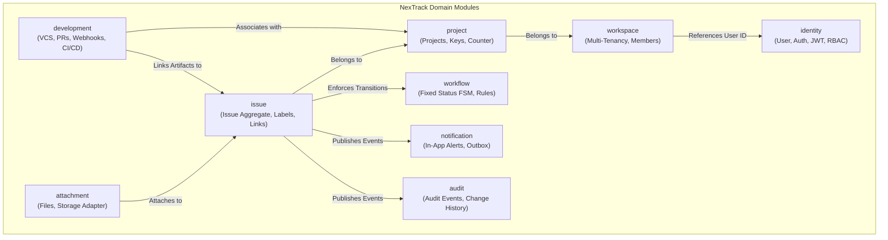

### Inward Dependency & Boundary Rules
1. **Zero Cross-Module Repository Access:** Module `A` must NEVER inject or query a Spring Data Repository belonging to Module `B`. Cross-module communication occurs strictly via public service interfaces (`*PublicApi`) or in-process domain events.
2. **Encapsulated Entity Invariants:** JPA entities are internal to their package (`package-private` or located in `.domain`). External modules and API controllers interact exclusively with immutable Request/Response DTOs.
3. **Decoupled Inter-Module Events:** Cross-module side effects (e.g., creating an audit log entry or triggering an in-app notification upon issue status changes) are published via Spring's `ApplicationEventPublisher`. Downstream listeners bind via `@TransactionalEventListener(phase = BEFORE_COMMIT)` or asynchronous event consumers.
4. **Automated Architectural Verification:** Continuous integration tests execute Spring Modulith assertions (`@ApplicationModuleTest`) and ArchUnit rules to prove zero cyclic dependencies and prevent boundary leaks.

---

## 4. Repository & Package Structure

```text
nextrack/
├── backend/
│   ├── build.gradle
│   ├── settings.gradle
│   ├── gradlew
│   └── src/
│       ├── main/
│       │   ├── java/com/nextrack/
│       │   │   ├── NexTrackApplication.java
│       │   │   ├── config/               # Security, HikariCP, WebMvc, ShedLock config
│       │   │   ├── shared/               # RFC 7807 errors, pagination, validation, crypto
│       │   │   ├── identity/             # Users, RS256 JWT, refresh token rotation, RBAC
│       │   │   ├── workspace/            # Multi-tenant workspaces and memberships
│       │   │   ├── project/              # Projects, unique keys, atomic issue counters
│       │   │   ├── issue/                # Issue aggregate root, labels, watchers, links
│       │   │   ├── workflow/             # Fixed 5-state FSM, transition rules and guards
│       │   │   ├── comment/              # Issue comments, soft deletion
│       │   │   ├── audit/                # Structured audit events and change streams
│       │   │   ├── notification/         # In-app notifications and transactional outbox
│       │   │   ├── attachment/           # Secure file streaming, magic bytes, storage SPI
│       │   │   └── development/          # VCS repositories, branches, commits, PRs,
│       │   │       ├── api/              # Controllers, filters, cached request wrappers
│       │   │       ├── application/      # DevelopmentService, query projections
│       │   │       ├── domain/           # Entities, DevelopmentProvider SPI
│       │   │       ├── infrastructure/   # GitHub App adapter, JWT generator, Webhook worker
│       │   │       └── mapping/          # DTO and webhook payload mappers
│       │   └── resources/
│       │       ├── application.yml
│       │       ├── application-local.yml
│       │       └── db/migration/         # Versioned Flyway SQL migration scripts
│       └── test/
│           └── java/com/nextrack/        # ArchUnit, Unit, and Testcontainers integration tests
├── frontend/
│   ├── package.json
│   ├── vite.config.ts
│   └── src/
│       ├── app/                          # Routing, query client, theme providers
│       ├── components/                   # Shared UI primitives (buttons, modals, toasts)
│       ├── features/                     # Board, issues, development, auth, settings
│       └── lib/                          # API client, error mapping, formatters
├── docker-compose.yml                    # PostgreSQL 16, Prometheus, Grafana
├── Makefile                              # Developer commands (dev, test, bench, clean)
└── docs/                                 # ADRs, load test results, screenshots
```

### Module Layering Structure
Every domain module (`identity`, `workspace`, `project`, `issue`, etc.) enforces strict granular separation of concerns:
- **`api/controller/`:** Pure HTTP handling with `@RestController`, path mapping, parameter validation, and status codes.
- **`api/dto/request/`:** Inbound command models as immutable Java `record`s with Jakarta validation constraints (`@NotBlank`, `@Size`, etc.).
- **`api/dto/response/`:** Outbound presentation models as immutable Java `record`s representing JSON contracts.
- **`api/mapper/`:** Decoupled mapper components translating between domain entities and API DTOs.
- **`application/service/`:** Orchestration services owning `@Transactional` boundaries, domain logic invocation, and cross-module checks.
- **`domain/entity/`:** Pure domain models, JPA `@Entity` definitions, state invariants, and domain Enums.
- **`domain/repository/`:** Spring Data JPA repository interfaces executing JPQL and atomic native SQL operations.

---

## 5. Domain Data Model & Comprehensive ERD

```mermaid
erDiagram
    USERS ||--o{ WORKSPACE_MEMBERSHIPS : "holds"
    USERS ||--o{ PROJECT_MEMBERSHIPS : "holds"
    USERS ||--o{ ISSUES : "reports / assigned to"
    USERS ||--o{ COMMENTS : "authors"
    USERS ||--o{ NOTIFICATIONS : "receives"
    USERS ||--o{ REFRESH_TOKENS : "owns"
    USERS ||--o{ USER_OAUTH_IDENTITIES : "authenticates via"

    WORKSPACES ||--|{ WORKSPACE_MEMBERSHIPS : "contains"
    WORKSPACES ||--o{ PROJECTS : "contains"
    WORKSPACES ||--o{ INTEGRATION_INSTALLATIONS : "provisions"

    PROJECTS ||--o{ PROJECT_MEMBERSHIPS : "has"
    PROJECTS ||--|| PROJECT_ISSUE_COUNTERS : "tracks"
    PROJECTS ||--o{ ISSUES : "contains"
    PROJECTS ||--o{ PROJECT_CONNECTED_REPOSITORIES : "links"

    INTEGRATION_INSTALLATIONS ||--o{ CONNECTED_REPOSITORIES : "manages"
    CONNECTED_REPOSITORIES ||--o{ PROJECT_CONNECTED_REPOSITORIES : "associated with"

    CONNECTED_REPOSITORIES ||--o{ DEVELOPMENT_BRANCHES : "contains"
    CONNECTED_REPOSITORIES ||--o{ DEVELOPMENT_COMMITS : "contains"
    CONNECTED_REPOSITORIES ||--o{ PULL_REQUESTS : "tracks"
    CONNECTED_REPOSITORIES ||--o{ BUILDS : "executes"
    CONNECTED_REPOSITORIES ||--o{ DEPLOYMENTS : "deploys"

    ISSUES ||--o{ COMMENTS : "has"
    ISSUES ||--o{ ATTACHMENTS : "contains"
    ISSUES ||--o{ ISSUE_DEVELOPMENT_BRANCHES : "links"
    ISSUES ||--o{ ISSUE_DEVELOPMENT_COMMITS : "links"
    ISSUES ||--o{ ISSUE_PULL_REQUESTS : "links"
    ISSUES ||--o{ ISSUE_BUILDS : "links"
    ISSUES ||--o{ ISSUE_DEPLOYMENTS : "links"

    DEVELOPMENT_BRANCHES ||--o{ ISSUE_DEVELOPMENT_BRANCHES : "associated with"
    DEVELOPMENT_COMMITS ||--o{ ISSUE_DEVELOPMENT_COMMITS : "associated with"
    PULL_REQUESTS ||--o{ ISSUE_PULL_REQUESTS : "associated with"
    BUILDS ||--o{ ISSUE_BUILDS : "associated with"
    DEPLOYMENTS ||--o{ ISSUE_DEPLOYMENTS : "associated with"

    USERS {
        uuid id PK
        string email UK
        string display_name
        string password_hash "nullable"
        string avatar_url "nullable"
        string status
        timestamptz created_at
        timestamptz updated_at
    }

    USER_OAUTH_IDENTITIES {
        uuid id PK
        uuid user_id FK
        string provider
        string provider_user_id
        string provider_email
        boolean email_verified
        timestamptz created_at
        timestamptz updated_at
    }

    REFRESH_TOKENS {
        uuid id PK
        uuid user_id FK
        string token_hash UK
        string token_family UK
        boolean is_revoked
        timestamptz expires_at
        timestamptz created_at
    }

    WORKSPACES {
        uuid id PK
        string name
        string slug UK
        uuid owner_user_id FK
        timestamptz created_at
        timestamptz archived_at
    }

    WORKSPACE_MEMBERSHIPS {
        uuid workspace_id PK,FK
        uuid user_id PK,FK
        string role
        timestamptz joined_at
    }

    PROJECTS {
        uuid id PK
        uuid workspace_id FK
        string name
        string project_key "UK(workspace_id, project_key)"
        string description
        uuid created_by FK
        timestamptz created_at
        timestamptz archived_at
    }

    PROJECT_ISSUE_COUNTERS {
        uuid project_id PK,FK
        bigint last_issue_number
    }

    ISSUES {
        uuid id PK
        uuid project_id FK
        bigint issue_number "UK(project_id, issue_number)"
        string title
        text description
        string issue_type
        string status
        string priority
        uuid reporter_id FK
        uuid assignee_id FK
        timestamptz due_date
        int story_points
        int version "Optimistic Lock (@Version)"
        timestamptz created_at
        timestamptz updated_at
        timestamptz archived_at
    }

    INTEGRATION_INSTALLATIONS {
        uuid id PK
        uuid workspace_id FK
        string provider
        bigint installation_id UK
        string account_name
        string repository_selection
        jsonb permissions
        string encrypted_webhook_secret
        timestamptz created_at
    }

    CONNECTED_REPOSITORIES {
        uuid id PK
        uuid installation_id FK
        string provider
        string external_repo_id "UK(installation_id, external_repo_id)"
        string full_name
        string html_url
        string default_branch
        boolean is_active
        timestamptz last_synced_at
    }

    PROJECT_CONNECTED_REPOSITORIES {
        uuid project_id PK,FK
        uuid repository_id PK,FK
        uuid connected_by FK
        timestamptz connected_at
    }

    DEVELOPMENT_COMMITS {
        uuid id PK
        uuid repository_id FK
        string commit_sha "UK(repository_id, commit_sha)"
        text message
        string author_name
        string author_email
        string commit_url
        timestamptz committed_at
    }

    PULL_REQUESTS {
        uuid id PK
        uuid repository_id FK
        bigint provider_pr_id "UK(repository_id, provider_pr_id)"
        int pr_number "UK(repository_id, pr_number)"
        string title
        text description
        string source_branch
        string target_branch
        string pr_url
        string status
        string review_status
        boolean is_draft
        timestamptz merged_at
    }

    WEBHOOK_INBOX_EVENTS {
        uuid id PK
        string provider
        string delivery_id "UK(provider, delivery_id)"
        string event_type
        jsonb payload
        string status
        uuid lease_owner_token
        timestamptz processing_lease_expires_at
        int retry_count
        timestamptz next_retry_at
        text error_message
        timestamptz received_at
        timestamptz processed_at
    }

    OUTBOX_EVENTS {
        uuid id PK
        string event_type
        jsonb payload
        string status
        int retry_count
        timestamptz next_retry_at
        timestamptz created_at
        timestamptz published_at
    }

    ISSUE_DEVELOPMENT_COMMITS {
        uuid issue_id PK,FK
        uuid commit_id PK,FK
        string link_type
        uuid linked_by FK
        timestamptz linked_at
    }

    ISSUE_PULL_REQUESTS {
        uuid issue_id PK,FK
        uuid pull_request_id PK,FK
        string link_type
        uuid linked_by FK
        timestamptz linked_at
    }
```

---

## 6. Architectural Design Decisions (ADRs) with Technical Rationale

This section details every significant engineering decision made in NexTrack, contrasting the selected approach against alternatives and providing explicit technical justification suitable for engineering leadership and technical interviews.

---

### ADR-01: Modular Monolith vs. Microservices Architecture
- **Context:** An issue tracking platform with Git VCS and CI/CD telemetry contains multiple distinct subdomains: Identity, Projects, Issues, Workflows, Notifications, and VCS Integrations.
- **Alternatives Considered:** 
  1. *Microservices:* Independent services for Auth, Issues, Webhook Ingestion, and VCS Synchronization, communicating over HTTP or Kafka.
  2. *Traditional Unstructured Monolith:* Single codebase with arbitrary cross-table joins, cyclic package dependencies, and shared database entities.
- **Decision:** **Modular Monolith** deployed as a single Spring Boot executable JAR backed by a single PostgreSQL database, partitioned internally by domain boundaries and verified via Spring Modulith and ArchUnit.
- **Rationale & Interview Justification:**
  - Microservices introduce distributed transactions (2PC or Sagas), distributed tracing overhead, network serialization latency, network failure modes, and deployment complexity that provides zero business value for small-to-medium teams.
  - A modular monolith preserves **ACID guarantees** across domain boundaries when necessary (e.g., issue creation + counter increment + audit event in one transaction).
  - Eliminates cloud infrastructure hosting costs (runs comfortably on a single free/cheap container instance).
  - Maintains a clean migration path: if the Webhook Ingestion module ever needs independent scaling due to massive webhook volume, its strict API contracts allow it to be carved out into an independent service without modifying core issue domain models.

---

### ADR-02: PostgreSQL Webhook Inbox with `SKIP LOCKED` vs. Kafka / RabbitMQ
- **Context:** External webhooks from GitHub must be ingested reliably without losing events, blocking caller threads, or overwhelming backend write pools.
- **Alternatives Considered:**
  1. *External Message Broker (Kafka / RabbitMQ / AWS SQS):* Publish webhooks directly to an external queue and consume via async workers.
  2. *In-Memory Queues (`LinkedBlockingQueue` / `@Async`):* Accept webhooks and process in an executor pool.
  3. *Synchronous Ingestion:* Process commits, parse regex, and execute relational upserts in the incoming HTTP request thread.
- **Decision:** **PostgreSQL-backed Webhook Inbox Pattern** (`webhook_inbox_events`) utilizing short leasing transactions and `SELECT ... FOR UPDATE SKIP LOCKED`.
- **Rationale & Interview Justification:**
  - *No in-memory risk:* In-memory queues drop uncommitted webhooks when the application restarts or crashes during deployments.
  - *No broker operational overhead:* External message brokers require dedicated clusters, monitoring, schema registries, and operational maintenance.
  - *PostgreSQL handles the workload natively:* PostgreSQL's `FOR UPDATE SKIP LOCKED` allows background worker threads (or multiple horizontal app nodes) to claim batches of pending events concurrently without lock contention or duplicate processing.
  - *Durable transactional ingestion:* Webhook payloads are persisted in < 30ms with `status = 'PENDING'` and immediately acknowledged with `202 Accepted`. Subsequent processing failures do not drop external telemetry.

---

### ADR-03: Raw-Byte HMAC-SHA256 Verification vs. Re-serialized JSON Verification
- **Context:** GitHub webhooks include an `X-Hub-Signature-256` header containing an HMAC-SHA256 hash computed over the HTTP request body.
- **Alternatives Considered:**
  1. *Jackson Pre-Deserialization:* Parse the body into a Jackson `JsonNode`, deserialize DTOs, then re-serialize to JSON string for signature calculation.
  2. *Spring `ContentCachingRequestWrapper`:* Standard Spring utility that caches bytes as downstream components read the input stream.
  3. *Raw-Byte Pre-Reading Filter (`WebhookSignatureFilter`):* Custom filter that intercepts the raw request stream before any controller or Jackson converter runs.
- **Decision:** Custom `WebhookSignatureFilter` paired with a replayable `CachedBodyHttpServletRequest`.
- **Rationale & Interview Justification:**
  - *Cryptographic Non-Malleability:* JSON formatters and serializers normalize whitespace, character escaping, and key order. Any discrepancy between GitHub's raw wire payload and the re-serialized string will cause the computed HMAC to mismatch, falsely rejecting valid payloads or creating security holes.
  - *Spring `ContentCachingRequestWrapper` Limitation:* In Spring MVC, `ContentCachingRequestWrapper.getContentAsByteArray()` returns empty if invoked *before* the request stream is consumed downstream. This creates a chicken-and-egg problem: you cannot authenticate before reading, but letting Jackson read unauthenticated payloads exposes the system to deserialization attacks and unauthenticated memory consumption.
  - *Bounded Streaming (DoS Defense):* The custom filter reads the raw byte stream up to a strict 2 MB limit (`BoundedInputStream`). If a malicious client streams an unbounded payload (e.g. gzip bombs or chunked transfer flooding), reading is aborted immediately with `413 Payload Too Large` without writing to disk or database.
  - *Constant-Time Comparison:* Verifies the calculated HMAC using `MessageDigest.isEqual()` to prevent timing side-channel attacks.

---

### ADR-04: GitHub App with In-Memory Ephemeral Tokens vs. Personal Access Tokens (PATs)
- **Context:** NexTrack needs API access to read repository contents, pull requests, and CI/CD workflow statuses from GitHub.
- **Alternatives Considered:**
  1. *Personal Access Tokens (PATs):* Storing static user-generated GitHub tokens in the database.
  2. *OAuth2 User Access Tokens:* Exchanging user login tokens with GitHub.
  3. *GitHub App Installation Authentication:* Asymmetric RS256 JWT key-pair exchange for short-lived installation access tokens.
- **Decision:** **GitHub App** integration with installation-scoped ephemeral tokens cached in-memory with a 50-minute TTL.
- **Rationale & Interview Justification:**
  - *Zero Static Credential Leakage:* PATs have indefinite lifespans and broad user permissions. If a database backup is compromised, static PATs expose private code repositories.
  - *Least Privilege & Granular Scopes:* GitHub Apps request strictly read-only repository permissions (`contents: read`, `pull_requests: read`, `checks: read`).
  - *Short-Lived (1-Hour) Tokens:* Installation tokens expire in 60 minutes. NexTrack caches them in memory with proactive background refresh at 50 minutes, eliminating database storage of sensitive access tokens entirely.
  - *PKCS#1 & PKCS#8 Key Flexibility:* The backend supports both standard PKCS#8 and legacy PKCS#1 private key formats via BouncyCastle / Java KeyFactory, loaded directly from runtime environment variables.

---

### ADR-05: Row-Level Atomic Issue Counter (`UPDATE ... RETURNING`) vs. PostgreSQL `SEQUENCE`
- **Context:** Issues within a project require human-readable sequential keys (e.g. `NT-1`, `NT-2`, `NT-3`) that increment monotonically per project.
- **Alternatives Considered:**
  1. *PostgreSQL `SEQUENCE`:* Creating a dedicated database sequence per project.
  2. *Application-Level Distributed Lock:* Using Redisson or database mutexes to calculate `SELECT MAX(issue_number) + 1`.
  3. *Dedicated Counter Row with Row-Level Locking (`project_issue_counters`):* An atomic `UPDATE ... RETURNING` query within the creation transaction.
- **Decision:** **Row-level atomic counter table (`project_issue_counters`)** updated via `UPDATE project_issue_counters SET last_issue_number = last_issue_number + 1 WHERE project_id = :id RETURNING last_issue_number`.
- **Rationale & Interview Justification:**
  - *Why NOT PostgreSQL `SEQUENCE`:* PostgreSQL sequences do not participate in transactional rollback. If an issue creation transaction aborts, the sequence value is consumed forever, creating gaps. Furthermore, dynamically creating and dropping DDL sequences whenever projects are created or deleted introduces schema management debt.
  - *Why NOT `MAX(issue_number) + 1`:* Prone to severe race conditions under concurrent issue creation without table locks, causing `409 Conflict` or duplicate key violations.
  - *Atomic & Rollback Safe:* The `UPDATE ... RETURNING` pattern acquires an exclusive row lock on only that project's counter row for mere microseconds. Concurrent issue creations for Project A serialize cleanly. Creations for Project B execute concurrently without lock contention.
  - *Zero Gaps on Transaction Rollback:* Because the counter increment executes inside the same Spring `@Transactional` boundary as the issue insert, if validation fails or the transaction rolls back, PostgreSQL rolls back the counter increment, restoring `last_issue_number` to its prior committed state.

---

### ADR-06: Explicit Join Entity (`project_connected_repositories`) vs. Direct Foreign Key
- **Context:** Connecting Git repositories to NexTrack projects.
- **Alternatives Considered:**
  1. *Direct Foreign Key:* Adding a `project_id` foreign key directly onto the `connected_repositories` table (1:N relationship).
  2. *Explicit Join Table (`project_connected_repositories`):* A normalized N:M association between Projects and Connected Repositories.
- **Decision:** **Explicit Join Entity (`project_connected_repositories`)**.
- **Rationale & Interview Justification:**
  - *Multi-Project Repository Sharing:* In modern engineering teams (especially monorepos or shared libraries), multiple projects often track work within the same physical GitHub repository (e.g., `frontend-app` and `backend-api` projects referencing `acme/platform`).
  - *Clean Tenant Boundaries:* Repositories are provisioned once at the Workspace level via the GitHub App installation. Individual Project Admins link authorized repositories to their specific projects without duplicating metadata or webhook handlers.

---

### ADR-07: Fixed Finite State Machine (FSM) vs. Dynamic Workflow Engine
- **Context:** Modeling issue lifecycles (`BACKLOG`, `TO_DO`, `IN_PROGRESS`, `IN_REVIEW`, `DONE`, `ARCHIVED`).
- **Alternatives Considered:**
  1. *User-Defined Dynamic Workflow Engine:* Database-driven state transition graphs where users define custom statuses and arbitrary transition rules.
  2. *Fixed, Standardized Finite State Machine (FSM):* An immutable domain-enforced state machine with centralized transition rules.
- **Decision:** **Fixed Finite State Machine** enforced in code by `IssueStatusTransitionRule` and `WorkflowTransitionGuard`.
- **Rationale & Interview Justification:**
  - Dynamic workflow configuration adds extreme schema complexity, table joins, validation overhead, and migration liabilities (e.g., handling issues stuck in deleted custom statuses).
  - A fixed, predictable FSM covers 95% of real-world software engineering workflows while guaranteeing high execution performance and bug-free board column bindings.
  - Webhooks (such as PR merge events) can never bypass domain invariants; external automations must traverse authorized FSM paths.

---

### ADR-08: JPA `@Version` Optimistic Locking vs. Pessimistic Locking
- **Context:** Multiple users and background webhook workers updating issues concurrently.
- **Alternatives Considered:**
  1. *Pessimistic Locking (`SELECT ... FOR UPDATE`):* Locking issue rows whenever they are opened or modified.
  2. *Last-Write-Wins (No Locking):* Overwriting issue fields with whatever request arrives last.
  3. *Optimistic Locking (`@Version`):* Detecting concurrent modifications via an incrementing version column.
- **Decision:** **JPA `@Version` Optimistic Locking** on the `Issue` aggregate root.
- **Rationale & Interview Justification:**
  - Pessimistic locking creates database connection starvation and user lockout during long form edits.
  - Last-write-wins leads to silent data loss (User B overwrites User A's changes without knowing).
  - Optimistic locking ensures zero database row lock overhead during reads. When two users submit concurrent changes with the same expected version, Hibernate throws `OptimisticLockException`, which the global exception handler translates into an RFC 7807 `409 Conflict`. The React frontend catches this and prompts the user to reload the latest state without data corruption.

---

### ADR-09: Transactional Outbox Pattern for Domain Events vs. Direct `@Async` / Dual-Writes
- **Context:** Emitting side-effects (in-app notifications, audit logs) following business mutations.
- **Alternatives Considered:**
  1. *Dual-Write:* Update issue in DB, then immediately call notification/email service or message broker in the same controller.
  2. *Direct `@Async` Methods:* Triggering Spring async tasks from within the service method.
  3. *Transactional Outbox Table (`outbox_events`):* Persisting an outbox row inside the initiating database transaction, polled and dispatched by an asynchronous worker.
- **Decision:** **Transactional Outbox Pattern** (`outbox_events`) polled via `SELECT ... FOR UPDATE SKIP LOCKED`.
- **Rationale & Interview Justification:**
  - *Elimination of Dual-Write Failures:* In dual-write architectures, if the application crashes or the external service fails *after* the DB commit, events are permanently lost. If the external call succeeds but the DB transaction rolls back, ghost events are published.
  - Storing the domain update and the outbox event in the same ACID transaction guarantees **at-least-once delivery**.
  - A background outbox worker polls pending events, dispatches them safely, and implements jittered exponential backoff with dead-letter status for failed dispatches.

---

### ADR-10: In-Memory Token Bucket (Bucket4j) + ShedLock for Distributed Coordination
- **Context:** Protecting endpoints against brute-force attacks and coordinating scheduled background tasks across horizontal instances.
- **Alternatives Considered:**
  1. *Redis + Redisson:* Deploying a Redis cluster for distributed rate limiting and distributed locks.
  2. *Uncoordinated Schedulers:* Letting all running instances run periodic polling jobs simultaneously.
  3. *Bucket4j (Token Bucket) + ShedLock (PostgreSQL Table):* Zero-infrastructure coordination using existing application memory and database.
- **Decision:** **Bucket4j** for endpoint rate limiting and **ShedLock** backed by a PostgreSQL table (`shedlock`).
- **Rationale & Interview Justification:**
  - Redis adds an entire new stateful infrastructure component, network hop, operational cost, and failure point.
  - ShedLock creates a tiny 1-row table in PostgreSQL to coordinate `@Scheduled` tasks across multiple app instances, guaranteeing only one worker executes the stuck-event supervisor or dead-letter monitor at any given millisecond.
  - Bucket4j provides high-throughput in-memory token bucket rate limiting on sensitive routes (`/api/v1/auth/login`, webhook endpoints) without any external dependency.

---

### ADR-11: RS256 Asymmetric JWT with Refresh Token Rotation Family vs. Stateful Sessions
- **Context:** Managing authentication across the React SPA and Spring Boot backend.
- **Alternatives Considered:**
  1. *Stateful HTTP Sessions (Spring Session + Redis):* Storing sessions in server-side memory.
  2. *Plain Symmetric JWT (HS256) in `localStorage`:* Storing long-lived HS256 tokens in the browser.
  3. *RS256 Asymmetric JWT + Refresh Token Rotation with HttpOnly Cookies:* Short-lived asymmetric access tokens paired with rotating refresh tokens.
- **Decision:** **RS256 Asymmetric JWT** (15-min access token) + **HttpOnly Refresh Token** with **Family Theft Detection**.
- **Rationale & Interview Justification:**
  - *No `localStorage` XSS Vulnerability:* Access tokens are held in client memory; refresh tokens are stored strictly in `HttpOnly`, `SameSite=Strict`, `Secure` cookies, impervious to JavaScript XSS attacks.
  - *Token Family Theft Detection:* Every refresh request issues a new refresh token and invalidates the previous one within the same "token family". If a stolen refresh token is reused by an attacker, the backend detects that an invalidated token from that family was presented, immediately revokes the entire family, and forces all sessions to re-authenticate.
  - *Asymmetric Verification (RS256):* The private key remains strictly on the authentication service. Any future microservice or external gateway can verify JWT signatures using only the public key.

---

### ADR-12: Zero Network Calls inside Database Transactions
- **Context:** Coordinating external GitHub API calls with local database writes.
- **Alternatives Considered:**
  1. *Synchronous API calls inside `@Transactional`:* Calling GitHub REST API to fetch commits while holding an open database transaction.
  2. *Strict Separation of I/O and Persistence Boundaries:* Executing network calls outside transactions, then persisting results in short, targeted database transactions.
- **Decision:** **Strict Rule: Never execute third-party HTTP/network calls inside `@Transactional` methods.**
- **Rationale & Interview Justification:**
  - External network calls have unpredictable latencies (often 500ms to 5 seconds, or timing out at 10 seconds).
  - Holding a PostgreSQL connection open while waiting for external network I/O quickly exhausts the HikariCP connection pool, cascading into application-wide thread starvation and service failure.
  - Network I/O is performed first (or queued via the inbox); once data is in memory, a short, isolated database transaction commits the state in under 5 milliseconds.

---

### ADR-13: Federated Multi-Provider OAuth2 (GitHub & Google) via Stateless Cookie State and Account Linking SPI
- **Context:** Developers and engineering teams require low-friction onboarding ("Continue with GitHub", "Continue with Google") alongside traditional email/password credentials. The architecture must satisfy four non-negotiable requirements:
  1. *100% Stateless Backend Invariant:* The OAuth2 handshake must not rely on Spring Security's default in-memory `HttpSession` or stateful Redis clusters, preserving horizontal scaling across container instances.
  2. *Unified Downstream Security:* The existing RS256 asymmetric JWT access token (15-min TTL in memory) and HttpOnly rotating refresh token (7-day TTL with token family theft detection) must remain the single source of truth across all product endpoints (`/issues`, `/projects`, `/workspaces`).
  3. *Account Takeover Prevention:* Malicious third parties must not be able to hijack existing accounts by registering unverified emails on external identity providers.
  4. *Zero Token Leakage in URLs:* Access tokens must never be transmitted via browser redirect query parameters (`?token=...`).
- **Alternatives Considered:**
  1. *Spring Security Default `HttpSession` with In-Memory OAuth2 Request Repository:* Uses servlet container sessions to store CSRF `state` and PKCE code verifiers. Rejected because it violates the stateless architecture requirement and requires sticky sessions or distributed session replication.
  2. *Single-Table Provider Columns (`github_id`, `google_id` on `users` table):* Adds provider columns directly to the core user table. Rejected because it couples core identity to specific third parties, fails to capture provider-specific metadata (such as verified email flags), and requires database schema migrations whenever a new provider (e.g. GitLab or Okta) is supported.
  3. *Client-Side Direct OAuth2 / Implicit Flow:* React SPA exchanges authorization code directly with GitHub/Google. Rejected because GitHub's OAuth token endpoint does not permit browser CORS without exposing the backend client secret or routing through a custom CORS proxy, violating OAuth2 security standards (RFC 8252).
  4. *Federated Multi-Provider SPI with Stateless Encrypted Cookie State and Unified Token Hand-off:*
     - A custom `HttpCookieOAuth2AuthorizationRequestRepository` serializes and AES-GCM encrypts authorization state into a short-lived (3-minute) `HttpOnly; SameSite=Lax; Secure` cookie (`nextrack_oauth2_state`).
     - A normalized `OAuth2UserInfo` strategy interface decouples provider payload discrepancies (OIDC claims for Google vs. OAuth2 attributes + `/user/emails` fallback for GitHub).
     - A normalized 1:N `user_oauth_identities` table models provider identities separately from the core `users` aggregate, enabling transparent account linking across multiple providers.
     - Upon successful authentication, the backend sets the standard HttpOnly `refresh_token` cookie and issues a clean 302 redirect to the SPA's `/auth/callback` route with zero tokens in the URL.
- **Decision:** **Option 4: Federated Multi-Provider SPI with Stateless Cookie State and Unified Token Hand-off.**
- **Rationale & Interview Justification:**
  - *Stateless Elastic Scalability:* Encrypted cookie state eliminates server-side session memory entirely. Any backend instance behind a round-robin load balancer can initiate or complete an OAuth2 handshake without distributed session stores.
  - *Cryptographic Takeover Immunity:* NexTrack enforces strict email verification checks before auto-linking accounts: Google OIDC guarantees `email_verified = true`, while the GitHub adapter queries `/user/emails` and rejects linking if the matching email is not marked as `verified: true`.
  - *Zero URL Credential Leakage:* Browser redirect URLs are completely sanitized (`/auth/callback` with zero query tokens). The frontend immediately triggers a silent `POST /api/v1/auth/refresh` using the secure HttpOnly cookie to acquire the in-memory RS256 access JWT, protecting credentials from browser histories, proxy logs, and `Referer` headers.
  - *Open-Closed Principle (OCP):* Supporting future enterprise identity providers (e.g. GitLab, Okta, Azure AD) requires only a new `OAuth2UserInfo` strategy implementation without schema migrations or downstream API modifications.

---

## 7. Core Architectural Workflows & Sequence Diagrams

---

### 7.1 Webhook Ingestion & 2-Phase Lease Lifecycle

Demonstrates the raw-byte cryptographic gate, sub-30ms ingestion, and the 2-phase claim and lease worker lifecycle:

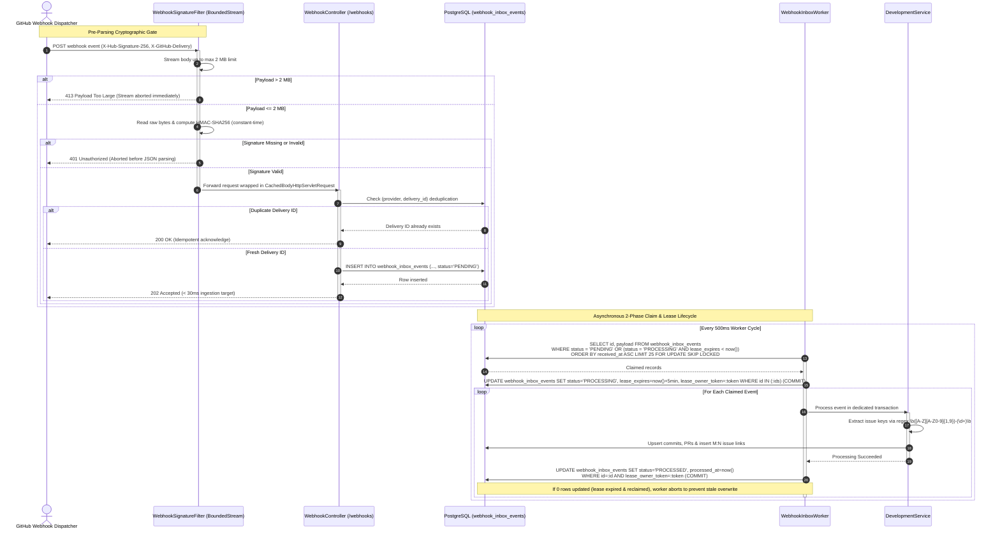

---

### 7.2 Board Drag-and-Drop, Optimistic UI & Version Conflict Reversion

Illustrates the client-side optimistic UI update, transaction validation, and rollback on `@Version` collision:

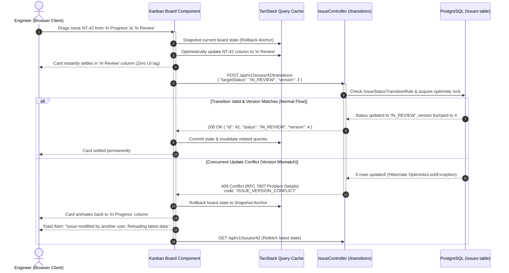

---

### 7.3 Atomic Issue Numbering & Rollback Invariant

Showing why atomic counter updates in the same transaction eliminate numbering gaps upon unhandled exceptions:

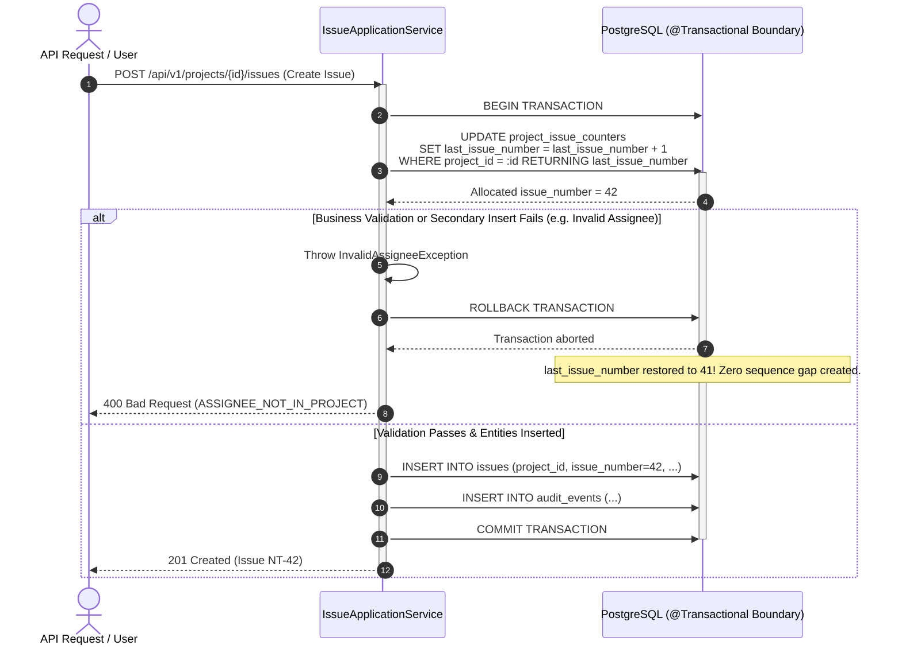

---

### 7.4 Secure Authentication & Refresh Token Rotation with Family Theft Detection

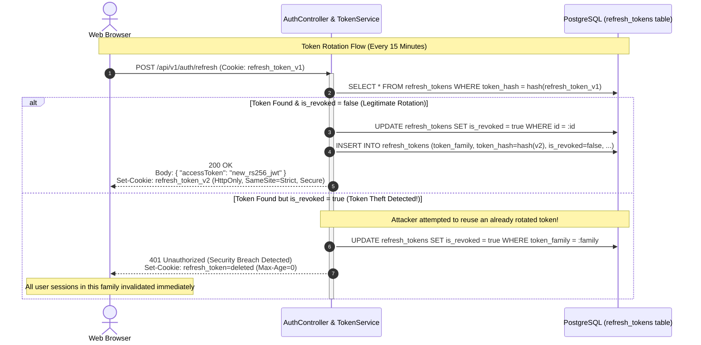

---

### 7.5 Secure Attachment Processing Pipeline

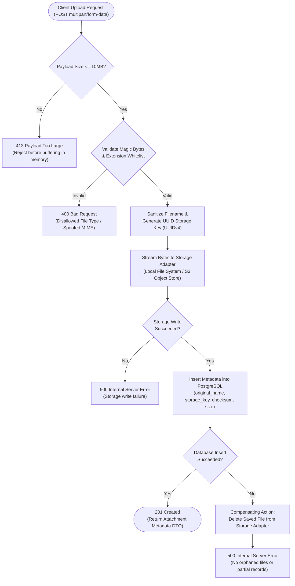

---

### 7.6 Federated Multi-Provider OAuth2 Handshake (GitHub & Google)

Demonstrates the stateless encrypted cookie state repository, provider-specific email normalization, JIT user provisioning, and secure zero-leakage token hand-off:

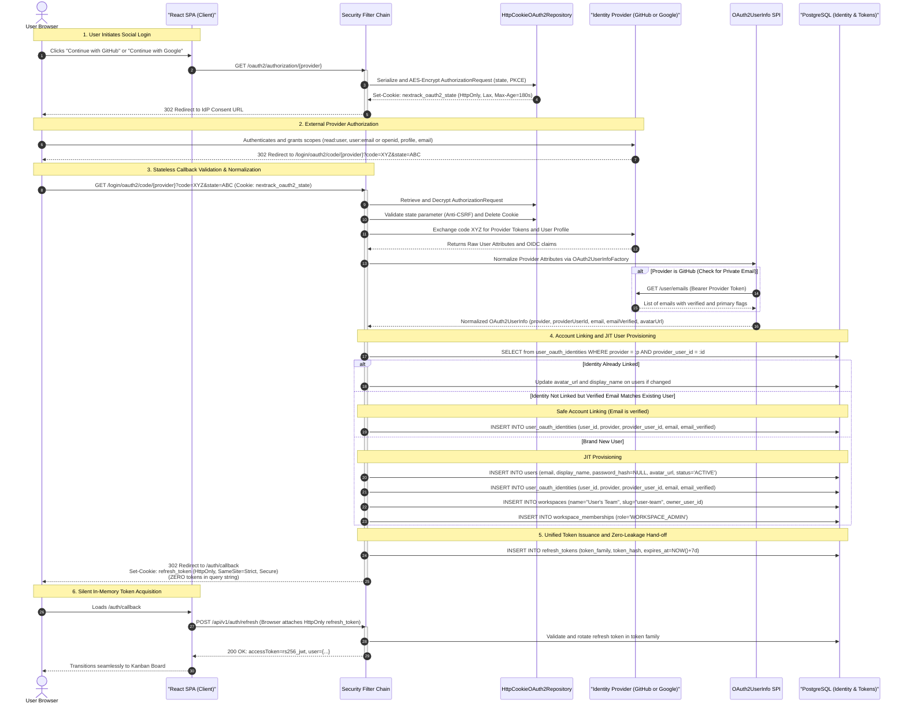

---

## 8. Core Product Modules & Acceptance Criteria

### 8.1 Identity & Access Module
- **Capabilities:** User registration, RS256 JWT access tokens, HttpOnly refresh token rotation with token family theft detection, federated multi-provider OAuth2 (GitHub & Google) with stateless encrypted cookie state, verified email account linking, JIT personal workspace provisioning, workspace-level RBAC (`WORKSPACE_ADMIN`, `MEMBER`, `VIEWER`), and project-level RBAC (`PROJECT_ADMIN`, `CONTRIBUTOR`, `VIEWER`).
- **Acceptance Criteria:**
  - Login failures return generic authentication errors to prevent account enumeration.
  - Passwords hashed using Spring Security `BCryptPasswordEncoder` with strength factor 12.
  - OAuth2 callback validates anti-CSRF `state` from encrypted HttpOnly cookie; expired or missing state returns `401 Unauthorized`.
  - Automatic account linking strictly requires `email_verified = true` from external identity providers; unverified emails reject auto-linking to prevent account takeover.
  - Initial OAuth2 registration automatically provisions a default personal workspace with `WORKSPACE_ADMIN` privileges.
  - Revoking workspace membership cascades to revoke project-level access immediately.

### 8.2 Workspace & Project Management Module
- **Capabilities:** Create, update, archive workspaces and projects. Configurable uppercase project key (`^[A-Z][A-Z0-9]{1,9}$`).
- **Acceptance Criteria:**
  - `CONSTRAINT uq_projects_workspace_project_key UNIQUE (workspace_id, project_key)` prevents collisions within workspace.
  - Atomically creates `project_issue_counters` initialized with `last_issue_number = 0`.
  - Archived projects are strictly read-only for non-admin users.

### 8.3 Issues & Board Module
- **Capabilities:** Create, update, paginate issues; Kanban board state; watchers; comments.
- **Acceptance Criteria:**
  - Server-managed invariants: client cannot forge `id`, `issue_number`, `created_at`, or `version`.
  - **Assignee Eligibility:** `assignee_id` must be an active project member; foreign users return `400 Bad Request` (`ASSIGNEE_NOT_IN_PROJECT`).
  - Monotonic sequential numbering (`NT-1`, `NT-2`) via `UPDATE project_issue_counters ... RETURNING`.
  - Bounded pagination enforced on all list endpoints (default 25, maximum 100).

### 8.4 Fixed Workflow State Machine (FSM) Module
- **Capabilities:** Enforce immutable 5-state FSM: `BACKLOG`, `TO_DO`, `IN_PROGRESS`, `IN_REVIEW`, `DONE`, `ARCHIVED`.
- **Acceptance Criteria:**
  - Centralized transition validation in `IssueStatusTransitionRule`.
  - Permitted transitions:
    - `BACKLOG` ↔ `TO_DO`
    - `TO_DO` ↔ `IN_PROGRESS`
    - `IN_PROGRESS` ↔ `IN_REVIEW`
    - `IN_REVIEW` ↔ `DONE`
    - `DONE` → `IN_PROGRESS` (defect reopen)
    - `BACKLOG` → `ARCHIVED` / `DONE` → `ARCHIVED`
  - All invalid transitions return `400 Bad Request` (`WORKFLOW_TRANSITION_DENIED`).
  - `@Version` optimistic locking detects conflicts and maps to `409 Conflict`.
  - Transitions commit atomic audit log records in `audit_events`.

### 8.5 Comments & Audit Logging Module
- **Capabilities:** Add/edit/delete comments; structured audit history recording all field mutations.
- **Acceptance Criteria:**
  - Audit actor is extracted directly from the authenticated `SecurityContext`, never client input.
  - Comment deletion soft-deletes via `deleted_at`.
  - Domain state mutation and audit row commit in the same database transaction.

### 8.6 In-App Notifications & Transactional Outbox Module
- **Capabilities:** Issue assignments, mentions, and status change alerts.
- **Acceptance Criteria:**
  - Outgoing events written to `outbox_events` in the initiating business transaction.
  - Background worker polls pending events via `FOR UPDATE SKIP LOCKED`.
  - Exponential backoff with jitter on delivery failures; terminal poison pills marked `FAILED` after 5 attempts.
  - Handlers enforce idempotency using `dedup_key`.

### 8.7 Secure Attachment Module
- **Capabilities:** Multi-part file upload, MIME validation, streaming download, safe storage.
- **Acceptance Criteria:**
  - Stream limit of 10 MB enforced before memory buffering (`413 Payload Too Large`).
  - Magic-byte inspection verifies file header matches declared extension.
  - Storage key is an opaque server-generated `UUIDv4`.
  - Compensating rollback deletes saved file if DB metadata insert fails.
  - Download verifies user holds project read permissions.

### 8.8 Development Module (VCS & CI/CD Integration)
- **Capabilities:** GitHub App integration, branch tracking, commit deduplication, pull request lifecycle, CI/CD build status, deployment tracking, automatic regex extraction, manual linking fallback.
- **Acceptance Criteria:**
  - Installation-based auth using RS256 JWT exchange; 50-minute cached installation tokens in memory.
  - Incoming webhooks verified against raw request bytes before JSON parsing (`WebhookSignatureFilter`).
  - Ingested webhooks queued into `webhook_inbox_events` in < 30ms with `202 Accepted`.
  - Background worker claims events using `SKIP LOCKED` and 5-minute lease tokens.
  - Automatic key extraction matches `\b([A-Z][A-Z0-9]{1,9})-(\d+)\b` and associates with project issues.
  - Manual linking fallback allows associating commits/PRs via `link_type = 'MANUAL'`.
  - Dual-field CI status mapping accurately derives `BuildStatus` from GitHub Actions `status` and `conclusion`.

---

## 9. API Design Conventions & REST Endpoint Registry

NexTrack APIs strictly follow RESTful conventions, versioned under `/api/v1`, using JSON bodies and RFC 7807/9457 Problem Details for all errors:

```json
{
  "type": "https://api.nextrack.io/errors/conflict",
  "title": "Conflict",
  "status": 409,
  "detail": "Issue NT-42 was updated by another user. Reload latest version to retry.",
  "code": "ISSUE_VERSION_CONFLICT",
  "instance": "/api/v1/issues/42/transitions",
  "timestamp": "2026-11-02T12:00:00Z"
}
```

### Complete REST Endpoint Registry

| Method | Endpoint | Description | Auth Scope |
|---|---|---|---|
| `POST` | `/api/v1/auth/register` | Register new user account | Public |
| `POST` | `/api/v1/auth/login` | Authenticate user & issue access JWT + refresh cookie | Public (Rate Limited) |
| `POST` | `/api/v1/auth/refresh` | Rotate refresh token & issue fresh access JWT | Public (Cookie Auth) |
| `POST` | `/api/v1/auth/logout` | Revoke active refresh token family | Authenticated |
| `GET` | `/oauth2/authorization/{provider}` | Initiate OAuth2 authorization (`github` or `google`) | Public |
| `GET` | `/login/oauth2/code/{provider}` | IdP callback endpoint exchanging authorization code | Public (IdP Callback) |
| `GET` | `/api/v1/auth/oauth2/identities` | List linked OAuth providers for current user | Authenticated |
| `DELETE` | `/api/v1/auth/oauth2/identities/{provider}` | Unlink OAuth provider (requires active password or secondary provider) | Authenticated |
| `GET` | `/api/v1/workspaces` | List accessible workspaces | Authenticated |
| `POST` | `/api/v1/workspaces` | Create new multi-tenant workspace | Authenticated |
| `GET` | `/api/v1/workspaces/{id}/members` | List workspace team members | Workspace Member |
| `POST` | `/api/v1/workspaces/{id}/members` | Invite member to workspace | Workspace Admin |
| `GET` | `/api/v1/workspaces/{id}/projects` | List projects in workspace | Workspace Member |
| `POST` | `/api/v1/workspaces/{id}/projects` | Create project with uppercase key (`NT`) | Workspace Admin |
| `GET` | `/api/v1/projects/{id}` | Get project overview | Project Member |
| `PATCH` | `/api/v1/projects/{id}` | Update project metadata | Project Admin |
| `GET` | `/api/v1/projects/{id}/issues` | List project issues (bounded pagination) | Project Member |
| `POST` | `/api/v1/projects/{id}/issues` | Create issue with atomic counter (`NT-1`) | Project Contributor |
| `GET` | `/api/v1/projects/{id}/board` | Get read-optimized Kanban board view (`v_board_cards`) | Project Member |
| `GET` | `/api/v1/issues/{id}` | Get full issue aggregate details | Project Member |
| `PATCH` | `/api/v1/issues/{id}` | Update issue fields with optimistic lock (`@Version`) | Project Contributor |
| `POST` | `/api/v1/issues/{id}/transitions` | Execute validated FSM status transition | Project Contributor |
| `GET` | `/api/v1/issues/{id}/comments` | List issue comments | Project Member |
| `POST` | `/api/v1/issues/{id}/comments` | Add comment to issue | Project Contributor |
| `GET` | `/api/v1/issues/{id}/history` | Get immutable audit change log | Project Member |
| `POST` | `/api/v1/issues/{id}/attachments` | Upload attachment (magic-byte check) | Project Contributor |
| `GET` | `/api/v1/issues/{id}/attachments/{attachId}` | Stream attachment download | Project Member |
| `GET` | `/api/v1/issues/{id}/development` | Get linked Git commits, PRs, builds | Project Member |
| `POST` | `/api/v1/issues/{id}/development/links` | Manually link branch, commit, or PR | Project Contributor |
| `DELETE`| `/api/v1/issues/{id}/development/links/{linkId}`| Remove manual development link | Project Contributor |
| `POST` | `/api/v1/integrations/github/webhooks` | Ingest raw-byte HMAC verified GitHub webhook | Public (HMAC Verified) |
| `POST` | `/api/v1/integrations/github/webhooks/inbox/{id}/retry` | Replay dead-letter webhook event | Workspace Admin |
| `GET` | `/api/v1/notifications` | List unread user notifications | Authenticated |
| `PATCH`| `/api/v1/notifications/{id}/read` | Mark notification as read | Authenticated |

---

## 10. Security Architecture & Threat Defense

Security is an architectural baseline in NexTrack, enforced across every layer:

| Security Vector | Threat Model | Mitigation in NexTrack |
|---|---|---|
| **Webhook Forgery** | Attacker dispatches malicious fake push/PR events to mutate issue states | `WebhookSignatureFilter` calculates HMAC-SHA256 directly over raw request bytes before JSON parsing using constant-time comparison (`MessageDigest.isEqual`). Missing/invalid signatures return 401. |
| **Webhook Stream DoS** | Malicious client sends unbounded HTTP streams or chunked transfer bombs | Bounded stream reader limits incoming webhook bodies to 2 MB (`BoundedInputStream`). Exceeding payloads abort with `413 Payload Too Large` without memory buffering or database writes. |
| **Credential Storage Leak** | Database dump exposes integration secrets or private keys | AES-256-GCM envelope encryption for stored webhook secrets. GitHub App private keys are loaded from environment variables and never written to database tables. |
| **Session Theft / XSS** | Malicious script steals long-lived access token from `localStorage` | Access tokens expire in 15 minutes and live in memory; refresh tokens are stored strictly in `HttpOnly`, `SameSite=Strict`, `Secure` cookies with token family theft detection. |
| **Brute Force & Flooding** | Attacker floods login or registration endpoints | Bucket4j token bucket rate limiting restricts `/api/v1/auth/login` to 5 requests/min per IP and webhook endpoints to 100 requests/sec. |
| **Broken Object Authorization (BOLA/IDOR)** | User guesses issue ID belonging to another workspace or project | All service methods verify that the authenticated user holds valid membership in the enclosing project and workspace. |
| **Cross-Tenant Data Leakage** | Buggy SQL query forgets `WHERE workspace_id = ...` | Architecture tests and AOP authorization aspects enforce workspace scoping; assignee assignment explicitly validates project membership. |
| **Path Traversal File Upload** | Attacker uploads filename containing `../../etc/passwd` | Filenames are stored only as display metadata; disk storage keys are strictly server-generated `UUIDv4` identifiers. |
| **MIME Type Spoofing** | Attacker uploads malicious `.exe` renamed to `.png` | Apache Tika / magic byte inspection validates file header signatures against a strict whitelist before disk writing. |
| **HTTP Security Headers** | Clickjacking, MIME sniffing, cross-site scripting | Spring Security enforces HSTS, `X-Frame-Options: DENY`, `X-Content-Type-Options: nosniff`, and restrictive Content Security Policy. |

---

## 11. Edge Cases & Failure Handling Matrix

The following edge cases are explicitly tested and verified in NexTrack:

| Area | Scenario | Expected System Behavior |
|---|---|---|
| **Authentication** | Invalid password or unknown email | Generic failure response (`401 Unauthorized`); zero account enumeration. |
| **Authentication** | Disabled user or expired token | Immediate access denial (`401 Unauthorized`). |
| **Authentication** | Replay of already-rotated refresh token | Token family theft detected; all tokens in family revoked immediately; forced re-authentication. |
| **Authentication** | OAuth2 callback with mismatched or expired `state` cookie | Rejects with `401 Unauthorized` (`OAUTH2_STATE_MISMATCH`); prevents CSRF login attacks. |
| **Authentication** | External IdP returns unverified email matching existing account | Rejects automatic linking with `409 Conflict` (`UNVERIFIED_EMAIL_LINK_REJECTED`); prevents account takeover. |
| **Authentication** | GitHub user has primary email set to private | `GithubOAuth2UserInfo` fetches `/user/emails` with access token to extract primary verified email. |
| **Authentication** | User attempts to unlink sole authentication method | Rejects with `400 Bad Request` (`CANNOT_UNLINK_SOLE_IDENTITY`); prevents account lockout. |
| **Authorization** | User modifies URL to access another workspace | `403 Forbidden` or policy-appropriate `404 Not Found`. |
| **Authorization** | Assign issue to user outside project | Rejected with `400 Bad Request` (`ASSIGNEE_NOT_IN_PROJECT`). |
| **Input** | Lowercase or malformed project key | Rejected before persistence; must match `^[A-Z][A-Z0-9]{1,9}$`. |
| **Concurrency** | Concurrent project creation with same key | `CONSTRAINT uq_projects_workspace_project_key` prevents collision; second request receives `409 Conflict`. |
| **Concurrency** | Concurrent issue creation (50 threads) | Atomic row increment on `project_issue_counters` serializes briefly; unique monotonic numbers allocated with zero duplicates. |
| **Transactions** | Exception thrown during issue creation | Entire transaction rolls back; `last_issue_number` restored to pre-transaction value; zero gap created. |
| **Transactions** | Committed issue deleted or archived | Issue number permanently consumed; never reused; gap persists in sequence by design. |
| **Concurrency** | Two users edit issue with same version | JPA `@Version` optimistic lock detects stale update; Hibernate throws `OptimisticLockException`; maps to `409 Conflict`. |
| **Workflow** | Disallowed status transition (e.g. `BACKLOG` → `DONE`) | Domain rule rejects transition; returns `400 Bad Request` (`WORKFLOW_TRANSITION_DENIED`); zero state or audit write. |
| **Database** | Unique constraint or foreign key violation | Global exception handler maps database error to safe RFC 7807 problem details; raw SQL hidden. |
| **Database** | HikariCP pool exhausted | Bounded 30-second acquisition timeout; returns 503 Service Unavailable; does not hang threads indefinitely. |
| **Querying** | Page size is 0, negative, or > 100 | Bounded to min 1, max 100; safe defaults applied. |
| **ORM** | Kanban board loading 100+ issues | Read-optimized projection (`v_board_cards`) used; zero N+1 queries. |
| **Webhooks** | Payload exceeds 2 MB limit | Streaming reader terminates immediately; returns `413 Payload Too Large`; zero JSON parsed; zero DB records. |
| **Webhooks** | Missing or invalid HMAC signature | Evaluated against raw bytes before parsing; returns `401 Unauthorized`; payload discarded. |
| **Webhooks** | Valid HMAC signature, malformed JSON | Deserialization error caught; returns `400 Bad Request`; no inbox record created. |
| **Webhooks** | Duplicate delivery ID received | Deduplicated via `CONSTRAINT uq_webhook_provider_delivery`; returns `200 OK` immediately; no duplicate row. |
| **Webhooks** | Worker crashes during event processing | 5-minute lease expires; stuck-event supervisor or subsequent worker poll reclaims record safely. |
| **Webhooks** | Worker lease expires before commit | Worker verifies lease ownership token before commit; detects 0 rows updated; rolls back to prevent stale overwrite. |
| **Webhooks** | Poison pill event fails repeatedly | After 5 retries, worker marks `status = 'FAILED'`, writes diagnostic error, and continues without blocking queue. |
| **Webhooks** | Out-of-order webhook delivery (PR merged before PR opened) | Compares provider updated timestamps; newer state persists; older payloads rejected from overwriting. |
| **Webhooks** | GitHub API rate limit (429/403) encountered | Reads `X-RateLimit-Reset`; applies exponential backoff with jitter; surfaces rate-limit alert in UI. |
| **VCS Traceability**| Extracted issue key not found in project | Artifact persisted at repository level; skipped from issue association without failing transaction. |
| **VCS Traceability**| Commit references multiple keys (`NT-101, NT-102`) | Creates M:N association rows for all valid matching project issues. |
| **VCS Traceability**| Manual link to already-linked commit | `PRIMARY KEY (issue_id, commit_id)` detects duplicate; returns `409 Conflict` ("Already linked"). |
| **Attachments** | Uploaded file exceeds 10 MB | Rejected before memory buffering with `413 Payload Too Large`. |
| **Attachments** | Filename contains path traversal (`../`) | Filename sanitized as metadata; disk file stored under server-generated `UUIDv4` key. |
| **Attachments** | Storage write succeeds but DB insert fails | Compensating cleanup triggers; saved file deleted from disk immediately; zero orphaned files. |
| **Attachments** | Unauthorized attachment download | Project read permission verified; cross-project or unauthenticated download returns 403/404. |
| **Frontend** | Network timeout during issue save | Preserves user input in form; displays retry banner; prevents blind duplicate writes. |
| **Frontend** | Board drag-and-drop version conflict (409) | Reverts card animation back to original column; displays toast notification prompt to reload latest data. |

---

## 12. Performance Bottlenecks & Query Projections

### 12.1 Read-Optimized Board Projection View
Fetching complete JPA issue aggregate graphs for the Kanban board causes severe latency and N+1 queries by fetching descriptions, comments, and attachment rows. NexTrack deploys a database projection view (`v_board_cards`) returning only required card fields alongside lateral count subqueries:

```sql
CREATE OR REPLACE VIEW v_board_cards AS
SELECT 
    i.id,
    i.project_id,
    i.issue_number,
    i.title,
    i.status,
    i.priority,
    i.issue_type,
    i.assignee_id,
    u.display_name AS assignee_name,
    u.email AS assignee_email,
    i.due_date,
    i.story_points,
    i.version,
    i.created_at,
    i.updated_at,
    (SELECT COUNT(*) FROM comments c WHERE c.issue_id = i.id AND c.deleted_at IS NULL) AS comment_count,
    (SELECT COUNT(*) FROM attachments a WHERE a.issue_id = i.id AND a.deleted_at IS NULL) AS attachment_count,
    (SELECT COUNT(*) FROM issue_pull_requests ipr WHERE ipr.issue_id = i.id) AS pr_count,
    (SELECT COUNT(*) FROM issue_development_commits idc WHERE idc.issue_id = i.id) AS commit_count,
    (SELECT COUNT(*) FROM issue_development_branches idb WHERE idb.issue_id = i.id) AS branch_count
FROM issues i
LEFT JOIN users u ON u.id = i.assignee_id
WHERE i.archived_at IS NULL;
```

### 12.2 High-Impact Partial Indexes
```sql
-- 1. Kanban Board status and sort query
CREATE INDEX idx_issues_project_status_updated 
    ON issues (project_id, status, updated_at DESC);

-- 2. Fast Assignee lookups
CREATE INDEX idx_issues_project_assignee 
    ON issues (project_id, assignee_id);

-- 3. Webhook Inbox partial index for sub-millisecond worker polling
CREATE INDEX idx_webhook_inbox_pending 
    ON webhook_inbox_events (status, received_at) 
    WHERE status = 'PENDING';

-- 4. Stuck-event supervisor lease scan index
CREATE INDEX idx_webhook_inbox_lease 
    ON webhook_inbox_events (status, processing_lease_expires_at) 
    WHERE status = 'PROCESSING';

-- 5. Outbox pending events partial index
CREATE INDEX idx_outbox_events_pending 
    ON outbox_events (status, next_retry_at) 
    WHERE status = 'PENDING';

-- 6. Issue-to-Commit lookup index
CREATE INDEX idx_issue_commits_lookup 
    ON issue_development_commits (issue_id, commit_id);

-- 7. Deduplicated commit ingestion index
CREATE INDEX idx_dev_commit_repo_sha 
    ON development_commits (repository_id, commit_sha);
```

### 12.3 Empirical Latency Targets (Benchmarked via k6)
- **Webhook Ingestion Latency:** < 30ms p95 under 100 concurrent requests.
- **Atomic Counter Allocation:** < 1ms p95 under 50 concurrent worker threads.
- **Board Card Listing:** < 200ms p95 on a seeded 10,000+ issue dataset.

---

## 13. Testing Strategy & Reliability Matrix

### Test Pyramid
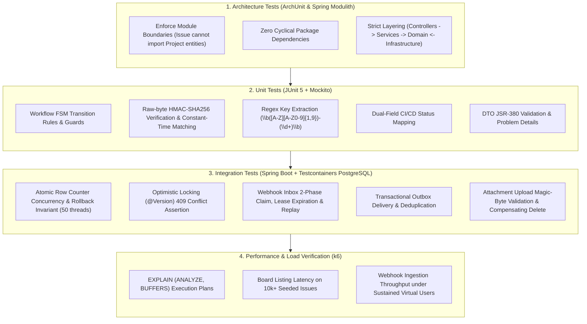

---

## 14. Deployment, Operations & CI/CD Pipeline

### 14.1 Continuous Integration & Quality Gate Pipeline
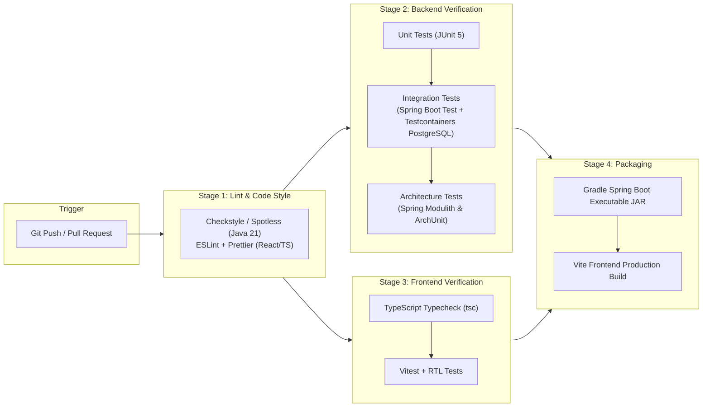

### 14.2 Local Environment Setup
- **One-Command Local Startup:**
  ```bash
  docker compose up -d db
  make dev
  ```
- **Configuration Profiles:**
  - `application-local.yml`: Local Docker PostgreSQL connection, mock storage adapter.
  - `application-test.yml`: Testcontainers dynamic database wiring.
  - `application-prod.yml`: Strict environment variable secrets, TLS, HikariCP tuning.
- **Graceful Shutdown:** `server.shutdown=graceful` with a 30s timeout allows active database transactions and webhook claims to complete cleanly before process exit.
